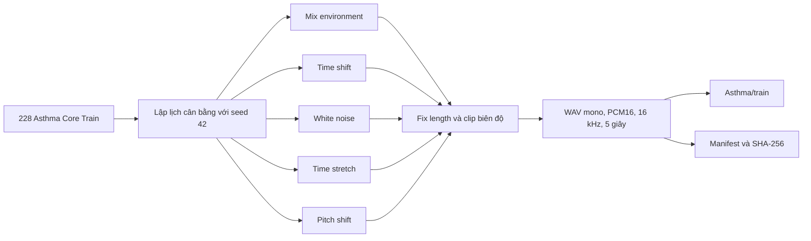

# Đặc tả tăng cường dữ liệu Asthma Train V2

## 1. Mục đích

Tài liệu này đặc tả các phép tăng cường được áp dụng cho dữ liệu **Asthma
Core thuộc tập Train** trong bước 05 của Phase 1.

Mục tiêu của bước này là:

- tăng độ đa dạng của Asthma Train mà không làm thay đổi Validation/Test;
- mô phỏng các biến thiên vừa phải về môi trường, vị trí thời gian, nhiễu,
  tốc độ và cao độ;
- cân bằng số lượng Asthma Train với Non-Asthma Train;
- bảo đảm mọi file sinh ra có thể truy vết về file Core cha và tham số đã dùng.

Hai script triển khai đặc tả:

| Script | Trách nhiệm |
|---|---|
| `Argument_Oversampling.py` | Cài đặt năm phép biến đổi tín hiệu |
| `05_Argument_Asthma.py` | Kiểm tra dữ liệu, lập lịch, sinh WAV và ghi manifest |

## 2. Phạm vi dữ liệu

### 2.1. Dữ liệu được phép tăng cường

- Chỉ sử dụng **228 Asthma Core Train** làm file cha.
- File cha được xác định từ
  `Output/00_Core_Split/core_split_manifest.csv`.
- Hash SHA-256 của file Core phải khớp manifest trước khi sử dụng.

### 2.2. Dữ liệu không được tăng cường

- 64 Asthma Playback Train;
- mọi file Asthma Validation;
- mọi file Asthma Test;
- các file tăng cường `AUGV2__*.wav` đã sinh trước đó;
- mọi nguồn Environment thuộc Validation hoặc Test.

Quy tắc này ngăn bản sao hoặc dữ liệu có quan hệ cha-con xuất hiện ở nhiều
tập khác nhau.

## 3. Quy mô trước và sau tăng cường

| Thành phần | Số file |
|---|---:|
| Asthma Core Train làm cha | 228 |
| Asthma Playback Train, giữ nguyên | 64 |
| Asthma Train trước tăng cường | 292 |
| File tăng cường được sinh | 695 |
| **Asthma Train sau tăng cường** | **987** |
| Non-Asthma Train đối chiếu | 987 |

Mỗi trong năm phương pháp sinh đúng **139 file**, do đó:

```text
5 phương pháp x 139 file = 695 file tăng cường
292 file ban đầu + 695 file tăng cường = 987 file Asthma Train
```

## 4. Luồng xử lý



## 5. Chuẩn tín hiệu chung

Mọi phép biến đổi đều tuân theo các thông số sau:

| Thuộc tính | Giá trị |
|---|---:|
| Sample rate | 16.000 Hz |
| Số kênh | Mono |
| Thời lượng | 5 giây |
| Số mẫu | 80.000 mẫu |
| Miền xử lý | Float32 trong `[-1, 1]` |
| Định dạng ghi | WAV PCM16 |

Hàm `fix_audio_length()` cắt hoặc đệm tín hiệu về đúng 80.000 mẫu, sau đó
giới hạn biên độ trong `[-1, 1]`. Bước này được thực hiện trước hoặc sau phép
biến đổi tùy phương pháp, đồng thời luôn được gọi lần cuối trước khi ghi WAV.

## 6. Các phép tăng cường

### 6.1. `mix_environment`

Trộn Asthma Core với một đoạn âm thanh môi trường chỉ thuộc Train:

```text
y = clip(asthma + gain x environment, -1, 1)
```

| Thuộc tính | Giá trị |
|---|---|
| Số file | 139 |
| Gain môi trường | Ngẫu nhiên đều trong `[0,02; 0,10]` |
| Nguồn chính | 270 clip Environment Train của bước 04 |
| Nguồn legacy | `Mixed/key_fan_5min.wav` |

`key_fan_5min.wav` không được dùng như một mẫu Non-Asthma độc lập. File này
chỉ là nguồn nền fan + keyboard cho augmentation và được thêm 10 suất chọn,
tương đương trọng số của một session môi trường đã cắt thành 10 clip.

Nếu nguồn môi trường dài hơn 5 giây, script lấy ngẫu nhiên một đoạn đúng 5
giây và ghi `noise_start_sample` vào manifest.

### 6.2. `time_shift`

Phương pháp này không dịch vòng toàn bộ tín hiệu. Quy trình gồm:

1. tính RMS theo frame trên Asthma Core;
2. tìm vùng có năng lượng RMS lớn nhất;
3. lấy vùng âm chính dài 4 giây quanh tâm năng lượng;
4. lấy một đoạn nền 5 giây từ `Silence/silence_5min.wav`;
5. chèn vùng âm chính vào vị trí ngẫu nhiên trong cửa sổ 5 giây.

| Thuộc tính | Giá trị |
|---|---|
| Số file | 139 |
| Độ dài vùng âm chính | 4 giây, 64.000 mẫu |
| Vị tríc chèn | Từ mẫu 0 đến 16.000 |
| Khoảng dịch tương ứng | 0-1 giây |
| Nguồn nền | `Silence/silence_5min.wav` |

Manifest ghi `insert_sample`, `insert_seconds` và vị trí lấy đoạn silence.

### 6.3. `white_noise`

Thêm nhiễu Gaussian chuẩn có cường độ nhỏ:

```text
y = clip(asthma + 0,001 x N(0, 1), -1, 1)
```

| Thuộc tính | Giá trị |
|---|---:|
| Số file | 139 |
| Noise level | 0,001 |

Mức nhiễu được giữ nhỏ để tăng độ bền với nhiễu điện/nền mà không che lấp
đặc trưng hô hấp chính.

### 6.4. `time_stretch`

Co giãn thời gian bằng `librosa.effects.time_stretch()` mà không chủ động thay
đổi cao độ.

| Thuộc tính | Giá trị |
|---|---|
| Số file | 139 |
| Rate | Ngẫu nhiên đều trong `[0,90; 1,10]` |

Sau phép co giãn, tín hiệu được đưa về đúng 5 giây. Rate thực tế của từng file
được lưu trong manifest.

### 6.5. `pitch_shift`

Dịch cao độ nhẹ bằng `librosa.effects.pitch_shift()` trong khi giữ thời lượng
mục tiêu 5 giây.

| Thuộc tính | Giá trị |
|---|---|
| Số file | 139 |
| Mức dịch | Ngẫu nhiên đều từ `-0,5` đến `+0,5` bán âm |

Giới hạn nhỏ được chọn để tạo biến thiên cao độ nhưng không làm biến dạng quá
mức đặc trưng âm thanh hô hấp.

## 7. Lập lịch file cha

Lịch tăng cường dùng seed tổng `42` và tuân theo các ràng buộc:

- mỗi phương pháp chọn 139 Core cha khác nhau;
- cùng một phương pháp không áp dụng hai lần lên cùng một Core cha;
- 217 Core nhận tổng cộng 3 file con;
- 11 Core nhận tổng cộng 4 file con;
- mỗi file con dùng seed riêng bằng `42 + global_index`.

Việc cân bằng theo số file con hạn chế một số bệnh nhân hoặc Core cha bị
oversampling quá mức so với phần còn lại.

## 8. Tên file và khả năng truy vết

Tên file đầu ra có dạng:

```text
AUGV2__<stt>__<method>__<ten_core_cha>.wav
```

Ví dụ:

```text
AUGV2__001__mix_environment__P39WheezingRS_192.wav
```

Manifest được lưu tại:

```text
Output/05_Argument_Asthma/asthma_augmentation_manifest.csv
```

Các trường chính:

| Trường | Ý nghĩa |
|---|---|
| `augmented_file` | Tên file tăng cường |
| `parent_file` | Asthma Core cha |
| `patient_id` | Mã nhóm bệnh nhân |
| `method` | Phương pháp tăng cường |
| `seed` | Seed riêng của file |
| `parameters` | Tham số thực tế đã dùng |
| `noise_source` | Nguồn môi trường/silence nếu có |
| `output_path` | Đường dẫn file đầu ra |
| `output_sha256` | Hash SHA-256 của file đầu ra |

Kết quả hiện tại trong manifest gồm đúng:

| Phương pháp | Số file |
|---|---:|
| `mix_environment` | 139 |
| `time_shift` | 139 |
| `white_noise` | 139 |
| `time_stretch` | 139 |
| `pitch_shift` | 139 |
| **Tổng** | **695** |

## 9. Điều kiện an toàn khi chạy

`05_Argument_Asthma.py` dừng và không tiếp tục nếu gặp một trong các trường
hợp sau:

- Asthma Core Train không đúng 228 file;
- Asthma Playback Train không đúng 64 file;
- Asthma Train ban đầu không đúng 292 file;
- Non-Asthma Train không đúng 987 file;
- hash Core không khớp manifest bước 00;
- thiếu clip Environment Train, `key_fan_5min.wav` hoặc `silence_5min.wav`;
- đã tồn tại file `AUGV2__*.wav`;
- đã tồn tại thư mục báo cáo bước 05.

Script không tự xóa đầu ra cũ để tránh vô tình ghi đè một lần sinh dữ liệu đã
được dùng cho huấn luyện.

## 10. Kết luận

Bộ tăng cường Asthma V2 gồm năm phép biến đổi độc lập và có kiểm soát. Chúng
chỉ mở rộng Asthma Core Train, không thay đổi Playback và không chạm vào
Validation/Test. Kết quả cuối cùng cân bằng Asthma Train và Non-Asthma Train
ở mức 987 file mỗi lớp, đồng thời duy trì khả năng tái tạo và truy vết bằng
seed, tham số, đường dẫn nguồn và SHA-256.
