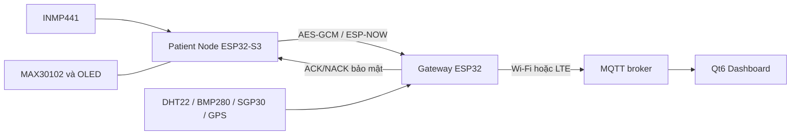

# Tóm tắt đề tài và kết quả hiện có

[Trang chủ tài liệu](../README.md)

## Mục lục

- [1. Bài toán và mục tiêu](#muc-1)
- [2. Kiến trúc và phân công xử lý](#muc-2)
- [3. Các giai đoạn nghiên cứu](#muc-3)
- [4. Model bàn giao](#muc-4)
- [5. Các điểm hiện hành cần hiểu đúng](#muc-5)
- [6. Cách trình bày đóng góp trong báo cáo](#muc-6)

## 1. Bài toán và mục tiêu

Dự án nghiên cứu một hệ thống hỗ trợ theo dõi âm thanh hô hấp tại thiết bị biên. Người dùng có thể chủ động ghi âm bằng CHECK hoặc để VAD tìm đoạn âm thanh phù hợp trong MONITOR. ESP32-S3 thực hiện tiền xử lý, suy luận và tạo sự kiện. Gateway bổ sung bối cảnh môi trường, chuyển sự kiện qua MQTT; Dashboard Qt6 trình bày kết quả và trạng thái.

Đầu ra AI là phân loại theo nhãn dữ liệu: Asthma-like hoặc Non-Asthma. Nhóm Non-Asthma còn gồm bệnh lý hô hấp khác và môi trường, vì vậy tên này không đồng nghĩa người dùng hoàn toàn khỏe mạnh. UNSURE được sinh bởi hậu xử lý xác suất, không phải lớp thứ ba được huấn luyện.

## 2. Kiến trúc và phân công xử lý

| Thành phần | Dữ liệu vào | Trách nhiệm | Dữ liệu ra |
|---|---|---|---|
| Node | PCM và PPG | Quality, DSP, TinyML, voting, vitals theo phiên | Payload 16 byte, packet bảo mật 56 byte |
| Gateway | Packet Node và cảm biến | Xác thực, latest-state, uplink | JSON `complete_packet` |
| Broker | JSON được publish | Chuyển bản tin đến subscriber | MQTT message |
| Dashboard | JSON theo schema | Kiểm tra, ánh xạ, cache và hiển thị | Trang kết quả, môi trường, vị trí, mạng |

Trong đường vận hành thông thường, raw PCM và Log-Mel không truyền lên broker. Những script xuất capture WAV chỉ phục vụ nghiên cứu/đối chiếu.

## 3. Các giai đoạn nghiên cứu

1. Tổ chức dữ liệu nguồn và tự thu bằng INMP441.
2. Chia tập theo nguồn, bệnh nhân/session và lưu manifest.
3. Tạo Log-Mel theo pipeline Python thống nhất.
4. Huấn luyện nhiều kiến trúc Phase 2.
5. Khảo sát frontend, seed và kết hợp cấu hình trong Frontend Benchmarking.
6. Lượng tử, so sánh FP32–INT8–INT16x8 và xuất artifact.
7. Kiểm tra runtime bằng tensor tĩnh, PCM16 cố định và live mic.
8. Tích hợp Node–Gateway–Dashboard, đo ngưỡng và nghiệm thu.

Chọn model bằng phần mềm và xác nhận chất lượng thu âm ngoài thực tế là hai lớp bằng chứng bổ sung nhau. Playback qua loa có thể thay đổi phổ, không chỉ thêm một độ trễ.

## 4. Model bàn giao

Nguồn số liệu: [deployment manifest](../../Final_Project_NCKH/AI_Model/C4_V1_s44_QAT_INT8/deployment_manifest.json), [validation metrics](../../Final_Project_NCKH/AI_Model/C4_V1_s44_QAT_INT8/val_metrics.json) và [test metrics](../../Final_Project_NCKH/AI_Model/C4_V1_s44_QAT_INT8/test_metrics.json).

| Thuộc tính | Giá trị |
|---|---|
| Trial / kiến trúc | `combo_pre0_mel40_fft2048__V1__s44` / SeparableConv2D + Flatten |
| Dataset | `Dataset_Chia_V2` |
| Preprocess | 16 kHz, 5 s, bandpass 100–2000 Hz, order 5, không pre-emphasis |
| Log-Mel | 40 × 129, FFT 2048, hop 625 |
| Lượng tử | QAT Full INT8 |
| Kích thước TFLite | 347.968 byte |
| Input / output | INT8 `[1,40,129,1]` / `[1,1]` |
| SHA-256 TFLite | `d081c1cfcd873c4e2182f9d9e0f8aff07a69ea0b041cf0d6d845d3222efc46b9` |

Báo cáo phần mềm dưới đây dùng quyết định nhị phân ngưỡng 0,5, chưa phải đánh giá policy UNSURE/voting của Node.

| Tập | Số mẫu | Accuracy | Asthma recall | Macro F1 |
|---|---:|---:|---:|---:|
| Validation | 154 | 97,40% | 97,37% | 96,57% |
| Historical Test | 159 | 95,60% | 92,11% | 94,00% |

Ma trận Test theo thứ tự hàng thật/cột dự đoán `[Asthma, Non-Asthma]`: `[[35,3],[4,117]]`. Accuracy bằng `152/159`; không phải trung bình của nhiều phương pháp lượng tử. Test đã từng được phân tích trong quá trình chọn/lượng tử nên được gọi rõ là Historical Test.

## 5. Các điểm hiện hành cần hiểu đúng

- MONITOR thu **ba đoạn đạt Quality Gate**, vote rồi gửi một sự kiện. Sau kết quả gửi cuối cùng, Node về STANDBY.
- Ring 1 giây giữ lịch sử để truy hồi đầu chuỗi VAD active; buffer suy luận đủ 5 giây tính từ onset của chuỗi đó.
- Vitals không hợp lệ được biểu diễn bằng `valid=false`, HR/SpO2 bằng 0 ở payload Node.
- Gateway lưu latest SpO2 riêng; Dashboard giữ latest HR/SpO2 trong RAM để Monitor không xóa kết quả CHECK trước.
- Gateway sử dụng latest-state RAM. Điều này không bảo đảm lưu đầy đủ mọi sự kiện khi mất mạng.
- Classification, Quality Gate và VAD đã có JSON `FROZEN` trong Final V1 Validation. Tensor Arena C4 đã profiling used169.380 B và firmware cấp192 KiB; nghiệm thu phần cứng/end-to-end vẫn phải gắn đúng firmware, board và log.

## 6. Cách trình bày đóng góp trong báo cáo

Có thể tổ chức đóng góp thành ba phần: pipeline dữ liệu và so sánh mô hình; triển khai DSP/TinyML trên MCU; tích hợp bảo mật và hiển thị dữ liệu. Với mỗi phần cần một bằng chứng tương ứng: manifest/metric, đối chiếu Python–C++, hoặc log end-to-end.

Các chỉ số tài nguyên phải ghi rõ board, compiler, phiên bản thư viện, vị trí arena, hash model và cách đo. Không dùng latency của model cũ để mô tả checkpoint mới chỉ vì hai model cùng tên kiến trúc.

Đọc tiếp [luồng toàn hệ thống](../05_Luong_Hoat_Dong/04_Toan_He_Thong.md) và [nghiệm thu](../06_Nghiem_Thu/01_Tai_Lap_Va_Chot_V1.md).

