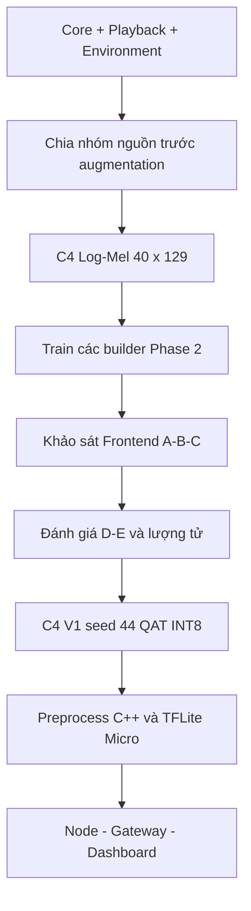

# Báo cáo mẫu: tóm tắt pipeline và cách tham chiếu

[Trang chủ tài liệu](../README.md)

## Mục lục

- [1. Nguồn](#muc-1)
- [2. Tóm tắt pipeline của bài](#muc-2)
- [3. Sử dụng bài làm mẫu viết báo cáo](#muc-3)
- [4. Pipeline riêng của đề tài](#muc-4)
- [5. Mẫu lập luận cho từng lựa chọn kỹ thuật](#muc-5)
- [6. Nguồn để viết phần triển khai của dự án](#muc-6)

## 1. Nguồn

Bài tham chiếu: **Hybrid deep learning and YAMNet features for asthma diagnosis from respiratory sounds**, Shatat và cộng sự, Scientific Reports 16, 13781, công bố 29/04/2026. [Bài gốc và DOI](https://www.nature.com/articles/s41598-026-49247-y).

Phần 2 là tóm lược ngắn nội dung bài; phần 3 trở đi là hướng dẫn đối chiếu và tổ chức báo cáo của dự án này.

## 2. Tóm tắt pipeline của bài

Dữ liệu: Asthma Detection Dataset v2. Pipeline: chuẩn hóa âm thanh, lọc, chia đoạn; tăng cường trong Train. Hai nhánh đặc trưng gồm YAMNet embeddings và mô tả âm học; ASPP, SE và MLP hỗ trợ phân loại.

Cấu hình huấn luyện được mô tả: Adam `1e-4`, batch `32`, tối đa `50` epoch, early stopping `5`, categorical cross-entropy. Đánh giá stratified 5-fold; tác giả báo cáo Accuracy `98,6% ± 0,14`, F1 `97,5% ± 0,14`, macro-AUC `99,1% ± 0,14`.

Cần đọc thận trọng: các mục mô tả lần lượt 22.050 Hz/đoạn 6 s và đầu vào YAMNet 16 kHz/1 s; không nên ghép chúng thành một cấu hình duy nhất chưa kiểm chứng. [Nguồn: Methods và Results của bài](https://www.nature.com/articles/s41598-026-49247-y).

## 3. Sử dụng bài làm mẫu viết báo cáo

Với dự án hiện tại, giá trị tham khảo là cách trình bày một nghiên cứu có đường đi rõ ràng từ nguồn audio đến kết quả. Khi viết, nên làm rõ ở mỗi công đoạn: đầu vào là gì, biến đổi nào được áp dụng, lý do lựa chọn, artifact đầu ra và cách kiểm chứng.

Khung đề xuất dưới đây do dự án tự xây dựng:

| Phần báo cáo | Câu hỏi phải trả lời | Bằng chứng trong repository |
|---|---|---|
| Đặt vấn đề | Thiết bị cần giải quyết tình huống sử dụng nào? | Node CHECK/MONITOR, luồng hệ thống |
| Dữ liệu | Nhãn, nguồn và nhóm độc lập được xác định thế nào? | Core/session/playback manifest |
| Phương pháp | WAV biến thành tensor ra sao? | Python preprocess và DSP C++ |
| Mạng neuron | Vì sao chọn các block này? | Các builder Phase 2 |
| Thí nghiệm | So sánh nào chỉ đổi một yếu tố? | Notebook A–F, config hash |
| Kết quả | Metric thuộc model/split/threshold nào? | Prediction CSV và metrics JSON |
| Triển khai | MCU cần bao nhiêu RAM, thời gian? | Log ba project Deploy_Model |
| Giới hạn | Điều kiện nào chưa được xác minh? | Checklist Final V1 và thử miền thu |

## 4. Pipeline riêng của đề tài

Pipeline trong sơ đồ được dẫn từ code của dự án. Nó có đầu vào nhị phân, giới hạn tài nguyên ESP32-S3 và một hợp đồng preprocessing 5 giây cụ thể. Cần giữ các điều kiện này khi dùng nghiên cứu bên ngoài làm tài liệu tham khảo.

Không lấy một con số accuracy của công bố khác làm mục tiêu phải đạt bằng mọi cách. Kết quả chỉ so sánh trực tiếp được khi thống nhất dataset, đơn vị chia tập, tập đánh giá, mapping nhãn và cách tổng hợp. Sự khác nhau về số bệnh nhân, số clip, nguồn tự thu và mức độ trùng nguồn có thể quan trọng hơn khác biệt vài điểm accuracy.

## 5. Mẫu lập luận cho từng lựa chọn kỹ thuật

Một đoạn lập luận có thể đi theo thứ tự:

1. Nêu yêu cầu: thu 5 giây trên ESP32-S3 và suy luận cục bộ.
2. Nêu lựa chọn: C4 dùng Log-Mel có 40 dải và 129 frame, FFT 2048.
3. Nêu ý nghĩa: biểu diễn giữ được cấu trúc thời gian–tần số, đồng thời có kích thước cố định.
4. Chỉ rõ biến đã khảo sát: số Mel, FFT, pre-emphasis và các tổ hợp frontend; C4 chốt không pre-emphasis.
5. So sánh trên cùng split, builder và seed.
6. Kết luận trong phạm vi số liệu, kèm chi phí RAM/latency.

Việc giải thích lựa chọn hiện hành không đồng nghĩa chứng minh đây là cấu hình tối ưu trên mọi thiết bị và mọi miền thu. Khi một cấu hình khác có metric tốt hơn nhưng chưa đáp ứng triển khai, báo cáo cần ghi cả hai mặt.

## 6. Nguồn để viết phần triển khai của dự án

- [Kiến trúc Phase 2](../02_AI_Huan_Luyen/02_Kien_Truc_Phase2.md): mô tả mạng thực sự được lập trình.
- [Pipeline Python](../02_AI_Huan_Luyen/03_Pipeline_Python_Va_Huan_Luyen.md): các hàm và hợp đồng tensor.
- [Preprocessing C++](../03_Preprocess_CPP/README.md): công thức, kiểu số và bộ nhớ.
- [Hồ sơ C4 hiện hành](../README_AI_C4_Current.md): hợp đồng model, frontend, QAT INT8 và metric có nguồn artifact.

Không ghi rằng dự án đã triển khai YAMNet/ASPP/SE nếu builder đang chạy chỉ chứa các block CNN trong repository.

