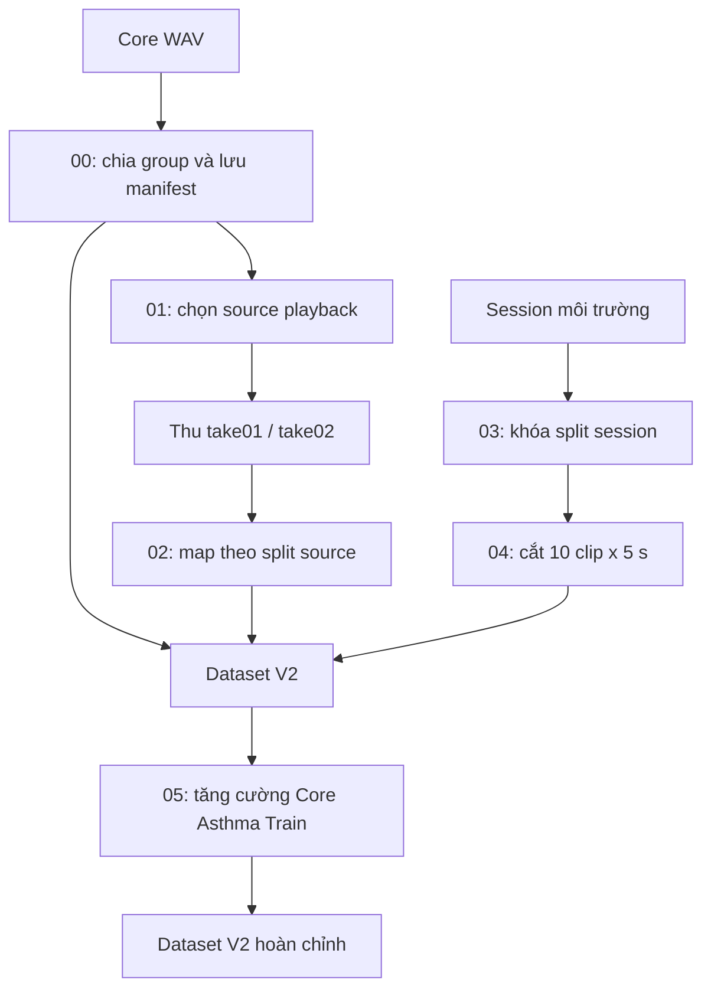

# Chia tập, tăng cường dữ liệu và truy vết

[Trang chủ tài liệu](../README.md)

## Mục lục

- [1. Nguyên tắc thiết kế](#muc-1)
- [2. Script và artifact](#muc-2)
- [3. Số lượng V2 theo artifact hiện có](#muc-3)
- [4. Chia môi trường 27/3/3](#muc-4)
- [5. Augmentation chỉ cho Core Asthma Train](#muc-5)
- [6. Dataset V3 dùng để khảo sát playback](#muc-6)
- [7. Kiểm tra trước khi preprocessing](#muc-7)

## 1. Nguyên tắc thiết kế

Đơn vị độc lập dùng để chia tập phải được xác định trước khi cắt clip hoặc tăng cường: bệnh nhân/nhóm nguồn cho Core, source gốc cho Playback và session thu cho Environment. Mục tiêu 80/10/10 là tỷ lệ gần đúng theo nhóm, không phải điều kiện buộc mọi lớp và mọi loại môi trường bằng nhau tuyệt đối.

## 2. Script và artifact

Tất cả script ở [Phase1_Split_Data](../../AI_Training_Model/Phase1_Split_Data/README.md).

| Script | Nhiệm vụ | Đối chiếu chính |
|---|---|---|
| `00_Split_Core_Data.py` | Chia Core theo nhóm, copy WAV | `Output/00_Core_Split/core_split_manifest.csv` |
| `01_Random_Playback.py` | Chọn nguồn đủ điều kiện để phát | `Output/01_Random_Playback/Playback_Source_List.csv` |
| `02_Map_Playback.py` | Copy take về split nguồn | `Output/02_Map_Playback/playback_map_manifest.csv` |
| `03_Cut_Environment.py` | Chia và copy nguyên session | `Output/03_Cut_Environment/environment_session_split.csv` |
| `04_Build_Dataset.py` | Cắt clip vào Non-Asthma | `Output/04_Build_Dataset/environment_clip_manifest.csv` |
| `05_Argument_Asthma.py` | Sinh augmentation và cân bằng Train | `Output/05_Argument_Asthma/` |
| `Argument_Oversampling.py` | Các phép biến đổi audio dùng bởi bước 05 | Hàm Python, không phải split mới |

Tên bước 03 có chữ Cut nhưng việc cắt waveform thuộc bước 04. Không đổi split theo kết quả inference của model.

Output Core hiện có được giữ để đối chiếu lịch sử V1. Script 00 là bộ chia có seed; không mặc định rằng chạy lại trên một cây nguồn khác sẽ khôi phục chính xác mọi lựa chọn lịch sử. Khi tái lập bộ dùng để báo cáo, manifest và fingerprint đã lưu là căn cứ.

## 3. Số lượng V2 theo artifact hiện có

| Thành phần | Asthma Train | Non-Asthma Train | Asthma Val | Non-Asthma Val | Asthma Test | Non-Asthma Test |
|---|---:|---:|---:|---:|---:|---:|
| Core | 228 | 653 | 30 | 78 | 30 | 83 |
| Playback | 64 | 64 | 8 | 8 | 8 | 8 |
| Environment clip | 0 | 270 | 0 | 30 | 0 | 30 |
| Augmentation Core | 695 | 0 | 0 | 0 | 0 | 0 |
| **Tổng** | **987** | **987** | **38** | **116** | **38** | **121** |

Nguồn: [Phase 1 README](../../AI_Training_Model/Phase1_Split_Data/README.md), [clip summary](../../AI_Training_Model/Phase1_Split_Data/Output/04_Build_Dataset/environment_clip_summary.md) và [augmentation summary](../../AI_Training_Model/Phase1_Split_Data/Output/05_Argument_Asthma/asthma_augmentation_summary.md).

Train có 1.974 file; Validation 154; Test 159. Số file là số mẫu waveform, không phải số bệnh nhân.

## 4. Chia môi trường 27/3/3

| Loại | Tổng session chính | Train | Val | Test |
|---|---:|---:|---:|---:|
| Podcast | 6 | 5 | 1 | 0 |
| Fan | 5 | 4 | 1 | 0 |
| Clap | 6 | 5 | 1 | 0 |
| Knock | 5 | 4 | 0 | 1 |
| Room noise | 6 | 5 | 0 | 1 |
| Speech | 5 | 4 | 0 | 1 |
| Tổng | 33 | 27 | 3 | 3 |

Mỗi session chính sinh 10 clip × 5 s; tổng 330 clip. Việc dùng 50 giây/session tránh để bản ghi dài áp đảo chỉ vì thời lượng lớn. Split được quyết định trước, mọi clip con theo đúng split đó.

Session mixed cũ `key_fan_5min.wav` dùng theo policy Train-only cho nguồn nền; không cộng vào 33 session chính của bảng. `silence_5min.wav` là nền cho dịch thời gian theo quy hoạch. Không lấy asset Train cũ để làm Test mới.

## 5. Augmentation chỉ cho Core Asthma Train

| Phương pháp | Số file | Tham số trong helper |
|---|---:|---|
| `mix_environment` | 139 | Gain môi trường 0,02–0,10 |
| `time_shift` | 139 | Dịch vị trí trên nền silence theo helper |
| `white_noise` | 139 | Mức noise 0,001 |
| `time_stretch` | 139 | Rate 0,90–1,10 |
| `pitch_shift` | 139 | ±0,5 bán âm |
| Tổng | 695 | Seed 42 trong quy trình |

228 Core cha sinh 695 file; báo cáo ghi 217 cha có 3 con và 11 cha có 4 con. 64 playback Asthma Train được giữ nguyên. Với mix môi trường, chỉ dùng nguồn thuộc Train hoặc legacy Train-only.

Gain 0,02 không tương đương một SNR cố định: SNR còn phụ thuộc RMS của Core và nền. Vì vậy cần giữ metadata source/gain; không diễn giải tham số gain thành một mức dB duy nhất.

## 6. Dataset V3 dùng để khảo sát playback

V3 loại playback khỏi V2 theo lineage. Train còn 923/923; Validation 30 Asthma + 108 Non-Asthma; Test 30 + 113. V3 giúp khảo sát tác động của việc thêm playback trong huấn luyện, nhưng “test V3” vẫn có clip Environment, không phải toàn bộ đều là raw bệnh lý.

Trong các báo cáo ghi “COMMON RAW TEST”, nên đọc là tập test chung không có playback và chỉ rõ thành phần 30 môi trường nếu phân tích theo nguồn. Model cuối C4 `combo_pre0_mel40_fft2048__V1__s44` đang tham chiếu `Dataset_Chia_V2`; thay frontend không thay đổi nguyên tắc chia theo bệnh nhân/session.

## 7. Kiểm tra trước khi preprocessing

- Manifest có đường dẫn tồn tại và không có nhãn ngoài hai lớp.
- Không có cùng group/source/session ở nhiều split.
- SHA-256 phát hiện WAV trùng nội dung; không chỉ so tên.
- File augmentation và source nền đều thuộc Train.
- Danh sách `Files_*.npy` về sau phải giữ cùng thứ tự với X/Y.
- Ghi phiên bản manifest/fingerprint trước khi thay dữ liệu.

Một bộ dữ liệu “cân bằng” vẫn có thể rò rỉ nguồn; tỷ lệ đẹp không thay thế kiểm tra lineage.

