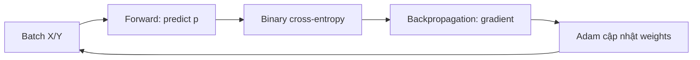

# Từ neuron đến mạng phân loại âm thanh

[Trang chủ](../README.md) · [Kiến trúc Phase 2](02_Kien_Truc_Phase2.md)

## Mục lục

- [1. Mạng nhận gì và học gì?](#muc-1)
- [2. Activation trong các builder](#muc-2)
- [3. Các block xử lý ảnh Log-Mel](#muc-3)
- [4. Hàm mất mát](#muc-4)
- [5. Optimizer và một bước học](#muc-5)
- [6. Callback và kiểm soát overfitting](#muc-6)
- [7. Đọc metric đúng lớp](#muc-7)
- [8. Nguồn thực thi](#muc-8)

<a id="muc-1"></a>

## 1. Mạng nhận gì và học gì?

Mạng cuối C4 nhận một ảnh đặc trưng Log-Mel đã chuẩn hóa, kích thước `40 × 129 × 1`. Trục40 là dải Mel; trục129 là thời gian; kênh1 không phải số lớp. Đầu ra sigmoid là một số `p_non_asthma`. Một số thí nghiệm lịch sử dùng Mel64 nhưng không phải hợp đồng deployment hiện hành.

Trong huấn luyện, mỗi tensor đi cùng nhãn `y=0` hoặc `y=1`. Mạng điều chỉnh trọng số để dự đoán nhãn từ những mẫu thời gian–tần số. Nó không nhận HR, SpO2 hoặc dữ liệu môi trường Gateway làm feature trong kiến trúc hiện tại.

Neuron tuyến tính tính `z = Σ(w_i x_i) + b`, sau đó đưa qua activation `a=f(z)`. Nếu mọi tầng chỉ tuyến tính, ghép nhiều tầng vẫn tương đương một phép tuyến tính; activation tạo khả năng biểu diễn quan hệ phức tạp.

<a id="muc-2"></a>

## 2. Activation trong các builder

| Hàm | Công thức | Vị trí thực tế |
|---|---|---|
| ReLU | `max(0,z)` | Các convolution và Dense ẩn V1/V2/V5, block V3 |
| ReLU6 | `min(max(0,z),6)` | Các block MobileNet-style V4 |
| Sigmoid | `1/(1+exp(-z))` | Dense cuối có 1 neuron |
| Softmax | `exp(z_i)/Σ exp(z_j)` | Giải thích đối chiếu; không dùng ở output nhị phân hiện tại |

Vì nhãn Non-Asthma là 1, output gần 1 nghiêng về Non-Asthma; output gần 0 nghiêng về Asthma. Không đảo tên xác suất khi chuyển sang firmware. Với quyết định nhị phân, `p >= 0.5` tương ứng lớp 1; vùng UNSURE của ứng dụng được áp dụng sau giải lượng tử.

ReLU không có nghĩa mọi tensor của mạng đều không âm: ví dụ BatchNormalization nằm sau ReLU ở V1 có thể tạo đầu ra âm. Thứ tự layer là một phần của kiến trúc.

<a id="muc-3"></a>

## 3. Các block xử lý ảnh Log-Mel

| Block | Chức năng | Điều cần chú ý |
|---|---|---|
| Conv2D | Học kernel quét vùng thời gian–tần số và trộn kênh | Kernel size, stride, padding quyết định shape/cost |
| DepthwiseConv2D | Lọc riêng từng kênh | Chưa trộn thông tin giữa kênh |
| Pointwise Conv2D 1×1 | Trộn các kênh tại một vị trí | Không mở rộng vùng lân cận không gian |
| SeparableConv2D | Ghép depthwise rồi pointwise | Nhẹ hơn Conv2D tương ứng khi xét số trọng số |
| BatchNormalization | Chuẩn hóa activation với tham số học được | Dùng thống kê khác nhau khi train và inference |
| MaxPool2D | Giảm kích thước bằng cực đại vùng nhỏ | Mất một phần chi tiết vị trí |
| Flatten | Trải toàn bộ feature map thành vector | Dense phía sau thường có nhiều trọng số |
| GlobalAveragePooling2D | Lấy trung bình theo hai trục không gian | Giảm số tham số nhưng cũng giảm thông tin vị trí |
| Dropout | Ngẫu nhiên bỏ activation khi train | Không áp dụng mask ngẫu nhiên như vậy khi inference |
| Dense | Kết hợp các feature để phân lớp | Số tham số bằng `input × output + bias` |

Cách ghép depthwise–pointwise của SeparableConv2D được mô tả trong [Keras API](https://keras.io/api/layers/convolution_layers/separable_convolution2d/). Các cách dùng cụ thể trong bảng được đối chiếu với builder của repository.

<a id="muc-4"></a>

## 4. Hàm mất mát

Các builder hiện dùng `binary_crossentropy`:

```text
L(y,p) = - y log(p) - (1-y) log(1-p)
```

Ví dụ một mẫu Asthma có `y=0`; nếu mạng trả `p_non=0.95`, loss lớn. Với Non-Asthma `y=1`, output gần 1 tạo loss nhỏ. Code dùng xác suất sigmoid nên không tự bật `from_logits=True`.

Accuracy đếm số dự đoán đúng sau quyết định lớp; loss còn phản ánh mức độ tự tin sai. Vì vậy epoch có accuracy cao nhất không nhất thiết là epoch có val_loss thấp nhất. Script hiện chọn checkpoint theo val_loss.

Class weight “balanced” thay đổi đóng góp loss của từng lớp theo số mẫu. Với Train hiện có 987/987, metadata ghi trọng số 1,0 cho cả hai. Nó không làm thay đổi nội dung từng WAV và không thay thế augmentation.

<a id="muc-5"></a>

## 5. Optimizer và một bước học

Một batch thực hiện:



Adam dùng ước lượng moment bậc một/bậc hai của gradient để điều chỉnh cập nhật. Các builder viết `optimizer="adam"`; mặc định API hiện hành là learning rate 0,001, beta1 0,9, beta2 0,999, epsilon 1e-7. Để tái lập chính xác cần giữ môi trường/optimizer config đã serialize, không chỉ nhớ tên optimizer. [Keras Adam](https://keras.io/api/optimizers/adam/).

`Batch size=32` nghĩa mỗi lần cập nhật dùng tối đa 32 mẫu. `Epoch` là một lượt đi qua Train. `Shuffle=True` đổi thứ tự lấy batch, không chia lại Validation/Test.

<a id="muc-6"></a>

## 6. Callback và kiểm soát overfitting

| Cơ chế | Cấu hình Phase 2 | Vai trò |
|---|---|---|
| EarlyStopping | val_loss, patience 10, restore best weights | Dừng khi không cải thiện đủ lâu |
| ReduceLROnPlateau | val_loss, factor 0,5, patience 5, min_lr 1e-6 | Giảm bước cập nhật |
| ModelCheckpoint | save_best_only theo val_loss | Lưu model được chọn |
| CSVLogger | `training_log.csv` | Lưu lịch sử epoch |
| TensorBoard | `logs/` | Quan sát quá trình học |
| TerminateOnNaN | Có | Dừng khi loss lỗi số học |

Không chọn lại epoch bằng Test. Test được đưa vào evaluate sau khi checkpoint đã xác định; seed giống nhau cũng chưa đủ bảo đảm kết quả giống nếu builder, dataset, dtype, thư viện hoặc kernel tính toán khác nhau.

<a id="muc-7"></a>

## 7. Đọc metric đúng lớp

Nếu coi Asthma là lớp cần phát hiện, TP là Asthma đoán Asthma; FN là Asthma đoán Non-Asthma; FP là Non-Asthma đoán Asthma.

```text
Precision_A = TP / (TP + FP)
Recall_A    = TP / (TP + FN)
F1_A        = 2 * Precision_A * Recall_A / (Precision_A + Recall_A)
Accuracy    = tổng dự đoán đúng / tổng mẫu
```

Macro F1 trung bình F1 hai lớp, mỗi lớp có trọng số bằng nhau; weighted F1 dùng support. Tập Test mất cân bằng nên chỉ báo accuracy sẽ khó nhìn lỗi bỏ sót Asthma.

Với UNSURE cần báo thêm tỷ lệ từ chối kết luận và các chuyển nhãn Asthma→Unsure/Non-Asthma. Không xóa các mẫu UNSURE khỏi mẫu số rồi so trực tiếp với accuracy nhị phân.

<a id="muc-8"></a>

## 8. Nguồn thực thi

- [Training_Model.py](../../AI_Training_Model/Phase2_Preprocess_&_Traning/Training_Model.py).
- [V1 builder](../../AI_Training_Model/Phase2_Preprocess_&_Traning/Model_Architectures/V1_SepConv2D_Flatten.py).
- [Inference Node](../../Final_Project_NCKH/Patient_Node/src/Inference_Asthma.cpp).

Những khái niệm trên giúp đọc code và giải thích thí nghiệm; lựa chọn model cuối vẫn cần metric và đo tài nguyên của chính artifact đó.

