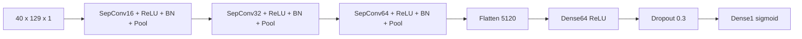

# Các kiến trúc mạng được cài đặt trong Phase 2

[Trang chủ](../README.md) · [Nền tảng neuron](01_Nen_Tang_Mang_Neuron.md)

## Mục lục

- [1. Cơ chế chọn kiến trúc](#muc-1)
- [2. Bảng kiến trúc](#muc-2)
- [3. V1 theo từng layer](#muc-3)
- [4. V2: thay cách tổng hợp feature](#muc-4)
- [5. V3: depthwise/pointwise tách rõ](#muc-5)
- [6. V4: ý nghĩa alpha và beta](#muc-6)
- [7. So sánh công bằng](#muc-7)

<a id="muc-1"></a>

## 1. Cơ chế chọn kiến trúc

[Training_Model.py](../../AI_Training_Model/Phase2_Preprocess_&_Traning/Training_Model.py) dùng `MODEL_ARCHITECTURE` và bảng `ARCHITECTURE_CONFIG` để import module trong [Model_Architectures](../../AI_Training_Model/Phase2_Preprocess_&_Traning/Model_Architectures/). Mỗi module cung cấp:

```python
def build_and_compile_model(input_shape):
    # Tạo các layer, compile và trả model.
    return model
```

Khi tái lập model cuối, input hiện hành là `(40,129,1)` theo frontend C4. Các builder nhận shape từ dữ liệu thay vì tự khóa Mel64; những docstring/smoke test lịch sử còn ghi `(64,129,1)` không được dùng để thay hợp đồng C4. Các builder trả một output sigmoid, dùng Adam, binary cross-entropy và accuracy. Output từng kiến trúc được lưu riêng để tránh ghi đè checkpoint.

<a id="muc-2"></a>

## 2. Bảng kiến trúc

| ID | Cấu trúc cài đặt | Đặc điểm khảo sát |
|---|---|---|
| V1_SepConv2D_Flatten | SeparableConv 16–32–64, BN/MaxPool; Flatten, Dense64, Dropout0,3, Dense1 | Baseline đang dùng |
| V2_SepConv2D_GAP | Backbone tương tự V1; thay Flatten bằng GlobalAveragePooling | Khảo sát giảm tham số classifier |
| V3_HelloEdge | Conv64 kernel (4,10), stride2; bốn block depthwise3×3 + pointwise64; GAP | DS-CNN tham khảo hướng Hello Edge |
| V4_0_MobileNet | MobileNetV1-style, alpha0,75, beta10, ReLU6, GAP | Mạng sâu hơn với width multiplier |
| V4_1_MobileNet | Cùng cách dựng V4, alpha0,50, beta8 | Giảm chiều rộng/số block |
| V5_ERespiNet | Conv2D thường 16–32–64, BN/MaxPool, Flatten, Dense64 | Đối chứng Conv2D với separable |
| V6_Azizi_SepCNN_Adapted | Conv2D stem, SepConv 16–32–64, BN/Pool/Dropout, GAP, Dense64 | Bản điều chỉnh tham khảo Azizi; không phải kiến trúc gốc của bài toán hen |

**Tên V5 là tên lịch sử:** nội dung builder tự ghi rõ chưa phải một bản E-RespiNet được tái lập từ paper. Khi viết báo cáo nên gọi “V5 – CNN thường 16–32–64 + Flatten” và dẫn đúng file, tránh gán một cấu trúc nghiên cứu khác cho model.

V0 có output lịch sử trong repo nhưng không nằm trong bảng lựa chọn hiện tại của Training_Model; không suy luận kiến trúc V0 chỉ từ tên thư mục.

<a id="muc-3"></a>

## 3. V1 theo từng layer



| Công đoạn | Shape sau công đoạn | Số tham số gồm thống kê BN |
|---|---|---:|
| Input | 40 × 129 × 1 | 0 |
| SeparableConv16, kernel3×3, same | 40 × 129 × 16 | 41 |
| BatchNorm16 | 40 × 129 × 16 | 64 |
| Pool2×2 | 20 × 64 × 16 | 0 |
| SeparableConv32 | 20 × 64 × 32 | 688 |
| BatchNorm32 | 20 × 64 × 32 | 128 |
| Pool2×2 | 10 × 32 × 32 | 0 |
| SeparableConv64 | 10 × 32 × 64 | 2.400 |
| BatchNorm64 | 10 × 32 × 64 | 256 |
| Pool2×2 | 5 × 16 × 64 | 0 |
| Flatten | 5.120 | 0 |
| Dense64 | 64 | 327.744 |
| Dropout | 64 | 0 |
| Dense1 | 1 | 65 |
| **Tổng** | | **331.386** |

Tổng này khớp [training_metadata.json của C4 V1 s44](../../Final_Project_NCKH/AI_Model/C4_V1_s44_QAT_INT8/training_metadata.json). Dense64 chiếm khoảng 98,90% số tham số. Đây là lý do giảm chi phí convolution chưa đồng nghĩa toàn mạng nhỏ: classifier Flatten–Dense vẫn chiếm phần lớn weights.

Với kernel K×K, input C và output O, bỏ qua bias: Conv thường có `K²CO` weights; separable có `K²C + CO`. Tuy vậy latency thực còn phụ thuộc operator được hỗ trợ, kernel tối ưu và bộ nhớ.

<a id="muc-4"></a>

## 4. V2: thay cách tổng hợp feature

V2 lấy trung bình feature map `5×16×64` của C4 thành vector64 rồi Dense64. Thay đổi này giảm mạnh số trọng số. Nó cũng mất thông tin vị trí cụ thể vốn có trong Flatten.

GAP có thể làm giảm độ nhạy với dịch vị trí trong một số tình huống, nhưng không bảo đảm bất biến dịch tuyệt đối. Padding, pooling và crop đầu/cuối vẫn ảnh hưởng đầu vào. Kết luận cần dựa trên thử shifted WAV cùng bộ test đã quy định.

<a id="muc-5"></a>

## 5. V3: depthwise/pointwise tách rõ

V3 dùng convolution đầu `(4,10)`, vì trục tensor là tần số trước, thời gian sau. Sau đó bốn block mỗi block gồm depthwise3×3, BN, ReLU, pointwise1×1, BN, ReLU. Cuối mạng dùng GAP và Dense1.

Trong báo cáo, phân biệt “tham khảo cách thiết kế” với “tái lập chính xác paper”. Cấu hình đầu vào 40×129 của C4 và bài toán nhị phân là của dự án này.

<a id="muc-6"></a>

## 6. V4: ý nghĩa alpha và beta

Hàm `filters(base_filters)` trả `int(base_filters*alpha)`; alpha giảm số kênh. Block stride2 thêm ZeroPadding rồi depthwise valid; block stride1 dùng same. Pointwise trộn kênh sau mỗi depthwise.

Cả hai bản có chuỗi mức kênh nền 64,128,128,256,256,512; vòng `range(beta-8)` thêm block512; cuối cùng đến 1024 rồi GAP. Trong code này beta là tham số điều khiển số block của implementation, không phải khái niệm chuẩn bắt buộc của mọi MobileNet.

Các builder này tạo mạng mới; không có lời gọi tải pretrained ImageNet weights trong source đã đọc.

<a id="muc-7"></a>

## 7. So sánh công bằng

Giữ cố định dataset/split, cách load, thứ tự file, min/max Train, budget train và threshold đánh giá. Nếu thay cả frontend và kiến trúc, cần ghi đó là thí nghiệm kết hợp, không gọi là ablation một biến.

Bảng kết quả nên có: trial ID, seed, input shape, parameters, size TFLite, Accuracy, Asthma recall/FN, Macro F1, arena used và latency trên board. Không kết luận mạng ít parameters nhất chắc chắn nhanh nhất.

Model hiện chọn `combo_pre0_mel40_fft2048__V1__s44` là kiến trúc V1 với frontend C4 và seed44; “V1” không thay thế thông tin frontend/checkpoint/seed.

