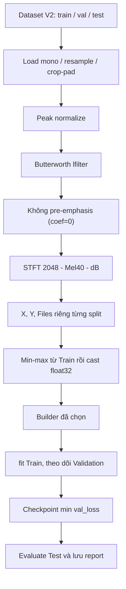

# Pipeline Python: từ WAV đến checkpoint

[Trang chủ](../README.md)

## Mục lục

- [1. Sơ đồ dữ liệu](#muc-1)
- [2. Hợp đồng preprocessing C4](#muc-2)
- [3. Ý nghĩa ba lần đổi miền số](#muc-3)
- [4. Tổ chức output](#muc-4)
- [5. Training_Model.py theo các hàm](#muc-5)
- [6. Cách chạy tái lập](#muc-6)
- [7. Tái lập accuracy](#muc-7)
- [8. Phân tích lỗi trước khi retrain](#muc-8)

<a id="muc-1"></a>

## 1. Sơ đồ dữ liệu



<a id="muc-2"></a>

## 2. Hợp đồng preprocessing C4

Nguồn: [Preprocess_Audio.py](../../AI_Training_Model/Phase2_Preprocess_&_Traning/Preprocess_Audio.py).

| Bước | Hàm | Thông số |
|---|---|---|
| Nhận diện playback | `is_playback_file` | Stem kết thúc `__take01` hoặc `__take02` |
| Chọn waveform | `load_model_audio_window` | Mono, 16 kHz, soxr_hq, load float32 |
| Crop/pad | librosa load + fix_length | Playback1–6 s; khác0–5 s; đủ80.000 mẫu |
| Peak normalization | librosa.util.normalize | norm infinity, chia max tuyệt đối |
| Bandpass | `butter_bandpass`, `apply_bandpass_filter` | Butterworth5, 100–2000 Hz, ba + lfilter zero state |
| Pre-emphasis | Nhánh chỉ chạy khi coefficient khác 0 | C4 đặt `PRE_EMPHASIS=0.0`, waveform đi thẳng sang Mel |
| Mel power | librosa.feature.melspectrogram | FFT2048, hop625, Hann, center, constant pad, 40 Mel Slaney |
| dB | librosa.power_to_db | ref max, amin1e-10, top_db80 |
| Kiểm tra | `preprocess_audio_file` | Bắt buộc shape40×129 |
| Đóng gói split | `process_split` | X thêm channel, Y int64, Files cùng thứ tự |

Ảnh PNG dùng để xem đặc trưng, không phải dữ liệu được đưa vào model. Không train bằng ảnh đã qua colormap hoặc nén PNG.

<a id="muc-3"></a>

## 3. Ý nghĩa ba lần đổi miền số

1. PCM được load thành số thực; peak normalization đưa waveform về miền gần [-1,1].
2. Mel power được đổi sang log năng lượng tương đối, thường trong [-80,0] dB.
3. Training lấy min/max toàn Train để đưa feature về [0,1], sau đó cast float32.

Các bước này có mục đích khác nhau. Chuẩn hóa waveform không thể thay cho chuẩn hóa tensor. Với signal all-zero, ref-max dB có thể tạo một ma trận không mang thông tin âm thanh; Quality Gate trên thiết bị cần xử lý trước DSP.

Sau `lfilter`, phép tính dùng hệ số float64 có thể tạo waveform/features float64 dù load là float32. `dtype=np.float32` trong melspectrogram chủ yếu chỉ dtype của filterbank, không bắt buộc toàn chuỗi về float32. Metadata của C4 s44 ghi raw Train/Val float64, rồi normalize/cast float32 trước model. Điều đó không biến model thành mạng FP64.

<a id="muc-4"></a>

## 4. Tổ chức output

`Output_Preprocess/` chứa `X_train_mel.npy`, `Y_train_mel.npy`, `Files_train.npy` và các bản tương ứng Val/Test. Một index phải trỏ đến cùng WAV trong cả ba array. Các ảnh mẫu chỉ là phụ trợ.

Nếu đổi crop, bandpass, pre-emphasis, FFT, Mel hoặc thứ tự file, phải tạo lại feature và metadata tương ứng. Không dùng X mới với Files cũ. Với model đã freeze, không âm thầm thay pipeline rồi dùng lại weights để gọi là tái lập.

<a id="muc-5"></a>

## 5. Training_Model.py theo các hàm

| Hàm/công đoạn | Việc thực hiện |
|---|---|
| `load_split` | Kiểm tra tồn tại X/Y, số lượng, shape, nhãn và NaN/Inf |
| `load_architecture_builder` | Import module theo bảng cấu hình |
| `create_callbacks` | Định nghĩa early stop, giảm LR, checkpoint và log |
| `main`: normalization | Tính Train min/max, áp cùng phép biến đổi cho mọi tập |
| `compute_class_weight` | Tính trọng số lớp trên Train |
| `model.fit` | Học weights, shuffle Train, theo dõi Val |
| `models.load_model` | Đọc lại checkpoint được chọn |
| `evaluate/predict` | Đánh giá và tạo nhãn bằng p_non>=0,5 |
| `plot_training_history` | Lưu đường loss/accuracy theo epoch |

Cấu hình script Phase 2 mặc định seed42, epochs100, batch32 và lần lượt train các builder đã đăng ký. Model cuối được chọn trong Frontend dùng seed44; checkpoint Phase 2 seed42 và C4 V1 s44 phải được ghi tên khác nhau trong báo cáo.

<a id="muc-6"></a>

## 6. Cách chạy tái lập

Lệnh dưới đây dành cho người thực hiện; tạo artifact và có thể ghi đè output tương ứng. Chọn kiến trúc và bảo toàn artifact cũ trước khi chạy.

Từ root repository:

```powershell
python ".\AI_Training_Model\Phase2_Preprocess_&_Traning\Preprocess_Audio.py"
python ".\AI_Training_Model\Phase2_Preprocess_&_Traning\Training_Model.py"
```

Mỗi script dùng đường dẫn bám vị trí file. Nếu Python báo thiếu TensorFlow/librosa, kiểm tra đúng interpreter đã cài dependencies; tên terminal hoặc tên kernel không đủ xác nhận môi trường.

<a id="muc-7"></a>

## 7. Tái lập accuracy

Một recipe giống nhau chưa bảo đảm bit-exact trên mọi môi trường. Cần giữ:

| Nhóm | Thông tin |
|---|---|
| Dữ liệu | Dataset root, fingerprint, manifest, thứ tự X/Y/Files |
| Feature | Crop policy, dtype, package version, toàn bộ frontend config |
| Model | Builder hash, kiến trúc, input shape |
| Training | Seed, optimizer, batch, callbacks, class weights |
| Runtime | TensorFlow/Keras, CPU/GPU, oneDNN, determinism |
| Đánh giá | Best checkpoint, split, mapping nhãn, threshold |

C4 V1 s44 metadata ghi TensorFlow2.21.0, oneDNN=0, determinism=false, best epoch27 và 37 epoch đã chạy. Đây là bằng chứng của checkpoint đó, không phải cấu hình cứng buộc mọi lần chạy phải dừng ở epoch37.

<a id="muc-8"></a>

## 8. Phân tích lỗi trước khi retrain

Dùng prediction CSV để nhóm lỗi theo Core/playback/environment và source ID. So raw với take01/take02, thử crop có kiểm soát, ước lượng onset/cross-correlation. Khi chọn quy tắc alignment, dùng Train+Val; Test chỉ xác nhận sau khi quy tắc đã chốt.

Nếu cùng PCM qua Python và C++ khác nhau, xử lý parity trước. Nếu Python và C++ cùng sai trên capture nhưng đúng trên raw, khảo sát domain shift loa–micro. Thay kiến trúc ngay ở bước này sẽ làm khó tách nguyên nhân.

