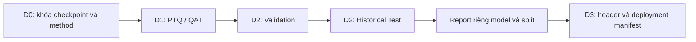

# Frontend Benchmarking, lượng tử và bàn giao C4

[Trang chủ](../README.md)

## Mục lục

- [1. Từ Phase 2 sang Frontend A–F](#muc-1)
- [2. Vai trò của các script](#muc-2)
- [3. PTQ và QAT](#muc-3)
- [4. Luồng D hiện hành](#muc-4)
- [5. Phân biệt report](#muc-5)
- [6. Artifact C4 V1 s44 bàn giao](#muc-6)
- [7. Ba mức kiểm chứng deployment](#muc-7)

<a id="muc-1"></a>

## 1. Từ Phase 2 sang Frontend A–F

Phase 2 cung cấp preprocessing nền và các builder. Frontend Benchmarking bổ sung kế hoạch thí nghiệm, fingerprint, nhiều seed và báo cáo phân tích để lựa chọn cấu hình trong phạm vi dự án.

| Mục | Câu hỏi | Script/notebook chính |
|---|---|---|
| A | DSP và baseline F0 có căn cứ gì? | `00_Analyze_Frontend.py`, notebook A |
| B | Đổi một tham số frontend ảnh hưởng thế nào? | B0/B1, `01_Build_Plan.py` → `04_Evaluate.py`, notebook B |
| C | Tám cấu hình × ba seed tương tác và ổn định ra sao? | Notebook C, 24 checkpoint FP32 |
| D | PTQ/QAT ảnh hưởng accuracy/cost và ESP32-S3 thế nào? | D0–D3, notebook D |
| E | Bằng chứng nhiều seed/kiến trúc/log board có nhất quán? | Notebook E |
| F | Tổng hợp lập luận nghiên cứu và bàn giao gì? | Notebook F |

Nguồn: [Frontend_Benchmarking](../../Experiments_Benchmarking/Patient_Node/Frontend_Benchmarking/). Trong cây hiện tại, một số README cũ còn trỏ hướng dẫn đã chuyển/xóa; dùng tên script đang tồn tại và argument parser để kiểm tra lệnh.

<a id="muc-2"></a>

## 2. Vai trò của các script

`01_Build_Plan.py` đọc candidate và tạo lịch; thay enabled trong CSV chưa chắc đã sửa plan cũ nếu chưa chạy lại bước lập lịch. `02_Preprocess.py` tạo feature theo cấu hình. `03_Train.py` dùng builder V1 và recipe đã đồng bộ. `04_Evaluate.py` tạo prediction/report theo split. Notebook đọc artifact để diễn giải kết quả; không thay thế việc tạo checkpoint.

Trong A, đối chứng chính là 12 Asthma raw và 12 Non-Asthma raw; 3 environment và 3 playback là phần khảo sát miền thu riêng. Không suy luận accuracy của model từ hình PSD của 24 file.

<a id="muc-3"></a>

## 3. PTQ và QAT

PTQ chuyển đổi model đã train; representative data giúp xác định phạm vi activation cho lượng tử nguyên. QAT có bước học/fine-tune mô phỏng tác động lượng tử trước khi convert. Chúng không chỉ là hai cách đổi tên header. [Google AI Edge: post-training quantization](https://developers.google.com/edge/litert/conversion/tensorflow/quantization/post_training_quantization).

Source hiện hỗ trợ:

| Method | Cách học/chuyển đổi | I/O |
|---|---|---|
| PTQ_INT8 | Convert checkpoint đã có, representative Train | int8 |
| PTQ_INT16x8 | Activation16-bit/weight8-bit theo converter hỗ trợ | int16 |
| QAT_INT8 | Fine-tune QAT rồi convert integer | int8 |

INT16x8 không thay trực tiếp vào code input/output int8. Cần runtime/operator hỗ trợ và đo arena riêng. Trong implementation QAT có các bước clone/sanitize và selective annotation; không mặc định mọi operator đều có cùng coverage QAT.

Luồng D hiện lượng tử 24 checkpoint của tám cấu hình × ba seed bằng ba method, tạo 72 model lượng tử; KERAS_FP32 của 24 checkpoint được giữ làm đối chứng. C4 V1 s44 QAT INT8 được chọn sau khi ghép metric phần mềm với bằng chứng triển khai.

<a id="muc-4"></a>

## 4. Luồng D hiện hành



| Script | Input | Output chính |
|---|---|---|
| D0_Build_Quantization_Plan.py | Checkpoint, metadata, methods CSV | `results/D_Quantization/quantization_plan.*` |
| D1_Quantize.py | Plan và Train representative | `artifacts/D_Quantization/<trial>/methods/<method>/` |
| D2_Evaluate_Quantized.py | Model và feature đúng trial | `evaluation/<method>/val_*`, `test_*` |
| D3_Export_Deployment.py | Trial/method được chỉ định | `artifacts/D_Deployment/<trial>/<method>/` |

D2 có thể chạy `--split both` để đánh giá Val rồi Historical Test. `--report-only` dựng lại report từ metrics có sẵn, không invoke.

Ví dụ từ thư mục Frontend_Benchmarking, khi cần tái lập theo plan phù hợp:

```powershell
python D0_Build_Quantization_Plan.py --all-c-checkpoints --force-plan
python D1_Quantize.py
python D2_Evaluate_Quantized.py --split both
python D3_Export_Deployment.py --trial-id combo_pre0_mel40_fft2048__V1__s44 --method QAT_INT8 --array-name model_data
```

Không tự thêm force nếu output hiện có cần bảo toàn. Representative phải là Train đúng frontend và normalization; không dùng Test để tìm thang lượng tử tốt hơn.

<a id="muc-5"></a>

## 5. Phân biệt report

Mỗi hàng kết quả cần đủ `trial_id, method_id, split, model_sha256, threshold`. `training_history.csv` là lịch sử model đang học; `KERAS_FP32/test_*` là đánh giá checkpoint float; `PTQ_INT8/test_*` là đánh giá TFLite integer.

Các report gộp trong Combined_Evaluation tập hợp từng model. Không hiểu chúng là trung bình của PTQ_INT8, PTQ_INT16x8 và QAT_INT8. So sánh chênh lệch nên ghép dự đoán theo file ID trên cùng split, không ghép theo hàng nếu thứ tự khác.

Test đã được xem trong D/E nên báo cáo gọi là Historical Test. Lần đo threshold trên model mới cần Validation phù hợp và quy tắc freeze; không trình bày test cũ như một external cohort độc lập.

<a id="muc-6"></a>

## 6. Artifact C4 V1 s44 bàn giao

Xem [Final AI Model](../../Final_Project_NCKH/AI_Model/README.md). Hợp đồng gồm weights, frontend, train normalization, I/O quantization, nhãn và hash. Header có mảng `model_data` căn hàng4; tên file không xác nhận được weights bên trong.

Hash TFLite hiện: `d081c1cfcd873c4e2182f9d9e0f8aff07a69ea0b041cf0d6d845d3222efc46b9`. Model QAT INT8 có input `[1,40,129,1]`, input scale `0.003921568859368563`, output scale `0.00390625`, zero-point cùng `-128`. Đọc scale từ tensor runtime là cách firmware đang dùng.

<a id="muc-7"></a>

## 7. Ba mức kiểm chứng deployment

| Project | Đường dữ liệu | Vấn đề được kiểm tra |
|---|---|---|
| 1_Test_Model_Static_Profiling | Tensor đã preprocess bằng Python → TFLM | Runtime, operator, invoke, arena |
| 2_Test_Model_LiveMic | PCM16 cố định → C++ DSP → TFLM, hoặc live mic | Parity và tích hợp thu âm |
| 3_Model_Complete | Micro → VAD/Quality/DSP/model | Luồng sử dụng và thống kê thực tế |
| Patient_Node | Luồng hoàn chỉnh + UI/vitals/ESP-NOW | Tích hợp hệ thống cuối |

Static project giữ nhiều header để đối chứng; phải kiểm tra selector đang trỏ C4 QAT trước khi đo. Live-mic và firmware cuối dùng manifest C4. Việc đã chép một header mới chưa chứng minh code đang include đúng bytes nếu selector/include vẫn trỏ nhánh khác.

Phase4 tạo 12 tensor và 12 PCM16 đối chiếu. Generator static hiện vẫn đọc cấu hình Phase3; cần kiểm tra đường TFLite trong cấu hình trỏ đúng artifact cuối. Tài liệu này không tự chạy generator hay thay cấu hình.

Nguồn tiếp: [kiểm chứng Python–C++](../03_Preprocess_CPP/07_Kiem_Chung_Python_CPP.md).

