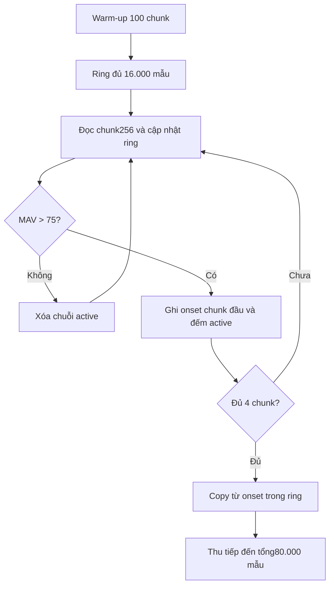

# Thu I2S, cửa sổ PCM, VAD và Quality Gate

[Mục lục C++](README.md)

## Mục lục

- [1. Cấu hình I2S hiện hành](#muc-1)
- [2. Kiểm tra micro lúc boot](#muc-2)
- [3. CHECK: cửa sổ chủ động](#muc-3)
- [4. MONITOR: ring lịch sử và onset](#muc-4)
- [5. Tính liên tục và lỗi DMA](#muc-5)
- [6. Quality Gate trước normalize](#muc-6)
- [7. Đo để chốt](#muc-7)

<a id="muc-1"></a>

## 1. Cấu hình I2S hiện hành

[I2S_Mic.cpp](../../Final_Project_NCKH/Patient_Node/src/I2S_Mic.cpp) dùng I2S_NUM_0, master RX, 16 kHz, slot32-bit, ONLY_RIGHT, 8 DMA buffer × 256 mẫu. Đấu chân theo [Board_Pinout.h](../../Final_Project_NCKH/Patient_Node/shared/Board_Pinout.h): SCK14, WS15, SD16.

Mỗi chunk256 mẫu tương ứng16 ms. Chọn ONLY_RIGHT phải phù hợp cấu hình kênh của INMP441 trên mạch; đọc được DMA không tự chứng minh micro đang phát dữ liệu đúng.

Chuyển mẫu:

```cpp
int32_t sample = (raw_samples[i] >> 16) * Amplify_Factor;
sample = constrain(sample, -32768, 32767);
chunk[i] = static_cast<int16_t>(sample);
```

`Amplify_Factor=1`. Đây là chuyển dữ liệu slot32-bit sang PCM16 trong implementation, không phải peak normalization. Firmware thu dataset và firmware suy luận cần giữ cùng cách dịch/gain để điều kiện biên độ có ý nghĩa.

<a id="muc-2"></a>

## 2. Kiểm tra micro lúc boot

I2S init bật pull-down chân SD, bỏ8 chunk rồi kiểm tra32 chunk. Với chunk đầy, tổng cửa sổ khoảng640 ms gồm128 ms warm-up và512 ms đo.

| Điều kiện health-check | Giá trị |
|---|---:|
| Peak | >0 |
| Tỷ lệ mẫu khác0 | ≥1% |
| Tỷ lệ chuyển giá trị giữa hai mẫu | ≥1% |
| Tỷ lệ mẫu abs≥32000 | ≤25% |

Nếu thất bại, Node hiện báo MIC ERROR và dừng quá trình setup. Nếu đạt, trạng thái READY được giữ; người dùng được nhắc không tháo micro khi Node đang hoạt động.

Đây là kiểm tra tính hợp lý của stream, không có thanh ghi nhận dạng thiết bị I2S để chứng minh chắc chắn mic đang cắm. Dây nhiễu có thể tạo giá trị biến thiên; sự cố sau boot không được health-check này theo dõi liên tục.

<a id="muc-3"></a>

## 3. CHECK: cửa sổ chủ động

`I2S_RecordSamples` đọc đến đủ80.000 mẫu. Timeout một lần đọc là100 ms; lỗi driver hoặc không có mẫu làm hàm trả false. Cờ abort được kiểm tra giữa các chunk để nút SLEEP không phải chờ hết5 s.

File test PCM16 và buffer ghi âm đều cần cùng thứ tự mẫu. Nếu capture lưu ra WAV để so Python, lưu đúng buffer trước normalize và chỉ xử lý khi đủ80.000 mẫu.

<a id="muc-4"></a>

## 4. MONITOR: ring lịch sử và onset



MAV là trung bình trị tuyệt đối, không phải RMS. Code dùng phép chia nguyên. Bốn chunk đầy là1.024 mẫu≈64 ms. Onset nằm ở đầu chunk active đầu tiên; độ phân giải tìm onset là chunk, không phải thuật toán xác định onset chính xác từng sample.

Ring chứa1 giây lịch sử nhưng không copy cả1 giây vào mỗi mẫu inference. Khi xác nhận VAD, code copy các mẫu thuộc chuỗi active đã ghi nhớ rồi thu phần còn lại đến5 s. Như vậy không mặc định mất1 s nội dung hữu ích để lấy im lặng.

Warm-up100 chunk≈1,6 s, rồi khoảng1 s nạp ring. Lần capture kế tiếp trong cùng phiên vote reset ring nhưng không warm-up lại. Trong thời gian DSP, inference và UI delay, thiết bị không phân tích VAD liên tục như một task thu âm song song; cần đo khả năng bỏ lỡ các sự kiện nối tiếp.

<a id="muc-5"></a>

## 5. Tính liên tục và lỗi DMA

DMA giúp đệm ngắn giữa các lần đọc; nó không giữ vô hạn khi CPU dừng lâu.8×256 slot chỉ là đệm cỡ128 ms dữ liệu danh định. Khi chuyển LISTENING→CAPTURE phải tiếp tục đọc kịp thời; log/blocking có thể ảnh hưởng.

Hiện `I2S_MonitorCaptureStep` trả false cả khi chưa đủ mẫu lẫn khi đọc lỗi. Máy trạng thái cần được nghiệm thu tình huống thiếu mẫu kéo dài; chưa có bằng chứng rằng chỉ timeout mỗi i2s_read đã tạo một deadline tổng cho Monitor.

<a id="muc-6"></a>

## 6. Quality Gate trước normalize

Nguồn: [Quality_Check.cpp](../../Final_Project_NCKH/Patient_Node/src/Quality_Check.cpp).

```text
RMS = sqrt(sum(x[n]^2) / N)
Peak = max(abs(x[n]))
Clipped ratio = count(abs(x[n]) > 32000) / N
Block MAV = floor(sum(abs(x[n])) / block_length)
Active ratio = active_blocks / total_blocks
```

Với80.000 mẫu và block256, có313 block; block cuối chỉ128 mẫu. Active ratio đếm block, không đếm trực tiếp phần trăm thời gian active theo sample.

**Giá trị đang chạy trong source, còn là thử nghiệm:**

| Điều kiện | Ngưỡng / thứ tự |
|---|---|
| Active block | MAV>20 |
| Active ratio<0,01 | AUDIO_INACTIVE, xét đầu tiên |
| Clipped ratio>0,01 | AUDIO_TOO_LOUD |
| RMS<20 | AUDIO_TOO_WEAK |
| Còn lại | AUDIO_OK |

Peak đang được đo/log nhưng chưa có điều kiện PEAK_MIN riêng. Một số đặc tả cũ ghi RMS150, MAV80, active5%; không được lấy các số cũ để mô tả code hiện tại.

Quality Gate chỉ loại đoạn không đủ điều kiện tín hiệu. Speech/quạt vẫn có thể PASS, vì chúng có năng lượng hợp lệ. Monitor không tăng vote khi Quality fail và quay lại lắng nghe.

<a id="muc-7"></a>

## 7. Đo để chốt

Thu riêng silence, too-quiet, clipping, ít hoạt động và audio hợp lệ. Ghi RMS/peak/active/clipping cùng điều kiện loa/khoảng cách. Chọn ngưỡng bằng calibration, xác nhận bằng các session khác. Đo thêm trigger/miss và false-trigger theo khoảng cách cho VAD; không lấy threshold classification làm threshold năng lượng.

