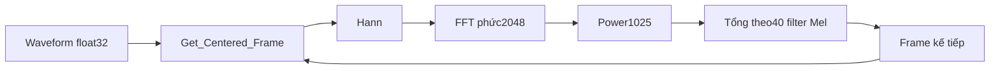

# STFT, FFT, Hann và cách tạo 129 frame

[Mục lục C++](README.md)

## Mục lục

- [1. Từ waveform đến phổ theo thời gian](#muc-1)
- [2. Center padding](#muc-2)
- [3. Hann tuần hoàn](#muc-3)
- [4. Power spectrum](#muc-4)
- [5. Bố trí vòng lặp](#muc-5)
- [6. Chẩn đoán sai số](#muc-6)

<a id="muc-1"></a>

## 1. Từ waveform đến phổ theo thời gian

FFT của cả5 giây cho biết thành phần tần số tổng thể nhưng không giữ rõ chúng xuất hiện ở lúc nào. STFT chia waveform thành nhiều frame ngắn, tính FFT từng frame rồi xếp theo thời gian.

Trong dự án:

| Đại lượng | Giá trị | Ý nghĩa |
|---|---:|---|
| Sample rate | 16.000 Hz | Tần suất lấy mẫu |
| FFT/window length | 2.048 mẫu |128 ms/frame |
| Hop |625 mẫu |39,0625 ms giữa hai tâm frame |
| Phần chồng lấn danh định |1.423 mẫu |88,9375 ms |
| Bước bin FFT |7,8125 Hz |sr/N_FFT; không đồng nhất với khả năng phân giải mọi tín hiệu |
| Số bin giữ |1.025 |N_FFT/2+1 với input thực |
| Số frame |129 |center=True, cửa sổ80.000 mẫu |

Nguồn: [Mel_Scale.h](../../Final_Project_NCKH/Patient_Node/include/DSP_Preprocessing/Mel_Scale.h) và [Mel_Scale.cpp](../../Final_Project_NCKH/Patient_Node/src/Mel_Scale.cpp).

<a id="muc-2"></a>

## 2. Center padding

`Get_Centered_Frame` tính:

```text
pad = 1024
start = frame_index * 625 - 1024
frame[i] = input[start+i] nếu nằm trong0..79999
frame[i] = 0 nếu ngoài vùng
```

Không cần cấp phát waveform dài hơn để padding; chỉ sinh giá trị0 khi truy cập ngoài vùng.

| Frame | Tâm danh định | Vùng chỉ số |
|---|---:|---|
|0 |0 |-1.024..1.023 |
|1 |625 |-399..1.648 |
|64 |40.000 |38.976..41.023 |
|128 |80.000 |78.976..81.023 |

Frame cuối có tâm ngay sau sample cuối. Việc có phần zero bên phải là đúng với center padding, không phải thêm audio thu được.

Công thức số frame:

```text
T = floor((80000 + 2*1024 - 2048)/625) + 1
  = floor(80000/625) + 1
  = 129
```

Nếu bỏ center, số frame thành125. Shape sai sẽ kéo theo input tensor không tương thích.

<a id="muc-3"></a>

## 3. Hann tuần hoàn

Mỗi frame được nhân:

```text
w[n] = 0.5 - 0.5*cos(2*pi*n/2048), n=0..2047
```

Mẫu số là2048, không phải2047. Source chủ động nhân Hann thủ công thay cho windowing mặc định của arduinoFFT để khớp pipeline Python. Cửa sổ làm mềm biên frame, giảm spectral leakage; nó không xóa hoàn toàn leakage.

Sau khi nhân Hann:

```cpp
vReal[i] = frame_buf[i] * hann;
vImag[i] = 0.0f;
FFT.compute(FFTDirection::Forward);
```

Việc nạp phần ảo bằng0 phản ánh input waveform thực. Output FFT vẫn là số phức, vì mô tả biên độ và pha của các thành phần tần số.

<a id="muc-4"></a>

## 4. Power spectrum

Code giữ bin0 đến1024:

```text
P[k] = Real[k]^2 + Imag[k]^2
```

Không lấy căn bậc hai ở đây vì Python đặt `power=2.0`. Không tự nhân2 cho phổ một phía hoặc chia thêm N nếu reference Python không làm bước đó. Những biến đổi tưởng là “chuẩn hóa FFT” có thể thay đổi kết quả so sánh.

Trong ref-max dB, một hệ số dương chung cho toàn bộ ma trận có thể triệt tiêu về lý tưởng, nhưng thay hệ số theo bin, theo frame hoặc khác floor epsilon thì không còn tương đương.

<a id="muc-5"></a>

## 5. Bố trí vòng lặp



Mảng FFT được tái sử dụng cho từng frame, không giữ toàn bộ129 phổ phức cùng lúc. Điều này tiết kiệm bộ nhớ nhưng cũng có nghĩa không gọi đồng thời Compute_Mel từ nhiều task khi các scratch buffer là static.

<a id="muc-6"></a>

## 6. Chẩn đoán sai số

| Hiện tượng | Kiểm tra trước |
|---|---|
| Sai rõ ở frame đầu/cuối | Center và zero padding |
| Sai dọc theo mọi bin | Hann, scale FFT, dtype |
| Hình bị xoay/chuyển trục | Layout frequency/time |
| Mỗi frame lệch đều theo thời gian | Hop và chỉ số onset/crop |
| Bin có năng lượng dịch vị trí | Sample rate, N_FFT, cách đọc PCM |
| Shape128 hoặc127 | Công thức số frame/center |

Cùng waveform là điều kiện cần cho phép so sánh; phát lại hai lần rồi so FFT sẽ đồng thời thay acquisition.

Tham chiếu API [librosa melspectrogram](https://librosa.org/doc/0.11.0/generated/librosa.feature.melspectrogram.html) để kiểm tra ý nghĩa n_fft, hop, center, power; các con số trong tài liệu được lấy từ source dự án.

