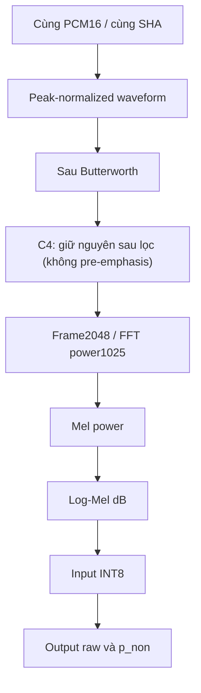

# Kiểm chứng tương đương Python–C++ và tìm nguyên nhân sai lệch

[Mục lục C++](README.md)

## Mục lục

- [1. Mục tiêu kiểm chứng](#muc-1)
- [2. Chuỗi artifact Phase 4](#muc-2)
- [3. So sánh theo từng điểm kiểm tra](#muc-3)
- [4. Metric sai số đề xuất](#muc-4)
- [5. Các nguồn sai lệch phổ biến](#muc-5)
- [6. Phép thử dịch cửa sổ và domain shift](#muc-6)
- [7. Trạng thái đối chiếu source hiện tại](#muc-7)
- [8. Mẫu bảng lưu nghiệm thu](#muc-8)

<a id="muc-1"></a>

## 1. Mục tiêu kiểm chứng

Một pipeline có thể đúng shape nhưng sai giá trị. Mục tiêu kiểm chứng là xác nhận cùng waveform, frontend config, normalization và model tạo ra tensor/output gần nhau trong sai số đo được.

Phân biệt ba câu hỏi:

| Phép thử | Giữ cố định | Câu hỏi |
|---|---|---|
| Tensor tĩnh | Input INT8 và weights | TFLite PC/TFLite Micro có output tương ứng? |
| PCM cố định |80.000 mẫu PCM16 | DSP/Mel C++ có khớp Python? |
| Live mic |Thiết lập thu và nguồn phát | Hệ thống có thu đúng cửa sổ và miền âm? |

Thử live mic trước khi xác nhận hai phép thử đầu sẽ trộn lỗi thu âm, DSP và model.

<a id="muc-2"></a>

## 2. Chuỗi artifact Phase 4

`Generate_Static_Test_Tensors.py` chọn6 Asthma +6 Non-Asthma, preprocess Python, normalize/quantize và lưu tensor header với expected output. `Generate_LiveMic_PCM16_Test_Header.py` dùng cùng manifest, xuất raw PCM16; không lọc DSP/Mel trong dữ liệu PCM.

Nguồn: [Phase4 README](../../AI_Training_Model/Phase4_Deployment_Artifacts/README.md). Trước khi tái sinh artifact cho C4 V1 s44 QAT INT8, kiểm tra generator đang trỏ đúng TFLite SHA `d081c1cf...46b9`, frontend40×129 và manifest C4.

Static project giữ nhiều model để đối chứng; cần chọn đúng C4 QAT khi nghiệm thu model cuối. Live-mic project dùng `RUN_RAW_PCM16_TEST=1` để chạy header và chuyển0 theo cấu hình hiện có để dùng micro. Không so expected output được tạo bởi model/frontend khác với header C4.

<a id="muc-3"></a>

## 3. So sánh theo từng điểm kiểm tra



Với mỗi tầng, xuất cùng số phần tử và thứ tự. File đối chiếu phải ghi dtype/shape, không chỉ một hình ảnh phổ. Có thể dùng các script capture/analysis hiện có hoặc thêm instrument khi thực hiện nghiệm thu; tài liệu này không giả định mọi tầng đã có sẵn exporter.

<a id="muc-4"></a>

## 4. Metric sai số đề xuất

```text
MAE       = mean(abs(CPP - Python))
MaxAbs    = max(abs(CPP - Python))
RMSE      = sqrt(mean((CPP - Python)^2))
QMismatch = count(q_cpp != q_python) / tensor_elements
DeltaP    = abs(p_non_cpp - p_non_python)
```

Ghi cả vị trí sai số lớn, tỷ lệ ô dB chạm floor, tỷ lệ input bị clamp và số lần flip class. Với tensor INT8, thêm số ô lệch1/2/>2 LSB. Tolerance phải được chốt từ phép đo và mức ảnh hưởng; không có một ngưỡng MAE phổ quát bảo đảm accuracy không giảm.

Nếu gần threshold, delta nhỏ cũng có thể làm flip nhãn; nếu xa threshold, delta lớn hơn đôi khi chưa flip. Vì vậy báo cả xác suất lẫn nhãn.

<a id="muc-5"></a>

## 5. Các nguồn sai lệch phổ biến

| Dấu hiệu | Nguyên nhân nên kiểm tra |
|---|---|
| PCM khác ngay đầu vào | Crop, resample, float→PCM16, gain hoặc dịch bit |
| Waveform lọc khác mạnh | Hệ số IIR/state reset/order, ba với SOS/filtfilt |
| Chỉ đầu/cuối clip khác | Padding/cửa sổ/crop |
| Mel giống hình nhưng tensor lệch | Layout, min/max, dtype hoặc rounding |
| Tensor giống nhưng p khác | Model hash, runtime/operator, I/O scale |
| Raw đúng, capture sai ở cả Python và MCU | Domain shift hoặc cửa sổ thu |
| Nhãn Node khác 3_Complete nhưng p giống | Policy threshold khác nhau |

Python load float→PCM16 có một bước làm tròn không tồn tại nếu chạy trực tiếp WAV float. Để tách DSP thật sự, cho Python xử lý chính các sample PCM16 đã đưa vào C++.

<a id="muc-6"></a>

## 6. Phép thử dịch cửa sổ và domain shift

Với một source và ba capture:

1. Đo lag raw/capture bằng cross-correlation; ghi quy ước dấu.
2. Crop raw theo đúng lag để được cửa sổ5 s tương ứng.
3. Chạy cả shifted-original và capture qua cùng Python/PTQ.
4. So p_non, waveform và phổ.

Nếu shifted-original đã tăng p_non mạnh, cửa sổ có đóng góp. Nếu shifted-original ổn nhưng capture sai, đường loa–mic/môi trường có đóng góp. Nếu cả hai thay đổi ở mức khác nhau, không ép kết luận một nguyên nhân duy nhất.

Cross-correlation có thể mơ hồ với âm lặp, khoảng lặng và méo; cần xem peak tương quan, độ rộng peak và vùng overlap. Offset không phải ground truth nếu correlation kém.

<a id="muc-7"></a>

## 7. Trạng thái đối chiếu source hiện tại

Đã đọc source ngày15/10/2026:

- DSP_Filter.cpp giữa Node, 2_Test và3_Complete có cùng hash.
- Mel_Scale.cpp khác log/debug, công thức chính khớp ở phần diff đã kiểm tra.
- Ngưỡng hậu xử lý khác nhau giữa các project.
- Arena Node hiện cấp192 KiB; profiling C4 ghi used169.380 B. Vẫn cần kiểm tra AllocateTensors và chạy lặp đúng firmware/toolchain.
- Health-check micro là heuristic boot; không phải phát hiện tháo/lắp liên tục.

Kết quả này chỉ xác nhận implementation trên đĩa. Tài liệu không tạo ra một benchmark hardware mới.

<a id="muc-8"></a>

## 8. Mẫu bảng lưu nghiệm thu

| file_id | model_sha | PCM_sha | Mel_MAE | Mel_MaxAbs | QMismatch | p_python | p_cpp | delta_p | status |
|---|---|---|---:|---:|---:|---:|---:|---:|---|
| mẫu cần đo | hash | hash | chưa đo | chưa đo | chưa đo | chưa đo | chưa đo | chưa đo | pending |

Log kèm board, build flags, thư viện, compiler, thời gian DSP/invoke, arena và heap. Chỉ đánh dấu nghiệm thu khi có dữ liệu điền thực; không dùng số latency của model cũ để lấp bảng.

