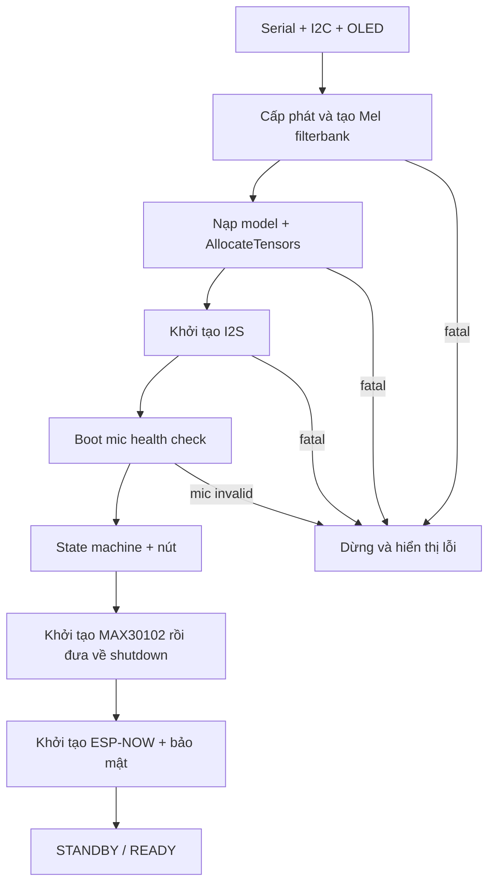
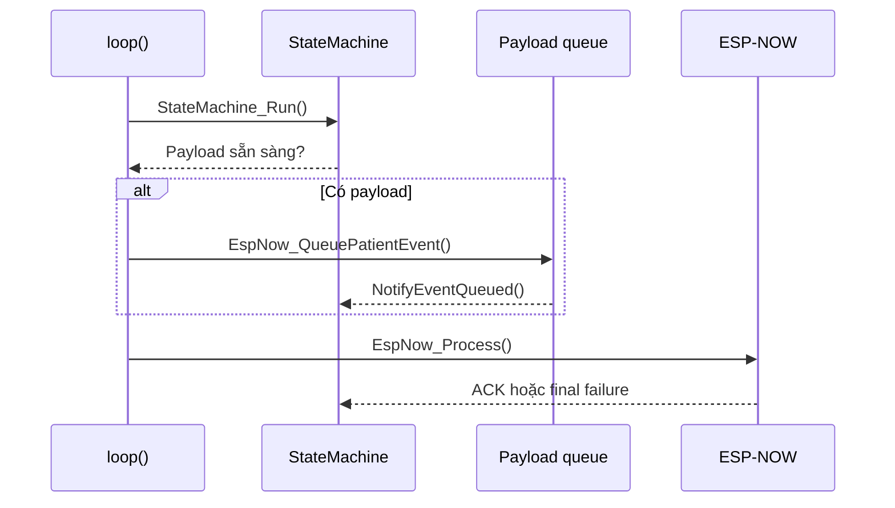
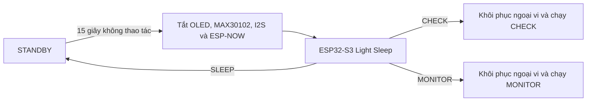
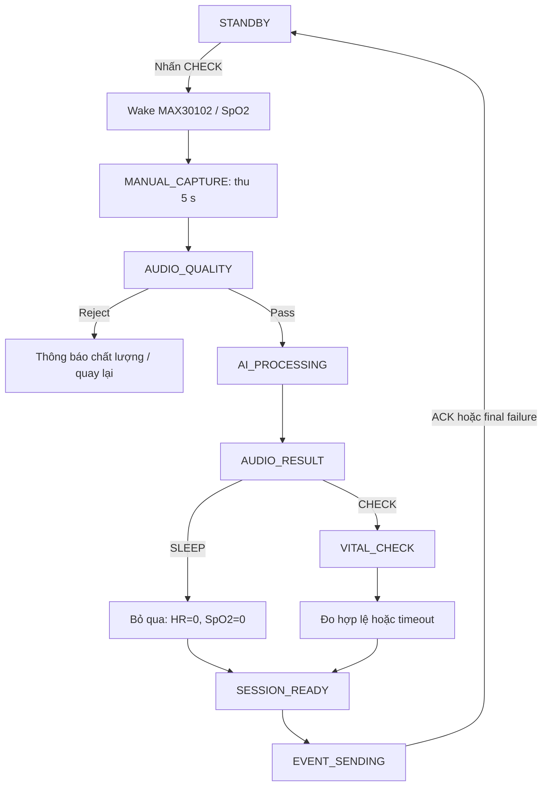
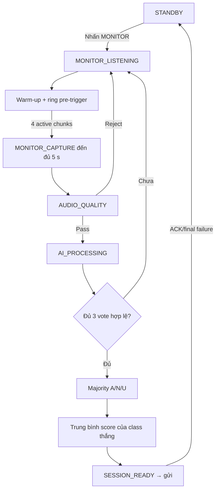

# Xây dựng Patient Node

[Trang chủ tài liệu](../README.md)

> Tài liệu này mô tả cấu hình đang có trong firmware `Final_Project_NCKH/Patient_Node`. Các ngưỡng ghi là **giá trị hiện hành trong source**, không mặc nhiên là giá trị nghiệm thu cuối cùng.

## Mục lục

- [1. Vai trò và ranh giới](#muc-1)
- [2. Phần cứng và thông số](#muc-2)
- [3. Tổ chức module](#muc-3)
- [4. Trình tự khởi tạo](#muc-4)
- [5. Bộ nhớ và vòng lặp chính](#muc-5)
- [6. Pipeline âm thanh và suy luận](#muc-6)
- [7. Luồng CHECK và MONITOR](#muc-7)
- [8. Sinh hiệu, giao tiếp và xử lý lỗi](#muc-8)
- [9. Kiểm tra và nghiệm thu](#muc-9)

<a id="muc-1"></a>

## 1. Vai trò và ranh giới

Patient Node là thiết bị suy luận tại biên. ESP32-S3 thu PCM từ INMP441, đánh giá chất lượng cửa sổ âm thanh, tạo Log-Mel, chạy model TFLite Micro INT8 và gửi kết quả cho Gateway qua ESP-NOW.

Node thực hiện:

- thu âm theo CHECK hoặc MONITOR;
- kiểm tra cửa sổ 5 giây có đủ chất lượng để suy luận;
- tiền xử lý DSP/Log-Mel tương ứng pipeline Python;
- phân loại Asthma, Non-Asthma hoặc Unsure;
- đo HR/SpO2 trong CHECK nếu người dùng yêu cầu;
- vote ba lần trong MONITOR;
- tự vào Light Sleep khi STANDBY không có thao tác trong 15 giây;
- mã hóa và gửi một `NodePayload` cho Gateway.

Node **không** gửi WAV qua ESP-NOW, không kết nối MQTT trực tiếp, không lưu lịch sử nhiều phiên trên flash và không thay thế thiết bị chẩn đoán y tế.

Project chính: [Final_Project_NCKH/Patient_Node](../../Final_Project_NCKH/Patient_Node/). Các project trong `Deploy_Model/` chỉ dùng kiểm chứng model, bộ nhớ và pipeline riêng lẻ.

<a id="muc-2"></a>

## 2. Phần cứng và thông số

### 2.1. Board và chân kết nối

| Thành phần | Cấu hình hiện tại | Chức năng |
|---|---|---|
| MCU | ESP32-S3 N16R8V, Arduino/PlatformIO | State machine, DSP, TFLite Micro |
| Flash/PSRAM | 16 MB Flash, 8 MB PSRAM; QIO/OPI | Chứa model và các buffer lớn |
| INMP441 | SCK GPIO14, WS GPIO15, SD GPIO16 | Micro I2S mono |
| Bus I2C | SDA GPIO8, SCL GPIO9 | OLED và MAX30102 |
| MAX30102 INT | GPIO10 | Chân interrupt được khai báo |
| Đọc điện áp pin | GPIO12, ADC2_CH1 | Nhận điện áp sau cầu chia áp; không nối trực tiếp pin 2S vào GPIO |
| CHECK | GPIO4, `INPUT_PULLUP` | Bắt đầu CHECK/xác nhận đo sinh hiệu |
| MONITOR | GPIO5, `INPUT_PULLUP` | Bắt đầu chế độ giám sát |
| SLEEP | GPIO6, `INPUT_PULLUP` | Hủy/bỏ qua; tại STANDBY yêu cầu Light Sleep |
| Serial | 115200 baud | Log khởi tạo, state, AI và truyền gói |
| ESP-NOW | Wi-Fi channel 6 | Gửi packet bảo mật đến Gateway |

Nguồn chân chuẩn là [Board_Pinout.h](../../Final_Project_NCKH/Patient_Node/shared/Board_Pinout.h). INMP441 phải đấu chân L/R phù hợp với `I2S_CHANNEL_FMT_ONLY_RIGHT`; đấu sai slot có thể vẫn đọc được dữ liệu nhưng dữ liệu là 0 hoặc rác.

### 2.2. Cấu hình build

| Mục | Giá trị |
|---|---|
| PlatformIO environment | `esp32-s3-n16r8v` |
| Framework | Arduino |
| Tối ưu compiler | `-O3` |
| PSRAM | `BOARD_HAS_PSRAM`, QIO/OPI |
| USB CDC lúc boot | Tắt (`ARDUINO_USB_CDC_ON_BOOT=0`) |
| Log level | `CORE_DEBUG_LEVEL=3` |
| Thư viện chính | TensorFlowLite_ESP32, arduinoFFT |

Cổng upload trong `platformio.ini` chỉ là cấu hình máy phát triển hiện tại; cần đổi theo máy sử dụng.

### 2.3. Thu âm và VAD

| Thông số | Giá trị hiện tại | Diễn giải |
|---|---:|---|
| Tần số lấy mẫu | 16.000 Hz | Khớp pipeline huấn luyện |
| Độ dài inference | 80.000 mẫu | Chính xác 5 giây |
| Dữ liệu I2S | 32 bit, mono right | Chuyển về PCM16 sau khi đọc |
| Kích thước chunk | 256 mẫu | Khoảng 16 ms/chunk |
| DMA | 8 buffer × 256 mẫu | Buffer phần cứng I2S |
| Timeout đọc I2S | 100 ms | Tránh chặn vô hạn một lần đọc |
| Ring pre-trigger | 16.000 mẫu | Giữ tối đa 1 giây lịch sử |
| VAD monitor | MAV > 75 | Ngưỡng phát hiện chunk hoạt động |
| Xác nhận VAD | 4 chunk liên tiếp | Khoảng 64 ms hoạt động liên tục |
| Warm-up lần đầu | 100 chunk | Khoảng 1,6 giây |

Ring 1 giây là vùng lịch sử để tìm đoạn bắt đầu, không có nghĩa firmware luôn ghép nguyên 1 giây im lặng với 4 giây mới. Khi VAD xác nhận, firmware lấy phần bắt đầu ứng viên quanh chuỗi active rồi thu tiếp cho đủ 80.000 mẫu.

### 2.4. Kiểm tra micro lúc khởi động

Firmware bỏ 8 chunk đầu, sau đó thống kê 32 chunk. Micro được coi là có tín hiệu hợp lệ khi đồng thời thỏa:

| Kiểm tra | Điều kiện hiện tại |
|---|---:|
| Peak | `> 0` |
| Tỷ lệ mẫu khác 0 | `>= 1%` |
| Tỷ lệ chuyển mức | `>= 1%` |
| Tỷ lệ clipping | `<= 25%` |
| Mức coi là clipping | `abs(sample) >= 32000` |

Đây là phép kiểm tra thống kê ngắn tại boot, không phải nhận dạng phần cứng tuyệt đối. Sau khi Node báo READY, không tháo/lắp mic nóng; nếu thay dây cần khởi động lại để kiểm tra từ đầu.

### 2.5. Model và tensor

| Thuộc tính | Giá trị |
|---|---|
| Model cuối | `combo_pre0_mel40_fft2048__V1__s44` (C4) |
| Kiến trúc | V1 SepConv2D + Flatten |
| Lượng tử | QAT full INT8 |
| Kích thước TFLite | 347.968 byte |
| Input | `[1, 40, 129, 1]`, INT8 |
| Input scale/zero-point | xấp xỉ `1/255`, `-128` |
| Output | `[1, 1]`, INT8 |
| Output scale/zero-point | `1/256`, `-128` |
| Tensor arena cấp phát | 192 KiB; profiling used 169.380 B |
| SHA-256 model | `d081c1cfcd873c4e2182f9d9e0f8aff07a69ea0b041cf0d6d845d3222efc46b9` |

<a id="muc-3"></a>

## 3. Tổ chức module

| Module/file | Trách nhiệm chính |
|---|---|
| `main.cpp` | Khởi tạo; chạy state machine; chuyển payload sang ESP-NOW |
| `State_Machine.cpp` | CHECK/MONITOR, nút nhấn, vote, PPG, kết thúc phiên |
| `Power_Manager.cpp` | Cấu hình GPIO4/5/6 thành nguồn `EXT1 ANY_LOW` và gọi ESP32-S3 Light Sleep |
| `I2S_Mic.cpp` | I2S, boot health check, direct capture, ring và VAD |
| `Quality_Check.cpp` | RMS, peak, clipping, active ratio trên PCM thô |
| `DSP_Filter.cpp` | Peak normalization và Butterworth; C4 không dùng pre-emphasis |
| `Mel_Scale.cpp` | Framing, Hann, FFT, power, Mel, dB |
| `Inference_Asthma.cpp` | TFLM, quantize input, dequantize output, classification |
| `PPG_Sensor.cpp` | FIFO MAX30102, finger check, HR/SpO2, timeout |
| `UI_Oled.cpp` | Hiển thị theo trạng thái, không quyết định nghiệp vụ |
| `EspNow_Client.cpp` | Pending packet, callback, timeout, retry |
| `Secure_Sender.cpp` | Mã hóa AES-GCM và tạo packet |
| `Secure_Response_Decryptor.cpp` | Xác thực ACK/NACK từ Gateway |
| `common/Packet_Metadata` | Device ID, session ID và sequence |

ISR nút chỉ ghi nhận cờ/sự kiện. Thu âm, DSP, inference, I2C và gửi radio đều chạy ngoài ISR.

<a id="muc-4"></a>

## 4. Trình tự khởi tạo



| Khối | Nếu lỗi | Hành vi |
|---|---|---|
| Mel/filterbank | Fatal | Không cho vào READY |
| Model/TFLM/tensor | Fatal | Không thể inference |
| I2S/mic health | Fatal | Chặn tiến trình để tránh suy luận trên rác |
| MAX30102 | Không fatal | AI vẫn chạy; sinh hiệu được đánh dấu không hợp lệ |
| ESP-NOW | Không làm hỏng AI | Phiên không thể được Gateway xác nhận; không có queue bền vững |

<a id="muc-5"></a>

## 5. Bộ nhớ và vòng lặp chính

### 5.1. Các vùng bộ nhớ lớn

| Vùng | Công thức | Xấp xỉ |
|---|---:|---:|
| PCM16 5 giây | 80.000 × 2 byte | 160.000 B |
| Float audio | 80.000 × 4 byte | 320.000 B |
| Ring pre-trigger | 16.000 × 2 byte | 32.000 B |
| Mel filterbank | 40 × 1.025 × 4 byte | 164.000 B |
| Log-Mel | 40 × 129 × 4 byte | 20.640 B |
| FFT real + imag | 2 × 2.048 × 4 byte | 16.384 B |
| Frame scratch | 2.048 × 4 byte | 8.192 B |
| Power spectrum | 1.025 × 4 byte | 4.100 B |
| Tensor arena | 192 × 1.024 byte | 196.608 B |
| **Tổng các vùng trên** | Chưa tính model/stack/DMA/allocator | **921.924 B** |

Các buffer lớn ưu tiên PSRAM. Con số trên là dung lượng cấp phát lý thuyết, không thay thế phép đo heap/PSRAM thực tế khi chạy.

### 5.2. Vòng lặp điều phối



Payload chỉ chuyển sang `EVENT_SENDING` sau khi tạo pending packet thành công. Node chỉ giữ một pending event trong RAM, không phải hệ thống hàng đợi offline nhiều bản ghi.

### 5.3. Quản lý nguồn tại STANDBY

Chỉ `STATE_STANDBY` được phép tự ngủ. Mốc 15 giây được tính lại từ lúc vừa đi vào
STANDBY; các state CHECK, MONITOR, xử lý AI, chờ gửi và chờ ACK không được ngủ.



Light Sleep giữ lại RAM/PSRAM và trạng thái model, nên firmware không chạy lại `setup()`
hoặc cấp phát lại Tensor Arena. Sau khi thức, I2S bỏ 8 chunk, khoảng 128 ms, để loại
mẫu chuyển tiếp; MONITOR sau đó vẫn chạy warm-up riêng 100 chunk, khoảng 1,6 giây.

Trước khi ngủ, firmware chỉ cho phép tắt ESP-NOW khi không có packet pending. Wi-Fi/
ESP-NOW được khởi tạo lại sau khi thức; nếu radio chưa phục hồi, audio và inference vẫn
có thể chạy nhưng sự kiện chưa thể được Gateway xác nhận.

<a id="muc-6"></a>

## 6. Pipeline âm thanh và suy luận

### 6.1. Quality Gate trên PCM thô

Quality Gate chạy **trước** peak normalization để không làm mất thông tin âm lượng thực.

| Đại lượng | Cách tính/giá trị hiện tại |
|---|---|
| RMS | RMS của toàn bộ 80.000 mẫu; tối thiểu 20 |
| Peak | `max(abs(sample))` |
| Clipping ratio | Mẫu có `abs(sample) > 32000`; tối đa 1% |
| Active ratio | Chia block 256 mẫu; block active khi MAV > 20; tối thiểu 1% |

Thứ tự quyết định hiện tại:

1. `active_ratio < 1%` → `TOO_LITTLE_AUDIO/INACTIVE`;
2. `clipping_ratio > 1%` → `CLIPPING/TOO_LOUD`;
3. `RMS < 20` → `TOO_QUIET/TOO_WEAK`;
4. còn lại → `PASS`.

Các mốc này đã được freeze trong `final_quality_gate.json` từ Calibration và kiểm tra Test riêng. Chúng là tiêu chí chất lượng kỹ thuật của nguyên mẫu, không phải tiêu chuẩn y khoa.

### 6.2. DSP và Log-Mel

```mermaid
flowchart LR
    A["PCM16 16 kHz / 5 s"] --> B["Float + peak normalize"]
    B --> C["Butterworth 100-2000 Hz"]
    C --> D["Không pre-emphasis"]
    D --> E["Frame 2048 / hop 625"]
    E --> F["Periodic Hann + FFT"]
    F --> G["Power spectrum 1025 bins"]
    G --> H["40 Slaney Mel filters"]
    H --> I["Power to dB, top_db=80"]
    I --> J["Log-Mel 40 x 129"]
    J --> K["Normalize train min=-80, range=80"]
    K --> L["Quantize INT8 theo tensor scale/zp"]
```



| Thông số DSP | Giá trị |
|---|---:|
| Band-pass | 100-2.000 Hz |
| Prototype order | 5; BA transfer order 10 |
| Bộ lọc | Direct Form II Transposed, reset mỗi clip |
| Pre-emphasis | Không dùng, coefficient 0 |
| FFT | 2.048 |
| Hop | 625 mẫu |
| Window | Periodic Hann |
| Center | Có, zero padding |
| Mel bins | 40 |
| Mel range | 100-2.000 Hz |
| Mel normalization | Slaney area normalization |
| Số frame | 129 |
| dB | ref=max, `top_db=80` |
| Chuẩn hóa train | `(x - (-80))/80`, miền [0,1] |

### 6.3. Hậu suy luận

Output được dequantize thành `p_non_asthma`:

| Điều kiện hiện tại | Classification |
|---|---|
| `p_non_asthma <= 0.47` | Asthma |
| `0.47 < p_non_asthma < 0.77` | Unsure |
| `p_non_asthma >= 0.77` | Non-Asthma |

Các threshold trên đã freeze cho C4 từ Validation. Việc đổi model header trong tương lai không tự động thay đổi threshold trong state machine; khi thay model phải nghiệm thu và freeze lại.

<a id="muc-7"></a>

## 7. Luồng CHECK và MONITOR

### 7.1. CHECK - một lần suy luận và tùy chọn sinh hiệu



CHECK lấy trực tiếp đúng 80.000 mẫu. Sau inference, người dùng chủ động chọn đo PPG hoặc bỏ qua; firmware không tự hiểu giá trị 0 là một số đo sinh lý.

### 7.2. MONITOR - VAD, ba lần và vote



Quy tắc quan trọng:

- quality reject không được tính là một vote;
- luôn lấy đủ 3 kết quả quality-pass, không dừng sớm khi đã có 2 vote;
- Asthma, Non-Asthma và Unsure đều là lựa chọn trong vote;
- nếu ba kết quả chia 1-1-1 thì kết luận Unsure, score bằng 0;
- score cuối là trung bình score của **những lần thuộc class thắng**;
- MONITOR không đo PPG;
- hoàn tất gửi hoặc thất bại cuối đều về STANDBY, không tự chạy vòng vote mới.

<a id="muc-8"></a>

## 8. Sinh hiệu, giao tiếp và xử lý lỗi

### 8.1. MAX30102

| Thông số | Giá trị hiện tại |
|---|---:|
| Timeout toàn phiên | 10 giây |
| Sample rate cảm biến | 100 SPS |
| Sample averaging | 4 |
| Tốc độ hiệu dụng cho thuật toán | 25 Hz |
| Cửa sổ đầu | 100 mẫu ≈ 4 giây |
| Cập nhật trong cùng phiên | Giữ 75, nhận thêm 25 mẫu |
| Ngưỡng phát hiện ngón tay | IR > 50.000 |
| HR hợp lệ | 40-180 bpm |
| SpO2 hợp lệ | 70-100% |
| Pulse width | 411 µs |
| LED current | `0x24` |

MAX30102 được xác minh và cấu hình một lần khi boot nhưng giữ ở shutdown trong STANDBY
và MONITOR. Khi bắt đầu CHECK, firmware bật SpO2 để AFE/LED ổn định trong thời gian thu
audio và inference. Tới `VITAL_CHECK`, firmware mới reset buffer, cache và FIFO để bắt đầu
phiên đo sạch; không tái sử dụng 75 mẫu từ phiên trước. Kết thúc, hủy hoặc lỗi CHECK đều
đưa cảm biến trở lại shutdown.

Không có ngón tay, FIFO/I2C không cung cấp mẫu hoặc thuật toán trả kết quả ngoài miền đều kết thúc với:

```text
vitals_valid = false
heart_rate   = 0
spo2         = 0
```

### 8.2. Packet và retry

| Thuộc tính | Giá trị |
|---|---:|
| `NodePayload` | 16 byte |
| Secure packet | 56 byte |
| Bảo vệ | AES-GCM |
| ESP-NOW channel | 6 |
| Send callback timeout | 1.000 ms |
| Gateway response timeout | 2.000 ms |
| Khoảng retry | 1.000 ms |
| Số retry | 3 lần sau lần gửi đầu, tối đa 4 attempt |

ACK `ACCEPTED` và `DUPLICATE` đều kết thúc thành công ở Node. ACK chỉ xác nhận Gateway đã nhận/chấp nhận state, không chứng minh MQTT hoặc Dashboard đã nhận.

`battery_node=255` hiện mang nghĩa chưa đo/không có dữ liệu, không phải pin 255%.

### 8.3. Ý nghĩa nút SLEEP

- tại `AUDIO_RESULT`/`VITAL_CHECK`: bỏ qua sinh hiệu, giữ kết quả audio;
- tại các bước capture/process khác: hủy phiên và về STANDBY;
- tại `SESSION_READY`/`EVENT_SENDING`: không hủy packet đang gửi;
- tại STANDBY: yêu cầu Light Sleep sau khi nút được nhả ổn định.

Ngoài thao tác thủ công, STANDBY tự vào Light Sleep sau 15 giây không có sự kiện. Cả ba
nút đều đánh thức được Node: CHECK chạy CHECK, MONITOR chạy MONITOR, còn SLEEP chỉ đánh
thức về STANDBY. Firmware không dùng Deep Sleep nên không khởi động lại toàn bộ model.

<a id="muc-9"></a>

## 9. Kiểm tra và nghiệm thu

Mở đúng thư mục Patient Node bằng PlatformIO và kiểm tra board, port, PSRAM trong [platformio.ini](../../Final_Project_NCKH/Patient_Node/platformio.ini). Trước khi tự build/upload cần đối chiếu model hash, input/output tensor, normalization, operator resolver và tensor arena.

Các ca nghiệm thu tối thiểu:

1. boot có mic và boot tháo mic;
2. CHECK quality-pass và từng loại quality-reject;
3. CHECK có ngón tay, không ngón tay, FIFO timeout;
4. MONITOR chỉ kích sau VAD và thu đủ 5 giây;
5. MONITOR đủ ba vote, gồm cả trường hợp Unsure và hòa 1-1-1;
6. mất ACK, duplicate ACK, Gateway vắng mặt và retry cuối;
7. kiểm tra một lần nhấn MONITOR không bật rồi tắt ngay;
8. theo dõi heap/PSRAM sau nhiều phiên;
9. đối chiếu cùng WAV giữa Python và C++;
10. xác nhận Node trở về STANDBY sau một phiên MONITOR.
11. xác nhận tự ngủ đúng sau 15 giây và không ngủ ngoài STANDBY;
12. đánh thức riêng bằng CHECK, MONITOR và SLEEP;
13. kiểm tra I2S/ESP-NOW hoạt động lại sau nhiều chu kỳ sleep/wake;
14. xác nhận MAX30102 tắt ngoài CHECK và bật/tắt đúng qua abort/timeout.

Xem thêm [luồng hoạt động Node](../05_Luong_Hoat_Dong/01_Node.md), [preprocess C++](../03_Preprocess_CPP/README.md) và [checklist nghiệm thu](../06_Nghiem_Thu/01_Tai_Lap_Va_Chot_V1.md).
