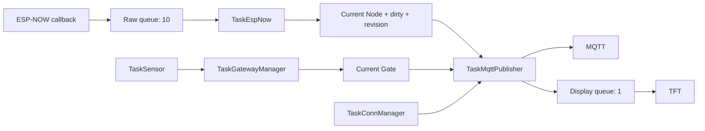
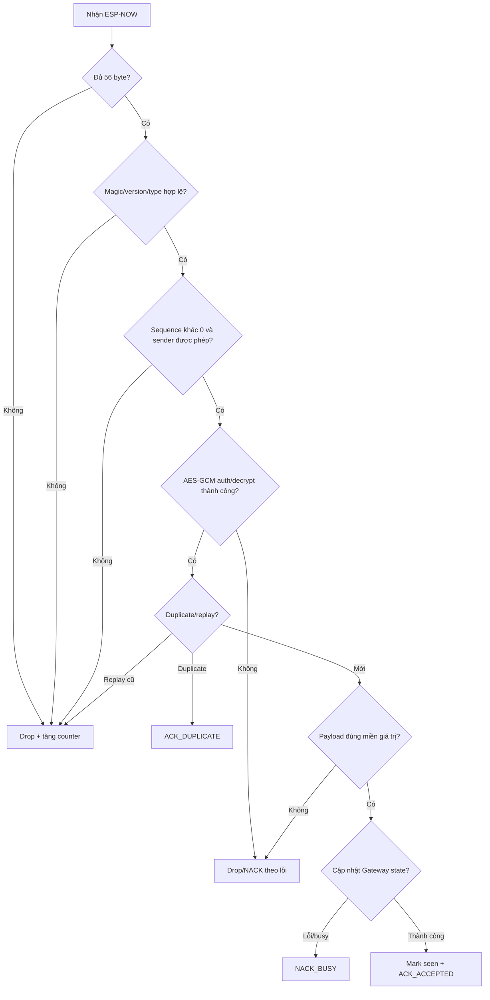
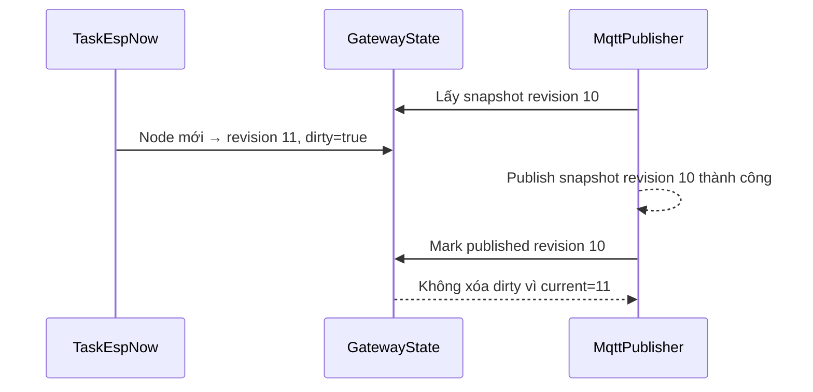
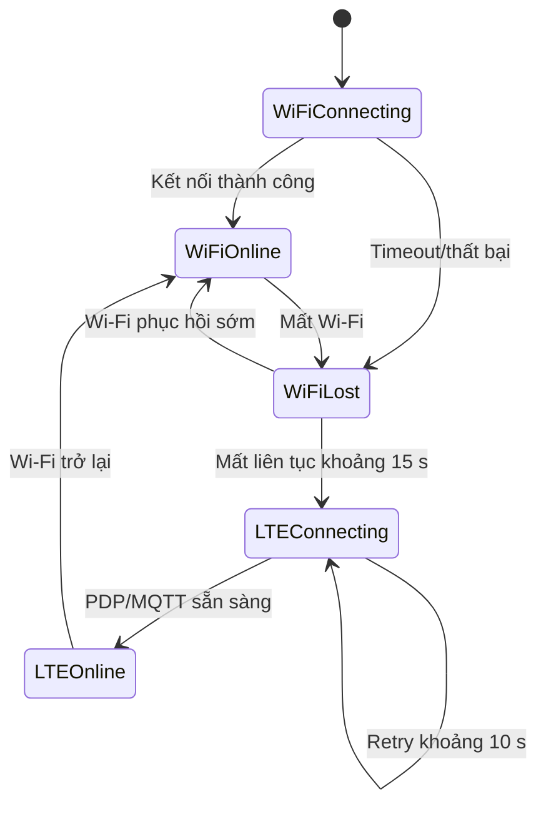
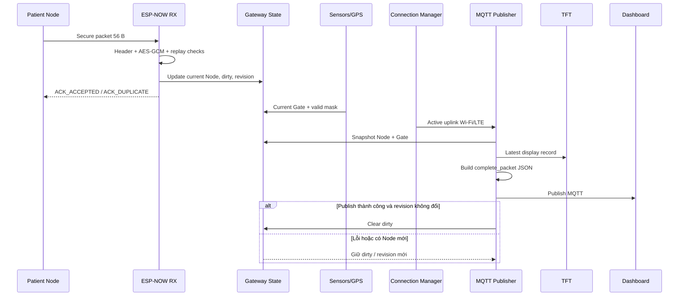

# Xây dựng Gateway

[Trang chủ tài liệu](../README.md)

> Tài liệu mô tả firmware đang có tại `Final_Project_NCKH/Gateway`. Thông tin mạng, khóa bảo mật và credential thật không được ghi vào tài liệu công khai.

## Mục lục

- [1. Vai trò và ranh giới](#muc-1)
- [2. Phần cứng và thông số](#muc-2)
- [3. Kiến trúc task và queue](#muc-3)
- [4. Nhận, xác thực và phản hồi Node](#muc-4)
- [5. Latest-state, dirty và revision](#muc-5)
- [6. Sensor, GPS và TFT](#muc-6)
- [7. Wi-Fi, LTE và MQTT](#muc-7)
- [8. Luồng hoạt động tổng thể](#muc-8)
- [9. Giới hạn và nghiệm thu](#muc-9)

## 1. Vai trò và ranh giới

Gateway là cầu nối giữa ESP-NOW cục bộ và hệ thống MQTT/Dashboard. Nó nhận kết quả đã suy luận từ Patient Node, xác thực packet, ghép với dữ liệu môi trường/GPS, hiển thị trên TFT và publish một `complete_packet` qua Wi-Fi hoặc LTE.

Gateway thực hiện:

- nhận và xác thực packet AES-GCM từ Node;
- chống packet trùng/replay trong phạm vi trạng thái RAM;
- giữ trạng thái Node mới nhất bằng revision/dirty flag;
- đọc DHT22, BMP280, SGP30 và GPS;
- ưu tiên Wi-Fi, chuyển LTE khi Wi-Fi mất kéo dài;
- tạo JSON theo schema và publish MQTT;
- đưa snapshot gần nhất sang TFT.

Gateway **không** chạy lại AI, không nhận WAV, không lưu database lịch sử và hiện không có queue bền vững chứa mọi sự kiện khi mất mạng.

Project chính: [Final_Project_NCKH/Gateway](../../Final_Project_NCKH/Gateway/).

## 2. Phần cứng và thông số

### 2.1. Board và ngoại vi

| Khối | Cấu hình hiện tại | Vai trò |
|---|---|---|
| MCU | ESP32 `esp32dev`, Arduino, espressif32 6.10.0 | Điều phối Gateway |
| I2C | SDA21, SCL22 | BMP280 và SGP30 |
| DHT22 | GPIO25 | Nhiệt độ, độ ẩm |
| BMP280 | I2C `0x76` | Áp suất và nhiệt độ |
| SGP30 | I2C | eCO2 và TVOC |
| GPS NEO-M8N | RX32, TX33, 9600 baud | Vị trí/thời gian khi fix hợp lệ |
| A7680C | RX16, TX26, 115200 baud | Uplink LTE bằng AT command |
| TFT ST7735 | 128×160 | Hiển thị cục bộ |
| ESP-NOW | Channel 6 | Nhận secure packet từ Node |
| MQTT | Wi-Fi hoặc LTE | Gửi cùng JSON schema |

### 2.2. TFT và SPI

| Tín hiệu | GPIO/thông số |
|---|---:|
| MOSI | 23 |
| MISO | 19 |
| SCLK | 18 |
| CS | 15 |
| DC | 27 |
| RST | 4 |
| SPI clock | 27 MHz |

### 2.3. Chu kỳ và ngưỡng chính

| Thông số | Giá trị hiện tại |
|---|---:|
| Đọc sensor cơ bản | 1 giây |
| Chu kỳ DHT22 | 2 giây |
| Re-probe sensor lỗi | 5 giây |
| Warm-up SGP30 | 15 giây |
| Tuổi dữ liệu môi trường tối đa | 5 giây |
| Tuổi GPS fix tối đa | 10 giây |
| Wi-Fi connect timeout | 12 giây |
| Chờ mất Wi-Fi trước LTE | 15 giây |
| Wi-Fi retry | 5 giây |
| MQTT retry | 5 giây |
| LTE retry xấp xỉ | 10 giây |
| Đọc chất lượng sóng LTE | 15 giây |
| Publish Gateway định kỳ | 5 giây |
| Watchdog | 30 giây |
| Alert Asthma | class Asthma và score ≥ 0,80 |

`alert.active` của Gateway là luật cảnh báo riêng; nó không đồng nghĩa mọi kết quả Asthma từ Node đều bật alert.

### 2.4. MQTT và JSON

| Mục | Giá trị |
|---|---|
| Topic chính | `aiot/2026/gateway/data` |
| Topic thử nghiệm | `aiot/2026/test/gateway/data` |
| JSON document capacity | 4.096 byte |
| MQTT buffer | 4.352 byte |
| Payload | `complete_packet`, schema version 1 |

Các hằng topic khác trong Config có thể phục vụ mở rộng; task publisher hiện dùng luồng complete packet nêu trên.

## 3. Kiến trúc task và queue

### 3.1. Task FreeRTOS

| Task | Stack | Priority | Chu kỳ/chờ chính | Trách nhiệm |
|---|---:|---:|---:|---|
| `TaskEspNow` | 4.096 B | 4 | Queue wait 500 ms | Xác thực, decrypt, replay/duplicate, ACK |
| `TaskGatewayManager` | 4.096 B | 3 | 100 ms | Tổng hợp current Gate |
| `TaskSensor` | 4.096 B | 2 | 1.000 ms | DHT/BMP/SGP/GPS |
| `TaskDisplayTFT` | 8.192 B | 2 | Queue wait 1.000 ms | Render snapshot |
| `TaskConnManager` | 4.096 B | 1 | 100 ms | Wi-Fi/LTE failover |
| `TaskMqttPublisher` | 8.192 B | 1 | 50 ms | Snapshot, JSON, MQTT |

Stack là dung lượng cấu hình hiện tại, chưa phải kết luận tối ưu. Cần đo high-water mark khi bật đồng thời TFT, sensor, LTE và MQTT.

### 3.2. Queue và shared state

| Thành phần | Dung lượng/cơ chế | Ý nghĩa |
|---|---|---|
| Raw ESP-NOW queue | 10 phần tử | Tách callback radio khỏi xử lý nặng |
| Display queue | 1 phần tử, overwrite | TFT luôn ưu tiên view mới nhất |
| Gateway state | Mutex, timeout 20 ms | Bảo vệ current Node/Gate |
| Duplicate window | 16 sequence | Phát hiện packet đã thấy gần đây |
| Revision | Tăng khi Node state đổi | Tránh xóa dirty nhầm bản mới |

Callback ESP-NOW chỉ sao chép dữ liệu và metadata vào queue. AES-GCM, state update, JSON, MQTT và TFT không chạy trong callback radio.

## 4. Nhận, xác thực và phản hồi Node

### 4.1. Chuỗi kiểm tra packet

### 4.2. Ý nghĩa bảo mật và ACK

- AES-GCM bảo vệ tính bí mật và xác thực packet; không log key.
- Learning mode hiện hướng tới một Node đã xác thực, không phải registry nhiều bệnh nhân hoàn chỉnh.
- Duplicate nhận `ACK_DUPLICATE` để Node có thể dừng retry.
- Sequence cũ hơn highest accepted bị coi là replay.
- Duplicate/replay state nằm trong RAM và mất khi Gateway reboot.
- `ACK_ACCEPTED` chỉ xác nhận Gateway đã cập nhật state, **không** xác nhận MQTT/Dashboard đã nhận.

Packet Node hiện có secure envelope 56 byte và payload 16 byte. Node/Gateway phải dùng cùng protocol layout, key và device identity; chỉ bằng nhau về `sizeof` là chưa đủ.

## 5. Latest-state, dirty và revision

Gateway duy trì `current_node`, `current_gate`, `node_dirty` và `node_revision` trong RAM.

Cơ chế revision tránh race làm mất sự kiện mới. Tuy nhiên đây vẫn là **latest-state**, không phải event log:

- khi mất mạng lâu, event mới có thể thay event cũ;
- không có FIFO bền vững trên flash;
- reboot làm mất current state, dirty và anti-replay state;
- publish lỗi giữ dirty, nhưng lần sau dựng JSON từ snapshot mới nhất chứ không giữ nguyên JSON lịch sử.

### 5.1. Cache sinh hiệu gần nhất

Gateway giữ SpO2 hợp lệ gần nhất:

- SpO2 trong miền 1-100 cập nhật cache;
- SpO2 bằng 0/ngoài miền không xóa cache;
- `vitals_valid=false` của MONITOR vẫn được giữ đúng nghĩa “phiên này không đo”;
- JSON/UI có thể hiển thị số cũ nhưng phải phân biệt với dữ liệu của phiên hiện tại.

HR không được cache hoàn toàn giống SpO2 trong Gateway JSON; Dashboard có cơ chế giữ HR gần nhất riêng. Không nên gộp hai hành vi thành một mô tả chung.

## 6. Sensor, GPS và TFT

### 6.1. Điều kiện hợp lệ

| Dữ liệu | Điều kiện hiện tại |
|---|---|
| DHT nhiệt độ | -40 đến 80 °C |
| DHT độ ẩm | 0 đến 100% |
| BMP áp suất | 300 đến 1.100 hPa |
| SGP30 | Chỉ valid sau warm-up 15 giây |
| GPS | Fix hợp lệ và tuổi không quá 10 giây |
| Environment snapshot | Tuổi không quá 5 giây |

Dữ liệu thiếu/quá tuổi được biểu diễn bằng valid mask và `null` trong JSON, không thay bằng 0 giả. eCO2 của SGP30 là giá trị CO2 tương đương, không phải cảm biến CO2 trực tiếp.

### 6.2. Chu kỳ đọc và phục hồi

- `TaskSensor` chạy khoảng mỗi 1 giây;
- DHT chỉ đọc mỗi 2 giây để phù hợp đặc tính cảm biến;
- BMP/SGP được thử trong vòng sensor, phần cứng lỗi được re-probe khoảng 5 giây;
- GPS parser cập nhật liên tục nhưng chỉ công bố fix còn mới;
- TFT chờ display queue tối đa 1 giây, sau đó có thể lấy snapshot hiện tại.

### 6.3. Sensor mode

| Mode | Ý nghĩa |
|---:|---|
| 0 | Sensor absent |
| 1 | Sensor thật, mặc định |
| 2 | Synthetic data cho kiểm thử |

Khi báo cáo kết quả phần cứng phải ghi rõ mode, tránh nhầm dữ liệu synthetic với phép đo thật.

## 7. Wi-Fi, LTE và MQTT

### 7.1. Failover mạng

Wi-Fi là uplink ưu tiên. Khi Wi-Fi trở lại, Gateway ngắt MQTT/LTE tương ứng rồi quay về Wi-Fi. Trạng thái uplink và trạng thái MQTT là hai trạng thái khác nhau: có IP không có nghĩa broker đang connected.

ESP-NOW và Wi-Fi STA dùng chung radio. AP phải nằm trên channel tương thích với channel 6 đang dùng; AP tự đổi channel có thể làm MQTT vẫn tốt nhưng Node không còn liên lạc ESP-NOW.

### 7.2. Publisher

Publisher chạy vòng khoảng 50 ms nhưng chỉ publish khi:

- có Node state dirty; hoặc
- đến chu kỳ telemetry Gateway khoảng 5 giây.

Luồng publish:

1. kiểm tra uplink và kết nối/reconnect MQTT;
2. lấy snapshot Node/Gate dưới mutex;
3. loại dữ liệu môi trường đã quá tuổi;
4. gắn patient event nếu `node_dirty`;
5. dựng `complete_packet` và alert;
6. đẩy snapshot hiển thị sang TFT;
7. serialize JSON và publish;
8. nếu thành công, chỉ clear dirty khi revision vẫn trùng.

Thành công của `publish()` không phải ACK từ Dashboard. A7680C có khả năng AT/SMS nhưng source hiện chưa chứng minh một chính sách SMS tự động hoàn chỉnh cho mọi cảnh báo; không ghi nhận như tính năng đã nghiệm thu nếu chưa kiểm thử riêng.

## 8. Luồng hoạt động tổng thể

Trình tự trên cho thấy ba mức xác nhận khác nhau:

1. callback ESP-NOW nhận frame vật lý;
2. ACK ứng dụng xác nhận Gateway chấp nhận Node state;
3. MQTT publish báo kết quả gửi đến broker theo client, không phải người dùng đã nhìn thấy Dashboard.

## 9. Giới hạn và nghiệm thu

### 9.1. Giới hạn cần ghi rõ

- Gateway giữ latest-state trong RAM, không phải message broker hay database lịch sử.
- Anti-replay và learned Node state mất sau reboot.
- Brownout detector hiện bị tắt trong `main.cpp`; vẫn phải cấp nguồn LTE đúng chuẩn.
- `battery_node=255` là chưa đo, không phải 255%.
- GPS uptime/timestamp nội bộ không tự động là UTC.
- Các secret hiện diện trong cấu hình cục bộ phải chuyển sang file không commit/biến môi trường trước khi công khai repository.
- Stack cấu hình lớn không chứng minh còn đủ RAM; phải đo thực tế.

### 9.2. Ca nghiệm thu tối thiểu

1. packet đúng, sai tag AES-GCM, sai magic/version/type;
2. duplicate packet và replay sequence cũ;
3. raw queue đầy và state mutex bận;
4. Wi-Fi hoạt động, mất dưới 15 giây, mất trên 15 giây và LTE failover;
5. Wi-Fi quay lại sau LTE;
6. MQTT mất broker rồi reconnect, dirty state vẫn còn;
7. event mới đến trong lúc publish event cũ;
8. sensor absent, stale, synthetic và re-probe;
9. GPS mất fix/quá 10 giây;
10. MONITOR packet không làm mất nghĩa của sinh hiệu gần nhất;
11. TFT, sensor và LTE chạy đồng thời không kích watchdog;
12. đo stack high-water mark, heap và nguồn modem.

Xem thêm [giao thức bảo mật](04_Giao_Thuc_Bao_Mat.md), [luồng Gateway](../05_Luong_Hoat_Dong/02_Gateway.md), [luồng Dashboard](../05_Luong_Hoat_Dong/03_Dashboard.md) và [checklist nghiệm thu](../06_Nghiem_Thu/01_Tai_Lap_Va_Chot_V1.md).
