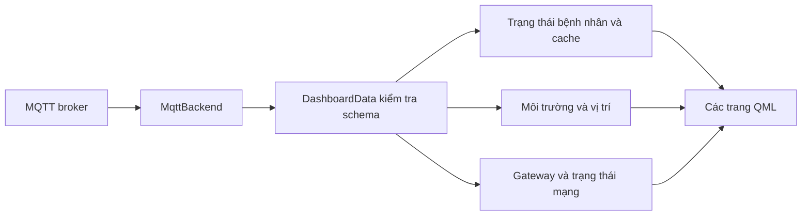

# Xây dựng Dashboard Qt6

[Trang chủ tài liệu](../README.md)

## Mục lục

- [1. Mục tiêu](#muc-1)
- [2. Công nghệ và cấu trúc](#muc-2)
- [3. Luồng dữ liệu và UI](#muc-3)
- [4. Cấu hình kết nối và khởi chạy](#muc-4)
- [5. Ý nghĩa các trang](#muc-5)
- [6. Giữ sinh hiệu gần nhất đúng nghĩa](#muc-6)
- [7. Chống trùng, lịch sử và thời gian](#muc-7)
- [8. Các tình huống cần kiểm tra](#muc-8)

## 1. Mục tiêu

Dashboard nhận JSON của Gateway qua MQTT và trình bày trạng thái bệnh nhân, kết quả AI, sinh hiệu, môi trường, vị trí và mạng. Ứng dụng không tự chạy model và không sửa kết quả phân loại tại Node.

Source nằm ở [Dashboard_Qt6](../../Final_Project_NCKH/Dashboard_Qt6/). Đây là ứng dụng Qt Quick/QML với backend C++, không phải trang web và chưa phải một hệ quản trị hồ sơ bệnh án.

## 2. Công nghệ và cấu trúc

CMake hiện yêu cầu CMake 3.16 trở lên, C++17 và **Qt 6.11** với Qml, Quick, QuickControls2, Mqtt, Network, Location, Positioning. Cần bộ Qt cài đủ QtMqtt và module bản đồ; chỉ có Qt Widgets là chưa đủ.

| Vị trí | Vai trò |
|---|---|
| `app/main.cpp` | Khởi tạo ứng dụng, backend và QML |
| `app/MqttBackend.*` | Đọc cấu hình, kết nối broker, subscribe, nhận message, reconnect |
| `app/DashboardData.*` | Kiểm tra schema, ánh xạ dữ liệu, cache sinh hiệu, lịch sử ngắn |
| `ui/Main.qml` | Bố cục tổng, điều hướng, liên kết các trang |
| `ui/Theme.qml` | Màu sắc, phong cách dùng chung |
| `ui/components/` | Thẻ số đo, trạng thái, sidebar, sparkline, các phần tử tái sử dụng |
| `ui/pages/` | Overview, Patient, PatientProfile, Environment, Location, GatewayNetwork |
| `config/mqtt_config.example.json` | Mẫu cấu hình kết nối |
| `CMakeLists.txt`, `ui/CMakeLists.txt` | Khai báo executable, module QML và copy cấu hình |

## 3. Luồng dữ liệu và UI

Backend không đẩy JSON tùy ý vào text trên UI. `DashboardData` kiểm tra `schema_version`, `message_type`, đối tượng Gateway và cờ có patient event; chỉ sau đó mới cập nhật các property. Điều này giúp phân biệt gói Gate định kỳ với một lần CHECK/MONITOR mới.

Nguồn nghiệp vụ chính: [DashboardData.cpp](../../Final_Project_NCKH/Dashboard_Qt6/app/DashboardData.cpp).

## 4. Cấu hình kết nối và khởi chạy

CMake ưu tiên `config/mqtt_config.json`; nếu không có, dùng file example và copy thành `mqtt_config.json` ở thư mục build. Có thể dùng biến môi trường `NCKH_MQTT_HOST`, `NCKH_MQTT_PORT`, `NCKH_MQTT_USERNAME`, `NCKH_MQTT_PASSWORD`, `NCKH_MQTT_TOPIC` để ghi đè các trường tương ứng mà không lưu secret vào source.

Quy trình trên Qt Creator:

1. Mở `CMakeLists.txt` của Dashboard_Qt6.
2. Chọn kit Qt phù hợp compiler, có đủ module đang yêu cầu.
3. Kiểm tra cấu hình broker và topic trùng Gateway.
4. Configure/build bằng kit đó, rồi chạy executable.
5. Kiểm tra trạng thái transport, subscribe và thời gian message cuối trước khi đánh giá số liệu.

Backend có cả nhánh kết nối TLS và không TLS theo setting. Không tự kết luận đường truyền đang mã hóa chỉ vì thư viện hỗ trợ TLS. Kiểm tra cấu hình triển khai và chứng chỉ thực tế. Timer reconnect hiện khoảng 5 giây, subscribe QoS 0.

Không đưa mật khẩu broker thật vào tài liệu. Cấu hình build cũ có thể còn bản copy JSON cũ: kiểm tra cả thư mục source lẫn cạnh executable khi đổi broker.

## 5. Ý nghĩa các trang

| Trang | Nội dung | Điều cần phân biệt |
|---|---|---|
| Overview | Tình trạng tổng hợp, AI, sinh hiệu, kết nối | Trạng thái kết nối khác chất lượng audio |
| Patient | Classification, score, quality, sự kiện, HR/SpO2 | Score có ý nghĩa theo class; không luôn là p_non |
| PatientProfile | Thông tin hồ sơ minh họa | Hiện lấy từ object trong QML, không phải hồ sơ nhận từ sensor |
| Environment | Nhiệt độ, độ ẩm, áp suất, chỉ số khí | Invalid/null khác giá trị đo bằng 0 |
| Location | Vị trí GPS và bản đồ | Giữ vị trí hợp lệ cuối; không dùng 0,0 như fix mới |
| GatewayNetwork | Tình trạng Gateway, transport, Wi-Fi/LTE | MQTT online không đồng nghĩa Node vừa gửi thành công |

`patientProfile` trong `ui/Main.qml` là dữ liệu demo. Không trình bày tên/tuổi/bệnh sử demo như thông tin do Node đo được. Nếu mở rộng lưu hồ sơ thật cần thiết kế lưu trữ, quyền truy cập và bảo vệ dữ liệu riêng.

## 6. Giữ sinh hiệu gần nhất đúng nghĩa

Sau CHECK hợp lệ, HR/SpO2 được cache. MONITOR không đo sinh hiệu nên không được làm mất số đo vừa có. Dashboard cập nhật độc lập giá trị mới hợp lệ và giữ cache khi nhận 0/null/không hợp lệ.

Hai trạng thái cần đọc riêng:

- `eventVitalsValid`: sự kiện đang xem có sinh hiệu hợp lệ hay không.
- `vitalsValid` tổng hợp: UI còn đủ hai giá trị hợp lệ trong cache hay không.

Vì vậy UI có thể hiển thị HR/SpO2 cũ bên cạnh kết quả MONITOR mới. Điều đó không có nghĩa MONITOR vừa đo PPG. Khi báo cáo cần kèm thời điểm/nguồn số đo để tránh diễn giải nhầm.

Cache hiện ở RAM. Sau khởi động lại Dashboard, HR cũ có thể chưa có nếu chỉ nhận các sự kiện MONITOR; Gateway chủ yếu cache SpO2. Không coi cơ chế này là lịch sử sinh hiệu được lưu bền vững.

## 7. Chống trùng, lịch sử và thời gian

Event ID giúp nhận biết gói gửi lại. Cơ chế hiện so với event cuối, không phải tập ID bền vững vô hạn. Lịch sử HR chỉ thêm khi là sự kiện mới, sinh hiệu của sự kiện hợp lệ và HR đầu vào hợp lệ; giữ tối đa 14 điểm.

Thời gian nhận trên máy chạy Dashboard là đồng hồ máy. Uptime Node/Gateway là thời gian từ boot, không phải timestamp lịch. GPS epoch chỉ có nghĩa khi nguồn time hợp lệ. Không trộn các loại này để tính độ trễ end-to-end nếu chưa đồng bộ.

Gói định kỳ không có patient event cập nhật Gate nhưng giữ phần bệnh nhân. Đây là hành vi mong muốn, không phải lỗi UI không refresh.

## 8. Các tình huống cần kiểm tra

- Gói CHECK có HR/SpO2, tiếp theo MONITOR thiếu sinh hiệu: giữ số cũ và giữ đúng cờ của sự kiện.
- Gói thiếu sensor: UI thể hiện không có dữ liệu, không dựng số đo giả.
- Reconnect broker: không nhân đôi history khi nhận lại cùng event ID.
- JSON sai schema hoặc thiếu đối tượng bắt buộc: không làm crash ứng dụng.
- GPS mất fix: vị trí cuối không bị biến thành 0,0; cần nhận biết dữ liệu cũ.
- Broker nhận message nhưng UI im lặng: kiểm tra topic, schema và log parse trước khi nghi model.

Chi tiết trình tự: [luồng Dashboard](../05_Luong_Hoat_Dong/03_Dashboard.md).

