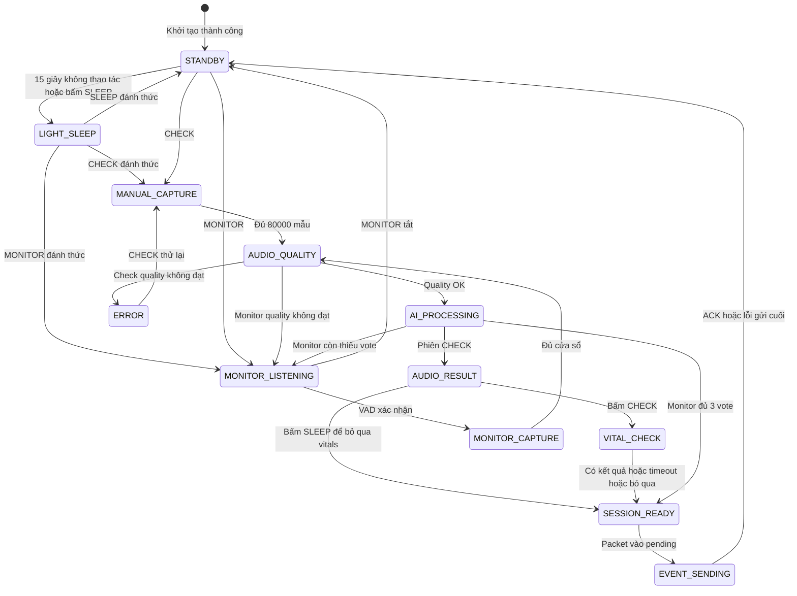
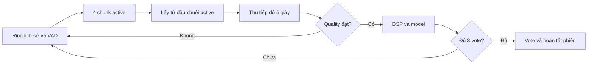

# Luồng hoạt động của Patient Node

[Trang chủ tài liệu](../README.md)

## Mục lục

- [1. Phạm vi](#muc-1)
- [2. Bản đồ trạng thái](#muc-2)
- [3. Phiên CHECK](#muc-3)
- [4. Phiên MONITOR và onset](#muc-4)
- [5. Luật vote và score](#muc-5)
- [6. Từ kết quả đến packet và ACK](#muc-6)
- [7. Nút nhấn và ngoại lệ](#muc-7)

## 1. Phạm vi

Tài liệu này mô tả hành vi hiện có trong [State_Machine.cpp](../../Final_Project_NCKH/Patient_Node/src/State_Machine.cpp), [main.cpp](../../Final_Project_NCKH/Patient_Node/src/main.cpp) và các module Audio/Network. Nó khác tài liệu xây dựng ở chỗ tập trung vào “bấm nút nào, state nào chạy, dữ liệu nào được giữ”.

Node có hai kiểu phiên chính: CHECK do người dùng chủ động và MONITOR thu đủ 3 cửa sổ hợp lệ rồi vote. MONITOR hiện không tự lặp phiên mới sau khi gửi xong.

## 2. Bản đồ trạng thái

Sơ đồ lược bỏ một số nhánh hủy/lỗi để dễ đọc. Bấm SLEEP trong khi đang thu có thể hủy phiên; ở SESSION_READY/EVENT_SENDING hệ thống không hủy payload đã hoàn tất theo cùng cách.

## 3. Phiên CHECK

### Bước 1 - Bắt đầu và thu

Ở STANDBY, bấm CHECK tạo session mới, bật MAX30102 sang SpO2, reset dữ liệu cũ và thu
80.000 mẫu PCM16. Với 16 kHz, đây là cửa sổ 5 s. CHECK không đợi VAD như MONITOR.

Nếu I2S lỗi hoặc bị người dùng hủy, không được coi buffer chưa đủ là một WAV hợp lệ. Ngưỡng quality kiểm tra trên raw PCM trước khi peak normalization có thể làm tín hiệu yếu nhìn thành lớn.

### Bước 2 - Quality và inference

Quality không đạt đưa CHECK vào ERROR với nguyên nhân tương ứng. Quality đạt mới chạy DSP → Mel → normalize theo Train → lượng tử INT8 → Invoke → giải lượng tử.

Kết quả có 3 trạng thái hiển thị, nhưng model vẫn là nhị phân:

- Asthma-like khi p_non thấp.
- Non-Asthma khi p_non cao.
- Unsure trong khoảng giữa.

Ngưỡng classification của Node hiện là LOW/HIGH `0,47/0,77`, đã freeze trên Validation cho C4. Đây là policy vận hành của nguyên mẫu, không phải chứng minh độ tin cậy lâm sàng.

### Bước 3 - Tùy chọn sinh hiệu

Sau inference, Node ở AUDIO_RESULT và hiển thị kết quả. Người dùng chọn:

| Thao tác | Hành vi |
|---|---|
| Bấm CHECK | Chuyển VITAL_CHECK, bắt đầu PPG mới |
| Bấm SLEEP | Bỏ qua sinh hiệu, giữ kết quả audio, chuẩn bị gửi |
| Chưa bấm | Ở màn kết quả; không tự giả lập số đo |

MAX30102 chỉ được cấu hình/xác minh khi boot rồi trở về shutdown. Cảm biến được bật từ
đầu CHECK để ổn định trong lúc thu và suy luận; phiên đo thực tế vẫn reset FIFO/buffer tại
`VITAL_CHECK`. Kết thúc/hủy/lỗi CHECK đều tắt LED và ngắt dữ liệu của cảm biến.

### Bước 4 - Đọc PPG có deadline

Node kiểm tra deadline chung 10 s; gọi poll để đọc FIFO và xem có ngón tay hay không. Một cửa sổ mới cần đủ dữ liệu của chính phiên đó. Khi có kết quả, chỉ đánh dấu valid nếu cả HR và SpO2 hợp lệ.

| Tình huống | Payload sau xử lý |
|---|---|
| HR và SpO2 hợp lệ trước deadline | valid=1 và số đo |
| Không có ngón tay đến timeout | valid=0, HR=0, SpO2=0 |
| Không có mẫu mới/FIFO timeout | valid=0, HR=0, SpO2=0 |
| Thuật toán đã trả kết quả nhưng invalid | valid=0, HR=0, SpO2=0 |
| Người dùng bỏ qua | valid=0, HR=0, SpO2=0 |

Deadline không thể chữa mọi kiểu driver I2C treo cứng ở tầng thấp; phải kiểm tra hardware/I2C riêng. Trong luồng polling bình thường, thiếu tay không được chặn vô thời hạn.

## 4. Phiên MONITOR và onset

Khi bật MONITOR, firmware warm-up I2S, nạp ring lịch sử và vào LISTENING. Mỗi chunk có 256 mẫu, tương đương 16 ms. Bốn chunk liên tiếp vượt ngưỡng hoạt động tạo xác nhận sau khoảng 64 ms.

Ring cho phép truy ngược về chunk đầu của chuỗi xác nhận. Firmware copy phần audio từ điểm đó rồi nhận tiếp để đủ tổng 80.000 mẫu. Không phải bỏ hẳn 1 s đầu và cũng không phải bắt buộc nối 1 s lịch sử với 4 s mới.

Trong lúc DSP, inference hoặc delay hiển thị, Node không có task VAD liên tục riêng. Vì vậy 3 cửa sổ của MONITOR không phải một bản ghi 15 s liền mạch. Ring được chuẩn bị lại cho lần thu kế tiếp.

## 5. Luật vote và score

Mỗi kết quả vượt quality đóng góp một vote Asthma, Non-Asthma hoặc Unsure. Cửa sổ bị reject không tăng số vòng. Hệ thống vẫn đợi đủ 3 vote, không dừng sớm ngay khi có 2 vote giống nhau.

Ví dụ dùng score đã ánh xạ theo class:

| Ba kết quả | Kết quả phiên | Score phiên |
|---|---|---|
| A 0.90, A 0.80, N 0.70 | Asthma | (0.90+0.80)/2 = 0.85 |
| N 0.95, A 0.60, N 0.85 | Non-Asthma | (0.95+0.85)/2 = 0.90 |
| U 0.50, U 0.55, A 0.80 | Unsure | (0.50+0.55)/2 = 0.525 |
| A, N, U | Unsure do hòa | 0 |

A/N/U lần lượt là Asthma/Non-Asthma/Unsure. Không lấy trung bình cả 3 lần nếu chỉ 2 lần thuộc class thắng. Score Unsure không nên diễn giải như xác suất lâm sàng của một bệnh thứ ba.

MONITOR không đo vitals và không gửi lại sinh hiệu Node của CHECK cũ như số đo mới. Việc giữ số đo gần nhất thuộc Gateway/Dashboard và vẫn phải nhận diện đó là cache.

## 6. Từ kết quả đến packet và ACK

SESSION_READY dựng payload một lần. Main cố đưa payload vào hàng pending bảo mật; thành công mới chuyển EVENT_SENDING. Trong lúc chờ, bộ gửi xử lý callback radio, ACK ứng dụng và retry.

ACK accepted hoặc duplicate kết thúc thành công. Lỗi cuối cũng kết thúc phiên và trở lại STANDBY, nhưng cần log/hiển thị thất bại. Không được báo “đã lên Dashboard” chỉ từ ACK Node.

Nếu ESP-NOW chưa khởi tạo hoặc không thể queue packet, Node có thể tiếp tục ở SESSION_READY. Trường hợp này cần nằm trong bài kiểm tra phục hồi, không được nhầm với vòng retry đã kết thúc.

## 7. Nút nhấn và ngoại lệ

ISR chỉ đặt bit sự kiện; xử lý chính chạy ở vòng lặp. MONITOR có cơ chế chờ nhả nút để tránh một lần bấm bị hiểu là bật rồi tắt ngay.

SLEEP là thao tác theo ngữ cảnh:

- Ở AUDIO_RESULT hoặc VITAL_CHECK: bỏ vitals, giữ audio để gửi.
- Ở SESSION_READY/EVENT_SENDING: không hủy tùy tiện packet đã hoàn tất.
- Ở STANDBY: yêu cầu Light Sleep sau khi nhả nút; không dùng Deep Sleep.
- Ở các state đang thu: có thể hủy phiên và quay lại chờ.

STANDBY cũng tự Light Sleep sau 15 giây không thao tác. OLED, MAX30102, I2S và radio
được dừng trước khi ngủ; RAM/PSRAM và model được giữ. Cả ba nút đều đánh thức Node:

| Nút wake | Hành vi |
|---|---|
| CHECK | Khôi phục ngoại vi, bật MAX30102 và bắt đầu CHECK |
| MONITOR | Khôi phục ngoại vi, giữ MAX30102 tắt và bắt đầu MONITOR |
| SLEEP | Khôi phục ngoại vi và ở lại STANDBY |

Những việc chưa nên tuyên bố đã hoàn tất: phát hiện mọi tình huống tháo mic khi đang chạy và tổng timeout cho toàn bộ chu kỳ MONITOR đợi tín hiệu. Classification, Quality Gate và VAD đã có cấu hình `FROZEN`, nhưng vẫn phải phân biệt kết quả calibration/offline với kiểm chứng vận hành phần cứng. Xem [nghiệm thu cuối](../06_Nghiem_Thu/01_Tai_Lap_Va_Chot_V1.md).

