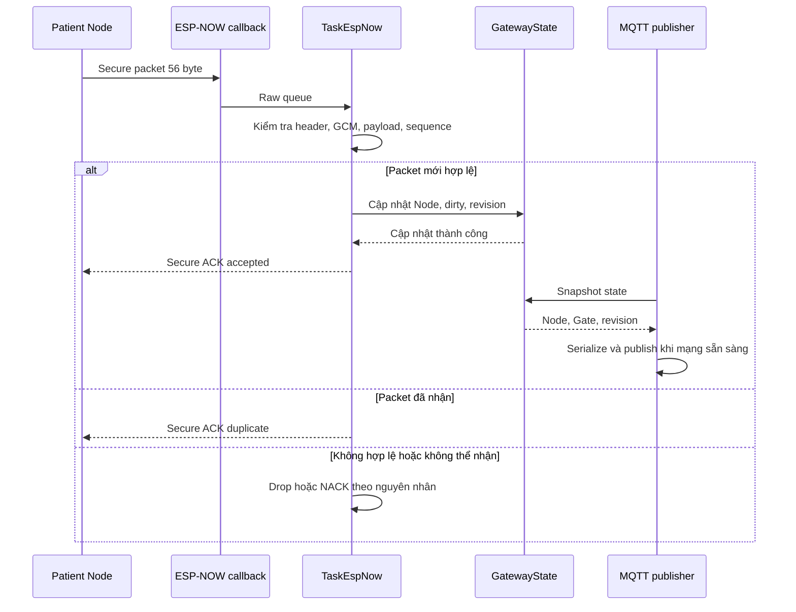
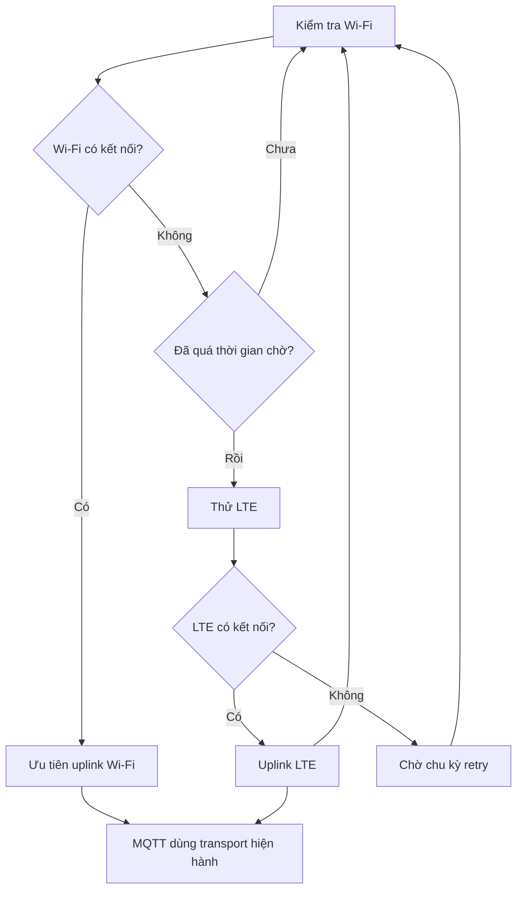

# Luồng hoạt động của Gateway

[Trang chủ tài liệu](../README.md)

## Mục lục

- [1. Khởi động và các luồng song song](#muc-1)
- [2. Một sự kiện Node đến Gateway](#muc-2)
- [3. Phân biệt lỗi nhận](#muc-3)
- [4. Đồng thời đọc môi trường](#muc-4)
- [5. Lựa chọn uplink](#muc-5)
- [6. Khi nào publish?](#muc-6)
- [7. Một số tình huống thực tế](#muc-7)
- [8. Theo dõi và giới hạn](#muc-8)

## 1. Khởi động và các luồng song song

Gateway khởi tạo TFT, watchdog, queue, state và ESP-NOW trước khi tạo task nhận, sensor, quản lý state, mạng, MQTT và hiển thị. Các task chạy độc lập có đồng bộ dữ liệu qua queue/mutex, không phải một hàm tuần tự đọc sensor xong mới chờ Node.

Nguồn chính: [main.cpp](../../Final_Project_NCKH/Gateway/src/main.cpp), [task_espnow.cpp](../../Final_Project_NCKH/Gateway/src/task/task_espnow.cpp), [task_mqtt_publisher.cpp](../../Final_Project_NCKH/Gateway/src/task/task_mqtt_publisher.cpp).

## 2. Một sự kiện Node đến Gateway

Đường ACK không chờ MQTT. Nhờ vậy độ trễ mạng Internet không kéo dài trực tiếp phiên Node; đổi lại ACK không có nghĩa đã lưu bền vững trên server.

## 3. Phân biệt lỗi nhận

| Tình huống | Ý nghĩa |
|---|---|
| Callback nhận được bytes | Radio có dữ liệu, chưa xác thực |
| Queue đầy | Task chưa nhận được packet để xử lý |
| Sai size/magic/version/type | Không đúng hợp đồng wire |
| Sai GCM tag | Không xác thực được; không dùng plaintext |
| Payload ngoài miền cho phép | Không cập nhật state |
| Duplicate | Đã nhận cùng packet; trả duplicate ACK |
| Sequence cũ | Khả năng replay/out-of-order theo chính sách hiện tại |
| Không khóa/cập nhật được state | Có thể trả busy để Node retry |
| Accepted | Đã nhận và cập nhật current Node trong RAM |

Không tăng bộ đếm thành công chỉ từ callback RX. Khi debug cần xem `rx`, `accepted`, `duplicate`, `replay`, `raw_dropped`, `state_busy` để xác định tầng lỗi.

## 4. Đồng thời đọc môi trường

TaskSensor đọc cảm biến theo chu kỳ và lưu timestamp/tình trạng từng nhóm. TaskGatewayManager kết hợp sensor với trạng thái mạng để cập nhật current Gate. Trước khi serialize, publisher còn lấy snapshot mới để kiểm tra tuổi dữ liệu.

| Dữ liệu | Xử lý khi thiếu/hết hạn |
|---|---|
| DHT/BMP/SGP | Xóa valid tương ứng và xuất null cho số đo không dùng được |
| GPS chưa fix hoặc quá cũ | Không xuất như tọa độ hợp lệ mới |
| Mạng | Ghi active uplink và trạng thái kết nối hiện có |
| Sinh hiệu của MONITOR | Không biến thành phép đo mới; SpO2 có thể lấy cache riêng |

Giữ giá trị cũ để hiển thị và xác nhận giá trị đó còn mới là hai việc khác nhau. Đặc biệt, không dùng GPS cũ để kết luận vị trí hiện tại nếu mất fix lâu.

## 5. Lựa chọn uplink

Kết nối IP và kết nối MQTT là hai điều kiện khác nhau. Có LTE registration hoặc Wi-Fi connected chưa chắc broker đã nhận subscribe/publish. Thông tin kết nối hiện tại cần được đọc cùng log MQTT.

## 6. Khi nào publish?

Publisher cần có uplink/MQTT hoạt động và current Gate hợp lệ. Nó gửi khi:

1. Có Node event mới còn dirty; hoặc
2. Đến chu kỳ telemetry Gate; hoặc
3. Vừa reconnect và cần gửi snapshot hiện hành.

Nếu dirty, record chứa patient event và event ID. Nếu không dirty, record chỉ cập nhật Gate; current Node vẫn được giữ trong RAM cho việc hiển thị nhưng không gắn thành “sự kiện mới” mỗi chu kỳ.

Sau publish thành công, chỉ mark published đúng revision. Nếu có sự kiện mới tới giữa chừng, dirty của sự kiện mới được giữ. Publish lỗi giữ state và lần tiếp theo tạo record từ snapshot mới nhất, không giữ nguyên một hàng đợi JSON lịch sử.

## 7. Một số tình huống thực tế

### CHECK rồi MONITOR

CHECK hợp lệ cập nhật HR/SpO2. MONITOR kế tiếp có `vitals_valid=false`; Gateway giữ SpO2 hợp lệ trước đó, nhưng JSON HR có thể là null. Dashboard tự giữ HR cuối và không coi MONITOR vừa có phép đo PPG.

### Node retry do ACK bị mất

Gateway đã nhận packet nhưng ACK bị mất trên radio. Packet gửi lại được nhận dạng duplicate và trả ACK duplicate. Dashboard không nên cộng thêm một lần đo HR chỉ vì uplink gửi lặp cùng event.

### Mất mạng trong nhiều phiên

Node vẫn có thể nhận ACK từ Gateway, trong khi Gateway chưa publish. Current Node tiếp tục bị cập nhật theo sự kiện mới. Không bảo đảm các phiên trung gian tồn tại sau khi có mạng trở lại.

### Gateway khởi động lại

State, cache SpO2 và danh sách chống trùng trong RAM bị mất. Lần đầu sau boot phải đánh giá lại sensor và mạng; không được mặc định còn sinh hiệu cũ.

## 8. Theo dõi và giới hạn

Các chỉ số nên lưu: thời điểm RX/accepted, thời điểm ACK, revision, event ID, record ID, transport, kết quả publish, queue drop, heap và reset reason. Muốn đo độ trễ toàn hệ thống phải có cách đồng bộ đồng hồ hoặc một điểm thu log chung.

Không có bằng chứng về việc Dashboard xác nhận đã đọc cảnh báo trong ACK Node hiện tại. Không có hàng đợi flash của mọi sự kiện. Hai giới hạn này cần ghi trong báo cáo để tách “truyền trạng thái gần nhất” khỏi “hệ thống lưu hồ sơ không mất bản ghi”.

