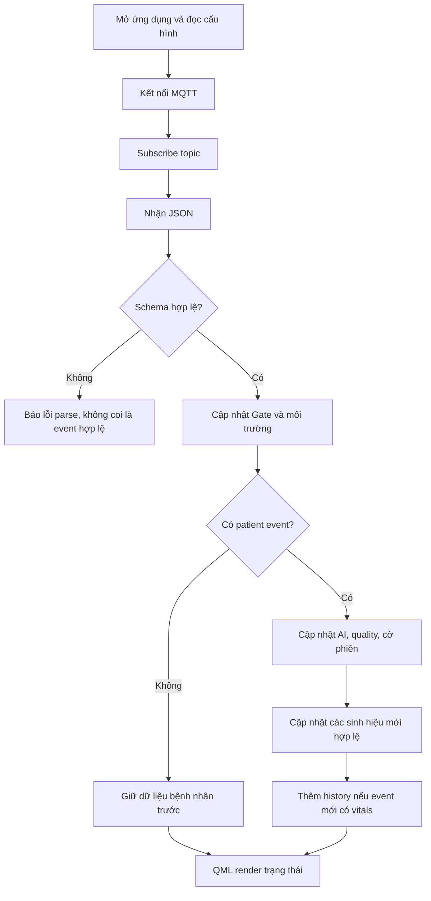

# Luồng hoạt động của Dashboard

[Trang chủ tài liệu](../README.md)

## Mục lục

- [1. Kết nối và nhận bản tin](#muc-1)
- [2. Hợp lệ về cấu trúc trước khi hợp lệ về số đo](#muc-2)
- [3. Ví dụ CHECK → MONITOR → telemetry](#muc-3)
- [4. Cache và tính độc lập từng chỉ số](#muc-4)
- [5. Lịch sử và chống lặp](#muc-5)
- [6. Vị trí, sensor và thời gian](#muc-6)
- [7. Kiểm tra nhanh khi UI không đổi](#muc-7)

## 1. Kết nối và nhận bản tin

Dashboard đọc cấu hình broker, tạo MQTT client và kết nối. Sau connected, nó subscribe topic đã cấu hình. Khi nhận payload, backend chuyển sang `DashboardData::applyCompletePacketJson()`.

Đọc [MqttBackend.cpp](../../Final_Project_NCKH/Dashboard_Qt6/app/MqttBackend.cpp) và [DashboardData.cpp](../../Final_Project_NCKH/Dashboard_Qt6/app/DashboardData.cpp) khi cần đối chiếu chính xác.

Khi mất kết nối, timer thử lại khoảng 5 giây. Đây là reconnect transport, không phải nạp lại toàn bộ lịch sử từ database.

## 2. Hợp lệ về cấu trúc trước khi hợp lệ về số đo

Dashboard yêu cầu JSON object đúng `schema_version=1` và `message_type="complete_packet"`, có Gate và cờ `has_patient_event` đúng kiểu. Khi cờ true phải có patient/source và event ID.

Sau đó mới kiểm tra sensor valid mask và giá trị. Một JSON parse được vẫn có thể chứa dữ liệu sensor không hợp lệ. Không dùng giá trị mặc định 0 để che việc thiếu field.

Nhánh cập nhật còn phụ thuộc loại message; packet Node 56 byte không phải dữ liệu đầu vào trực tiếp của Dashboard. Gửi hex ESP-NOW lên topic không làm UI hiểu được.

## 3. Ví dụ CHECK → MONITOR → telemetry

| Bản tin | Dữ liệu mới | Kết quả UI mong đợi |
|---|---|---|
| CHECK valid | Asthma/Non-Asthma/Unsure + HR/SpO2 | Cập nhật AI, quality, sinh hiệu và history hợp lệ |
| MONITOR | AI từ 3 vote, valid=false, HR null | Cập nhật AI; giữ HR/SpO2 hợp lệ gần nhất |
| Gate telemetry | Môi trường/mạng; không patient event | Cập nhật Gate, không xóa bệnh nhân |
| Retry cùng event ID | Có thể lặp JSON bệnh nhân | Không cộng thêm điểm HR như một lần đo mới |
| CHECK timeout | AI mới nhưng sinh hiệu không hợp lệ | Giữ số cũ nếu có; cờ phiên vẫn false |

Điều này giải quyết tình huống “đo CHECK xong rồi MONITOR làm mất vitals”. Nó không làm phép đo cũ trở thành số đo của MONITOR. Khi trình bày demo, cần nói rõ phép đo nào được cập nhật lúc nào.

## 4. Cache và tính độc lập từng chỉ số

Dashboard chỉ cập nhật HR khi nhận giá trị nguyên dương trong miền kiểu dữ liệu; cập nhật SpO2 khi nguyên trong 1–100. Cửa kiểm tra kiểu/miền tại UI không phải ngưỡng hợp lệ lâm sàng.

Cache từng chỉ số độc lập. Nếu một bên có giá trị mới và bên kia không, UI có thể đang hiển thị hai giá trị khác thời điểm. Cờ `eventVitalsValid` mô tả phiên, trong khi cờ availability mô tả dữ liệu đang có để render.

Sau khi restart, cache RAM mất. Không thể đảm bảo HR cũ trở lại ngay nếu Gateway chỉ gửi MONITOR với HR=null. Muốn khôi phục xuyên restart cần cơ chế lưu trữ hoặc snapshot đầy đủ bổ sung.

## 5. Lịch sử và chống lặp

`hrHistory` có tối đa 14 điểm. Một điểm được thêm khi đồng thời:

1. Event ID khác event vừa xử lý.
2. Sự kiện có vitals valid.
3. HR đầu vào hợp lệ.

Đây là biểu đồ ngắn trên giao diện, không phải kho lưu mọi phiên. Cơ chế so ID cuối cũng không phải giải pháp chống trùng tổng quát khi bản tin bị đảo thứ tự nhiều lần.

Hồ sơ bệnh nhân trong QML là phần demo tĩnh, không được cập nhật từ packet sensor. Dữ liệu hồ sơ, dữ liệu phiên và trạng thái transport nên được hiểu là ba lớp riêng.

## 6. Vị trí, sensor và thời gian

GPS hợp lệ cập nhật vị trí cuối. Khi chưa có fix hoặc dữ liệu mới invalid, không dựng vị trí 0,0. UI cần được đọc cùng cờ hợp lệ và thời điểm dữ liệu, không chỉ nhìn marker còn hiện.

Các nhóm sensor lấy theo mask; giá trị không hợp lệ hiển thị trạng thái thiếu dữ liệu. Uptime được format như uptime, epoch có thể đổi sang giờ địa phương. `lastMessageTime` là giờ máy nhận message, không phải lúc audio bắt đầu trên Node.

Mất MQTT có thể khiến UI vẫn hiện dữ liệu cuối. Đó là trạng thái cũ còn được giữ, không chứng minh hệ thống đang đo liên tục.

## 7. Kiểm tra nhanh khi UI không đổi

| Triệu chứng | Kiểm tra trước |
|---|---|
| Chưa có message nào | Host, port, TLS, credential, topic và subscribe |
| Broker có JSON nhưng UI không nhận | Topic chính/test, schema version, message type |
| AI đổi nhưng HR không đổi | MONITOR có đo PPG không; vitals_valid và HR=null |
| HR về trống sau restart | Cache RAM đã mất; chưa có CHECK valid mới |
| Môi trường null | Sensor valid mask và tuổi dữ liệu Gateway |
| Vị trí không đổi | GPS fix/tuổi dữ liệu; có đang giữ vị trí cuối không |
| History bị thiếu vài sự kiện | Chỉ event có HR valid mới thêm; không phải log mọi message |

Luồng end-to-end và phân biệt các mức ACK được mô tả ở [tài liệu tổng thể](04_Toan_He_Thong.md).

