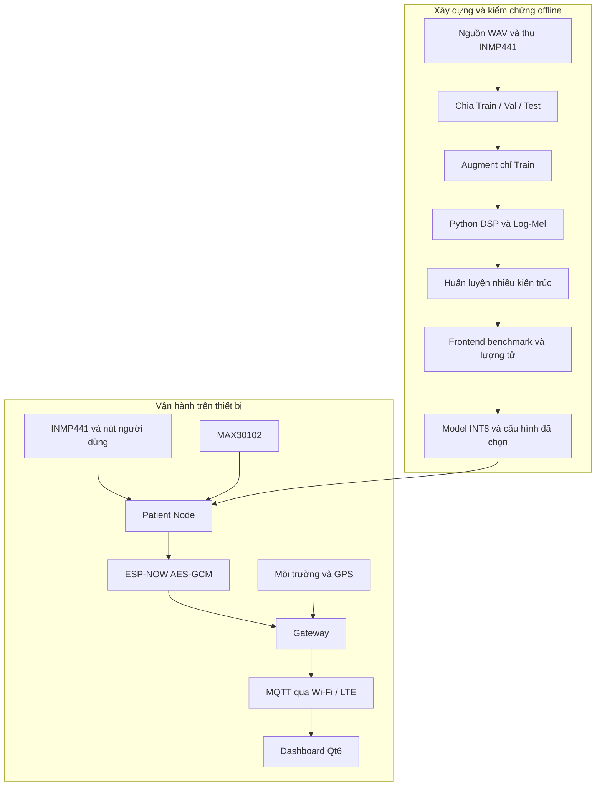
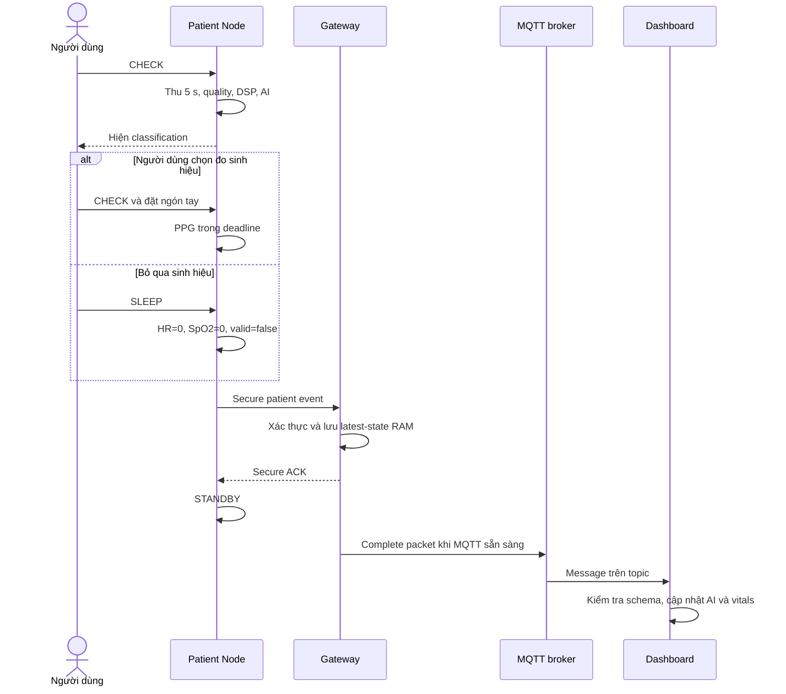

# Cách hoạt động tổng thể của dự án

[Trang chủ tài liệu](../README.md)

## Mục lục

- [1. Hai nửa của hệ thống](#muc-1)
- [1.1. Ba trường hợp sử dụng](#muc-1-1)
- [2. Từ dữ liệu đến model triển khai](#muc-2)
- [3. Một phiên CHECK hoàn chỉnh](#muc-3)
- [4. Một phiên MONITOR hoàn chỉnh](#muc-4)
- [5. Bốn loại trạng thái “thành công”](#muc-5)
- [6. Mất kết nối và dữ liệu cũ](#muc-6)
- [7. Các quyết định chưa được đồng nhất tự động](#muc-7)
- [8. Tiêu chí kết thúc dự án ở phạm vi nguyên mẫu](#muc-8)

## 1. Hai nửa của hệ thống

Dự án có một luồng offline tạo model và một luồng online dùng model. Phải tách hai phần để tránh hiểu “Gateway nhận dữ liệu rồi train lại” hoặc “Dashboard suy luận từ WAV”.

Model cuối hiện chọn C4 `combo_pre0_mel40_fft2048__V1__s44 / QAT_INT8`. Dataset V2, architecture V1, frontend C4 và phiên bản nghiệm thu Node V1 là các khái niệm khác nhau. Mục tiêu vận hành là hỗ trợ theo dõi nguyên mẫu; không thay thế chẩn đoán hoặc một hệ thống cấp cứu đã được chứng nhận.

## 1.1. Ba trường hợp sử dụng

Patient Node luôn thu dữ liệu bệnh nhân và chạy TinyML tại edge. Ba trường hợp
khác nhau ở vị trí của Gateway và đường uplink; raw audio không được chuyển tới
Gateway trong luồng vận hành bình thường.

| Trường hợp | Bố trí | Luồng chính | Giới hạn hiện hành |
|---|---|---|---|
| Theo dõi tại nhà | Patient Node ở gần người dùng; Gateway cố định trong vùng ESP-NOW | Node → AES-GCM/ESP-NOW → Gateway → Wi-Fi → MQTT → Dashboard | Gateway và Internet mất kết nối không làm dừng TinyML cục bộ, nhưng làm gián đoạn cập nhật từ xa |
| Mang Patient Node độc lập | Node đi cùng người dùng; Gateway ở ngoài vùng phủ hoặc không khả dụng | CHECK/MONITOR → Quality Gate → TinyML → OLED; Node thử gửi theo timeout/retry | Không có dữ liệu môi trường hay Dashboard thời gian thực; chưa có hàng đợi bền vững để đồng bộ lại mọi phiên |
| Mang cả Node và Gateway | Hai thiết bị ở gần nhau; Gateway dùng LTE và có thể dùng GPS | Node → ESP-NOW → Gateway → LTE → MQTT → Dashboard | LTE/GPS tiêu thụ năng lượng cao; chỉ nên bật subsystem cần thiết |

Trong cả ba trường hợp, Patient Node vẫn tạo kết quả cục bộ. ACK chỉ xác nhận
Gateway đã tiếp nhận sự kiện; nó không tự chứng minh MQTT hoặc Dashboard đã cập
nhật. Chi tiết CHECK/MONITOR nằm trong [luồng Patient Node](01_Node.md), còn giới
hạn kết nối và cache nằm trong [luồng Gateway](02_Gateway.md).

## 2. Từ dữ liệu đến model triển khai

| Giai đoạn | Input | Output | Điều phải giữ |
|---|---|---|---|
| Thu/chọn nguồn | WAV raw, playback, environment | WAV và metadata | Nguồn gốc, session, patient/source ID |
| Chia dữ liệu | Nguồn đã xác định | Tập Train/Val/Test | Không rò source/session qua split |
| Preprocess | Cửa sổ 5 s | C4 Log-Mel 40×129, FFT2048, không pre-emphasis | Cùng DSP và quy tắc crop |
| Train | Mel và nhãn | Checkpoint Keras | Normalize theo Train, seed, builder |
| Quantize | Checkpoint + representative Train | TFLite | Scale/zero point, shape, phương pháp |
| Hardware test | Header model và bộ test cố định | Log sai số/timing/RAM | Đúng model hash, tensor reference |
| Runtime | PCM thật và sensor | Patient event | Quality, threshold, vote và transport |

Log-Mel đã chuẩn hóa phải khớp giữa Python và C++. WAV PCM16 không được đưa trực tiếp vào tensor INT8 của model vì tensor cần đặc trưng Mel, không phải mẫu âm thanh.

## 3. Một phiên CHECK hoàn chỉnh

Nếu không có tay hoặc FIFO không có dữ liệu đúng hạn, Node vẫn hoàn tất bằng sinh hiệu invalid/0. Dashboard không được hiểu 0 là số đo sinh lý thực.

## 4. Một phiên MONITOR hoàn chỉnh

1. Người dùng bật MONITOR.
2. Node warm-up, giữ ring và chờ VAD.
3. Xác nhận chuỗi chunk, lấy onset và thu đủ 5 s.
4. Quality đạt thì chạy AI và thêm một vote; quality không đạt thì thu lại.
5. Lặp đến đủ 3 vote, chọn đa số và trung bình score của class thắng.
6. Không đo PPG trong phiên này.
7. Gửi packet, xử lý ACK/retry, về STANDBY.
8. Dashboard cập nhật kết quả MONITOR, giữ số đo sinh hiệu cũ nếu chưa có số mới.

Ba vote không đồng nghĩa ba mẫu độc lập về mặt thống kê: có thể cùng môi trường, cùng nguồn âm và cùng thiết bị. Vote giúp ổn định quyết định vận hành nhưng không tự tạo bằng chứng accuracy cao hơn trên bệnh nhân độc lập.

## 5. Bốn loại trạng thái “thành công”

| Mức | Có thể kết luận | Chưa thể kết luận |
|---|---|---|
| Quality PASS | Cửa sổ vượt tiêu chí chất lượng kỹ thuật hiện dùng | Có tiếng bệnh lý hoặc model đúng |
| Inference hoàn tất | Model nhận tensor và trả output | Kết quả chẩn đoán chắc chắn |
| Gateway ACK | Gateway xác thực và chấp nhận sự kiện | Broker/UI đã nhận hoặc dữ liệu đã lưu bền vững |
| MQTT/UI cập nhật | Đường uplink và giao diện xử lý được bản tin | Người dùng đã đọc/can thiệp |

Cần log từng mức riêng. Đừng dùng dòng “send success” của callback radio để báo toàn hệ thống đã hoàn thành.

## 6. Mất kết nối và dữ liệu cũ

| Sự cố | Hành vi/giới hạn hiện tại |
|---|---|
| Mic lỗi lúc boot | Node dừng READY và yêu cầu kiểm tra mic |
| Mic tháo sau READY | Không bảo đảm phát hiện mọi trường hợp; không hot-plug |
| Không có tay | Timeout hoặc kết quả invalid, vitals=0 |
| Gateway không phản hồi | Node retry; lỗi cuối về STANDBY |
| ESP-NOW chưa init | Payload có thể giữ ở SESSION_READY |
| Wi-Fi mất | Gateway thử LTE sau khoảng chờ |
| Wi-Fi và LTE đều mất | Latest-state RAM giữ trạng thái mới nhất, không giữ mọi phiên |
| Dashboard mất MQTT | Giữ dữ liệu cũ và trạng thái mất kết nối |
| Gateway/Dashboard reboot | Cache RAM tương ứng mất |

Bảng này mô tả khả năng source, không phải kết quả test đã chạy trong lần viết tài liệu.

## 7. Các quyết định chưa được đồng nhất tự động

Đổi model header không tự đổi các cấu hình dưới đây:

- Min/max Train và quy tắc dựng Mel.
- LOW/HIGH của classification, cách xử lý Unsure.
- Ngưỡng quality trên PCM thật.
- VAD và cách chốt onset/cửa sổ.
- Ngưỡng alert phía Gateway.
- Arena, operator resolver, latency và mức RAM thực dùng.

Node và 3_Model_Complete hiện dùng LOW/HIGH 0,47/0,77 theo threshold C4 đã freeze; Gateway alert dùng score >=0,80 đối với Asthma. Đây là hai tầng policy khác nhau: LOW/HIGH tạo class/UNSURE tại Node, còn alert quyết định mức cảnh báo sau khi đã nhận class Asthma.

## 8. Tiêu chí kết thúc dự án ở phạm vi nguyên mẫu

Có thể đóng gói bản bàn giao khi:

1. Artifact model và cấu hình deployment truy vết được bằng hash.
2. Preprocess Python/C++ được so trên cùng PCM, không chỉ WAV phát lại qua loa.
3. Static/live/Node được đo lại sau thay model.
4. Quality/VAD/threshold/vote có dữ liệu kiểm chứng và cấu hình cuối.
5. CHECK/MONITOR/PPG timeout/ACK/retry/cache vitals được thử end-to-end.
6. Có mô tả trung thực về dữ liệu đã dùng để chọn mô hình, domain shift và các giới hạn offline/bảo mật.
7. Lưu log, commit/config phần cứng để người khác tái lập.

Các phần Gateway/Dashboard/Frontend đã hoàn thành chức năng vẫn cần thử tích hợp lại với Node cuối. Hoàn thành từng module không tự bảo đảm hợp đồng dữ liệu giữa các module không thay đổi.

