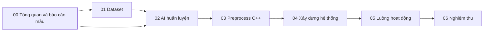

# Tài liệu trung tâm của dự án

Bộ tài liệu này giải thích cách xây dựng, huấn luyện và vận hành hệ thống Edge AI & IoT hỗ trợ theo dõi âm thanh liên quan hen suyễn. Nội dung AI hiện hành được đồng bộ theo artifact C4 trong repository ngày **07/11/2026**. Đây là tài liệu kỹ thuật cho nguyên mẫu nghiên cứu; kết quả phân loại âm thanh không thay thế chẩn đoán.

## Đọc theo nhu cầu

| Nhu cầu | Bắt đầu tại |
|---|---|
| Hiểu đề tài, phạm vi và kết quả hiện có | [Tóm tắt đề tài](00_Tong_Quan/01_Tom_Tat_De_Tai.md) |
| Đọc bài báo tham chiếu trong `link_baocao_mau.txt` | [Báo cáo mẫu và cách đối chiếu](00_Tong_Quan/02_Bao_Cao_Mau_Va_Doi_Chieu.md) |
| Thu và tổ chức dữ liệu | [Nguồn và quy trình thu](01_Dataset/01_Nguon_Va_Quy_Trinh_Thu.md) |
| Hiểu chia tập, playback, augmentation | [Chia tập và truy vết](01_Dataset/02_Chia_Tap_Tang_Cuong_Truy_Vet.md) |
| Học từ neuron, activation đến optimizer | [Nền tảng mạng neuron](02_AI_Huan_Luyen/01_Nen_Tang_Mang_Neuron.md) |
| So sánh các kiến trúc Phase 2 | [Kiến trúc V1–V6](02_AI_Huan_Luyen/02_Kien_Truc_Phase2.md) |
| Hiểu các hàm preprocessing và training Python | [Pipeline Python và huấn luyện](02_AI_Huan_Luyen/03_Pipeline_Python_Va_Huan_Luyen.md) |
| Tra hợp đồng model AI đang deploy | [Hồ sơ C4 V1 s44 QAT INT8](README_AI_C4_Current.md) |
| Đọc pipeline F0 cũ để đối chiếu lịch sử | [Hồ sơ F0 lịch sử](README_AI_Training_Model_F0_Historical.md) |
| Hiểu Frontend A–F, PTQ/QAT và model bàn giao | [Benchmark, lượng tử và deployment](02_AI_Huan_Luyen/04_Benchmark_Luong_Tu_Deployment.md) |
| Xây dựng preprocessing trên ESP32-S3 | [Bộ tài liệu preprocessing C++](03_Preprocess_CPP/README.md) |
| Tra danh sách mô-đun, chân kết nối và vai trò phần cứng | [Danh sách mô-đun phần cứng](../ESP32_Pinout/Danh_sach_Module.md) |
| Xây firmware Node | [Patient Node](04_Xay_Dung_He_Thong/01_Patient_Node.md) |
| Xây firmware Gateway | [Gateway](04_Xay_Dung_He_Thong/02_Gateway.md) |
| Xây ứng dụng hiển thị | [Dashboard Qt6](04_Xay_Dung_He_Thong/03_Dashboard_Qt6.md) |
| Hiểu packet và bảo mật | [Hợp đồng giao tiếp](04_Xay_Dung_He_Thong/04_Giao_Thuc_Bao_Mat.md) |
| Theo dõi từng state của Node | [Luồng Node](05_Luong_Hoat_Dong/01_Node.md) |
| Theo dõi nhận gói và publish | [Luồng Gateway](05_Luong_Hoat_Dong/02_Gateway.md) |
| Hiểu cập nhật và giữ dữ liệu UI | [Luồng Dashboard](05_Luong_Hoat_Dong/03_Dashboard.md) |
| Theo dõi một phiên xuyên suốt hệ thống | [Luồng toàn hệ thống](05_Luong_Hoat_Dong/04_Toan_He_Thong.md) |
| Nghiệm thu sau khi thay model | [Tái lập và chốt V1](06_Nghiem_Thu/01_Tai_Lap_Va_Chot_V1.md) |

## Quan hệ giữa các nhóm

Nhóm 04 giải thích cách chia module và triển khai. Nhóm 05 giải thích trình tự hoạt động khi người dùng bấm nút, khi có sự kiện và khi mất kết nối. Nhóm 03 là tài liệu chuyên sâu, nên đọc tuần tự nếu cần sửa DSP/Mel.

## Quy ước đọc và cập nhật

- **Hiện hành:** giá trị hoặc hành vi đọc được từ code/artifact hiện tại.
- **Đã đo:** phải có báo cáo, log hoặc manifest đi kèm; cấu hình trong source chưa phải kết quả nghiệm thu.
- **Đề xuất kiểm chứng:** cách thực hiện trong lần nghiệm thu tiếp theo.
- `V1` trong tên kiến trúc, `Dataset_Chia_V2` và `FINAL V1` của Node là ba loại phiên bản khác nhau.
- `combo_pre0_mel40_fft2048__V1__s44` là ID trial C4 đầy đủ. Giữ nguyên hai dấu gạch dưới trước kiến trúc khi dùng đường dẫn hoặc lệnh.
- Khi tài liệu lịch sử và source khác nhau, kiểm tra source đang build cùng hash model trước khi kết luận.

Model được chọn hiện nay: **C4 `combo_pre0_mel40_fft2048__V1__s44` / QAT_INT8**. Pipeline bắt buộc là 40 Mel, FFT 2048, hop 625 và không pre-emphasis. Threshold ba trạng thái đã freeze ở `LOW=0,47`, `HIGH=0,77`; Quality Gate, VAD và kiểm chứng phần cứng vẫn có hồ sơ nghiệm thu riêng.

Tài liệu cũ trong [Docs_Member](../Docs_Member/) và [Docs_NCKH](../Docs_NCKH/) vẫn là nguồn lịch sử. Bộ `Docs/` bổ sung cách giải thích thống nhất, không tự đánh dấu các checklist cũ là hoàn thành.

