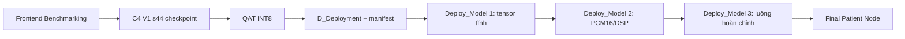

# Hồ sơ AI hiện hành - C4 V1 s44 QAT INT8

> Đây là điểm tham chiếu chính cho mọi tài liệu AI hiện hành trong `Docs/`.
> Hồ sơ F0 được giữ riêng tại
> [README_AI_Training_Model_F0_Historical.md](README_AI_Training_Model_F0_Historical.md)
> để truy vết lịch sử, không dùng làm hợp đồng deployment cuối.

## 1. Định danh model

| Thuộc tính | Giá trị |
|---|---|
| Trial đầy đủ | `combo_pre0_mel40_fft2048__V1__s44` |
| Tên ngắn | `C4 V1 s44` |
| Kiến trúc | V1 - SeparableConv2D + Flatten |
| Seed | `44` |
| Dataset | `Dataset_Chia_V2` |
| Lượng tử | QAT Full INT8 |
| Số tham số FP32 | 331.386 |
| Kích thước TFLite | 347.968 byte |
| SHA-256 TFLite | `d081c1cfcd873c4e2182f9d9e0f8aff07a69ea0b041cf0d6d845d3222efc46b9` |
| SHA-256 header | `bb26264a77ef0c382e3b127fb3b3345a563e42d5a610796a67738a2b197851d1` |

Nguồn chuẩn:

- [README model cuối](../Final_Project_NCKH/AI_Model/README.md)
- [Deployment manifest](../Final_Project_NCKH/AI_Model/C4_V1_s44_QAT_INT8/deployment_manifest.json)
- [Training metadata](../Final_Project_NCKH/AI_Model/C4_V1_s44_QAT_INT8/training_metadata.json)
- [Validation metrics](../Final_Project_NCKH/AI_Model/C4_V1_s44_QAT_INT8/val_metrics.json)
- [Test metrics](../Final_Project_NCKH/AI_Model/C4_V1_s44_QAT_INT8/test_metrics.json)

## 2. Hợp đồng preprocessing C4

```text
PCM16 mono, 16 kHz, đúng 5 giây = 80.000 mẫu
  -> peak normalization
  -> Butterworth band-pass 100-2000 Hz, prototype order 5
  -> KHÔNG pre-emphasis (coefficient = 0)
  -> STFT: n_fft=2048, hop_length=625, periodic Hann, center=True
  -> 40 Mel Slaney trong dải 100-2000 Hz, power=2
  -> power_to_db(ref=max, amin=1e-10, top_db=80)
  -> tensor Log-Mel 40 x 129
  -> min-max theo Train: [-80, 0] -> float32 [0, 1]
  -> lượng tử affine INT8 theo scale/zero-point runtime
```

| Tensor | Shape | Dtype | Scale | Zero point |
|---|---|---|---:|---:|
| Input | `[1,40,129,1]` | `int8` | `0.003921568859368563` | `-128` |
| Output | `[1,1]` | `int8` | `0.00390625` | `-128` |

Output sau giải lượng tử là `p_non_asthma`. Model chỉ có một output nhị phân;
`UNSURE` là policy hậu xử lý, không phải lớp thứ ba được huấn luyện.

## 3. Kết quả phần mềm

Các chỉ số dưới đây dùng ngưỡng nhị phân `0,5`, nhằm đánh giá model trước policy
ba trạng thái của Patient Node.

| Split | n | Accuracy | Asthma recall | Asthma F1 | Macro F1 | Confusion matrix |
|---|---:|---:|---:|---:|---:|---|
| Validation | 154 | 97,40% | 97,37% | 94,87% | 96,57% | `[[37,1],[3,113]]` |
| Test | 159 | 95,60% | 92,11% | 90,91% | 94,00% | `[[35,3],[4,117]]` |

Thứ tự ma trận là hàng thật/cột dự đoán `[Asthma, Non-Asthma]`. Test đã được
truy cập trong nghiên cứu lựa chọn model, vì vậy không trình bày nó như một
external cohort hoàn toàn chưa từng quan sát.

## 4. Policy phân loại đã freeze

Nguồn: [final_threshold.json](../Experiments_Benchmarking/Patient_Node/Final_V1_Validation/01_Classification_Threshold/results/combo_pre0_mel40_fft2048__V1__s44_QAT_INT8/final_threshold.json).

| Điều kiện | Kết quả |
|---|---|
| `p_non_asthma <= 0,47` | Asthma |
| `0,47 < p_non_asthma < 0,77` | Unsure |
| `p_non_asthma >= 0,77` | Non-Asthma |

Ở miền output INT8, hai biên inclusive tương ứng raw `-8` và `70`. Khi sửa
threshold phải cập nhật cả luật float, luật raw INT8, test và tài liệu.

## 5. Chuỗi bàn giao



Không xác nhận model chỉ bằng tên `Asthma_Model.h`. Trước phép đo cần đối chiếu
SHA-256, shape, dtype, scale/zero-point và frontend config trong manifest.

Ba cấu hình ngưỡng Final V1 hiện đã freeze độc lập:

- [Classification LOW/HIGH](../Experiments_Benchmarking/Patient_Node/Final_V1_Validation/01_Classification_Threshold/results/combo_pre0_mel40_fft2048__V1__s44_QAT_INT8/final_threshold.json): `0,47 / 0,77`.
- [Quality Gate](../Experiments_Benchmarking/Patient_Node/Final_V1_Validation/02_Quality_Check/results/final_quality_gate.json): RMS20, active ratio1%, clipping ratio1%, block-MAV20.
- [VAD trigger](../Experiments_Benchmarking/Patient_Node/Final_V1_Validation/03_VAD_Trigger/results/final_vad_trigger.json): MAV75, 4 chunk liên tiếp, chunk256 mẫu.

## 6. Quy tắc cập nhật tài liệu

- Nội dung nói về pipeline **đang dùng** phải theo C4 trong tài liệu này.
- Nội dung mô tả F0, Mel64, FFT1024, pre-emphasis 0,97 hoặc PTQ F0 phải gắn
  nhãn lịch sử/đối chứng.
- Không thay số liệu F0 bằng số C4 trong một báo cáo lịch sử; thay vào đó dẫn
  sang hồ sơ hiện hành.
- Khi model cuối thay đổi, cập nhật manifest và hồ sơ này trước, sau đó mới
  đồng bộ các tài liệu dẫn xuất.

