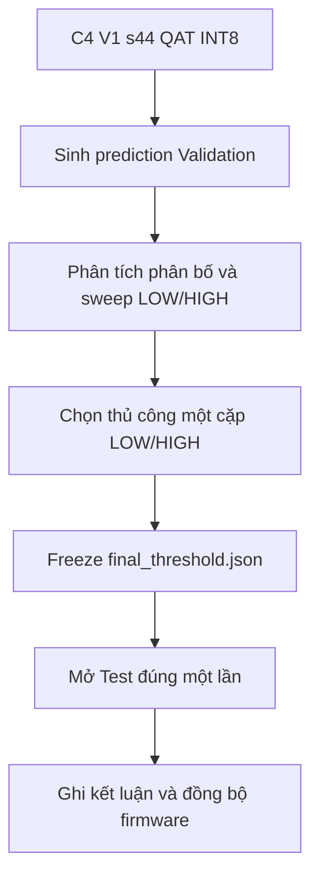

# 01 - Classification Threshold

Mục này nghiệm thu hai ngưỡng hậu xử lý cho model cuối của Patient Node:

```text
combo_pre0_mel40_fft2048__V1__s44
└── QAT Full INT8
    └── output = p_non_asthma
```

Luật quyết định:

```text
p_non_asthma <= LOW       -> ASTHMA
LOW < p_non_asthma < HIGH -> UNSURE
p_non_asthma >= HIGH      -> NON_ASTHMA
```

`UNSURE` là trạng thái hậu xử lý, không phải lớp thứ ba của mạng neuron.

## 1. Baseline đã khóa

| Thành phần | Giá trị |
|---|---|
| Trial | `combo_pre0_mel40_fft2048__V1__s44` |
| Kiến trúc | V1 SepConv2D + Flatten |
| Lượng tử | QAT Full INT8 |
| Model | `Frontend_Benchmarking/artifacts/D_Quantization/combo_pre0_mel40_fft2048__V1__s44/methods/QAT_INT8/QAT_INT8.tflite` |
| Model SHA-256 | `d081c1cfcd873c4e2182f9d9e0f8aff07a69ea0b041cf0d6d845d3222efc46b9` |
| Frontend | Band-pass 100-2000 Hz, order 5, pre-emphasis 0, FFT 2048, 40 Mel, hop 625 |
| Input | INT8, `[1, 40, 129, 1]` |
| Normalization | Min-max theo Train, `TRAIN_MIN=-80`, `TRAIN_MAX=0` |
| Nhãn | `0=Asthma`, `1=Non-Asthma` |

Script đọc tensor Log-Mel đã khóa tại:

```text
Experiments_Benchmarking/Patient_Node/Frontend_Benchmarking/artifacts/features/combo_pre0_mel40_fft2048/
```

Tensor này thuộc đúng config SHA-256 `5ae8a2c9...576f8` của C4.
Không cần preprocess WAV và không cần train lại model để nghiệm thu threshold.

`Generate_Predictions.py` kiểm tra cứng SHA-256. Nếu file TFLite bị thay bằng model
khác, script sẽ dừng thay vì sinh kết quả sai baseline.

## 2. Thành phần

| File | Nhiệm vụ |
|---|---|
| `Generate_Predictions.py` | Load tensor, normalize, quantize INT8, invoke C4 QAT INT8 và xuất `p_non_asthma`. |
| `threshold_utils.py` | Áp dụng LOW/HIGH, tính metric, sweep và export cấu hình đã freeze. |
| `Threshold_Selection.ipynb` | Phân tích Validation, chọn thủ công threshold và đánh giá Test sau khi freeze. |
| `Prepare_Playback_Calibration.py` | Chọn WAV đủ biên độ để kiểm tra lại bằng loa -> INMP441 sau nghiệm thu offline. |
| `results/combo_pre0_mel40_fft2048__V1__s44_QAT_INT8/` | Toàn bộ kết quả mới của model cuối. |
| `figures/combo_pre0_mel40_fft2048__V1__s44_QAT_INT8/` | Biểu đồ Validation của model cuối. |

Các CSV/JSON đang nằm trực tiếp trong `results/` là kết quả lịch sử của model cũ.
Chúng được giữ để truy vết và không được notebook mới sử dụng.

## 3. Nguyên tắc Validation/Test



- Chỉ dùng Validation để lựa chọn LOW/HIGH.
- Test chỉ dùng để đánh giá cấu hình đã khóa.
- Không quay lại thay threshold dựa trên kết quả Test.
- Mọi threshold của F0 cũ chỉ là kết quả lịch sử, không được mặc định áp dụng cho C4.

## 4. Chuẩn bị môi trường

Từ thư mục gốc repository:

```powershell
py -3.11 -c "import sys, numpy, pandas, tensorflow as tf; print(sys.executable); print(tf.__version__)"
```

Máy hiện tại cần dùng Python 3.11 vì đây là môi trường đã có TensorFlow. Khi mở
notebook, chọn cùng kernel Python 3.11.

Không chạy trực tiếp `threshold_utils.py`; đây chỉ là module được notebook import.

## 5. Thứ tự chạy đầy đủ

### Bước 1 - Sinh prediction Validation

Nếu terminal đang đứng tại **root repository** `NCKH_2026_AIOT`:

```powershell
py -3.11 "Experiments_Benchmarking/Patient_Node/Final_V1_Validation/01_Classification_Threshold/Generate_Predictions.py" --split val
```

Nếu terminal đang đứng tại `Experiments_Benchmarking/Patient_Node/Final_V1_Validation`
như terminal trong VS Code của dự án này:

```powershell
py -3.11 ".\01_Classification_Threshold\Generate_Predictions.py" --split val
```

Không ghép đường dẫn tính từ root repository vào lệnh thứ hai, nếu không Windows sẽ
lặp lại đoạn `Experiments_Benchmarking/.../Final_V1_Validation` hai lần.

Script thực hiện:

1. Đọc `X_val.npy`, `Y_val.npy`, `Files_val.npy` của frontend C4.
2. Đọc normalization và hợp đồng INT8 từ `conversion_metadata.json` của C4 QAT.
3. Xác minh SHA-256 của model.
4. Normalize Log-Mel về `[0,1]`.
5. Quantize bằng input scale/zero-point của TFLite.
6. Invoke model và dequantize output thành `p_non_asthma`.

Đầu ra:

```text
results/combo_pre0_mel40_fft2048__V1__s44_QAT_INT8/
├── validation_predictions.csv
└── validation_predictions_metadata.json
```

Mở metadata và kiểm tra tối thiểu:

```text
trial_id     = combo_pre0_mel40_fft2048__V1__s44
model        = combo_pre0_mel40_fft2048__V1__s44_QAT_INT8
model_sha256 = 68e412047a2bb60fcb090d2bdec190fd08fc2c800b6bddbeac431b414a7ef1ce
sample_count = 154
```

### Bước 2 - Chạy notebook đến hết phần Validation

Mở `Threshold_Selection.ipynb`, chọn Python 3.11 và chạy lần lượt:

| Mục | Công việc | Đầu ra |
|---|---|---|
| 0 | Setup đường dẫn và import module | Không |
| 1 | Load prediction Validation và kiểm tra model hash | Không |
| 2 | Phân bố `p_non_asthma` | `figures/combo_pre0_mel40_fft2048__V1__s44_QAT_INT8/validation_probability_distribution.png` |
| 3 | So sánh các candidate LOW/HIGH | `candidate_threshold_comparison.csv` |
| 4 | Sweep lưới threshold | `threshold_grid_sweep.csv` |
| 5 | Nhập LOW/HIGH và xem riêng mẫu WRONG/UNSURE | Chưa freeze |

Không bấm `Run All` ngay. Cell mục 5 đang cố ý để:

```python
FINAL_LOW = None
FINAL_HIGH = None
SELECTION_NOTE = ""
```

Sau khi xem kết quả Validation, tự điền một cặp threshold và lý do lựa chọn. Các
metric cần ưu tiên:

- `asthma_miss_rate`;
- `asthma_recall`, `asthma_precision`, `asthma_f1`;
- `non_asthma_false_alarm_rate`;
- `overall_unsure_rate`;
- `coverage` và `accepted_accuracy`.

Không chọn threshold chỉ bằng accuracy tổng.

### Bước 3 - Freeze threshold

Khi đã chốt trên Validation, chạy mục 6 của notebook. Đầu ra:

```text
results/combo_pre0_mel40_fft2048__V1__s44_QAT_INT8/
├── validation_predictions_final.csv
└── final_threshold.json
```

`final_threshold.json` phải có:

```text
status = FROZEN
selection_split = validation
test_used_for_selection = false
model_sha256 = SHA của C4 V1 s44 QAT INT8
```

### Bước 4 - Đánh giá Test

Cách khuyến nghị là chạy mục 7 trong notebook. Cell này tự sinh Test predictions
nếu chưa có, rồi áp dụng đúng threshold đã freeze.

Cũng có thể sinh prediction Test trước bằng terminal. Từ **root repository**:

```powershell
py -3.11 "Experiments_Benchmarking/Patient_Node/Final_V1_Validation/01_Classification_Threshold/Generate_Predictions.py" --split test
```

Hoặc nếu terminal đang đứng tại
`Experiments_Benchmarking/Patient_Node/Final_V1_Validation`:

```powershell
py -3.11 ".\01_Classification_Threshold\Generate_Predictions.py" --split test
```

Lệnh Test sẽ bị chặn nếu thiếu `final_threshold.json`, config chưa `FROZEN`, hoặc
model hash trong config không phải C4 hiện hành.

Đầu ra cuối:

```text
results/combo_pre0_mel40_fft2048__V1__s44_QAT_INT8/
├── test_predictions.csv
├── test_predictions_metadata.json
├── final_test_result.csv
├── final_test_metrics.csv
└── final_test_metrics.json
```

### Bước 5 - Ghi kết luận và đồng bộ Patient Node

Điền mục 8 trong notebook bằng số liệu mới. Sau đó mới đồng bộ:

```text
LOW  -> ASTHMA_MAX_THRESHOLD
HIGH -> NON_ASTHMA_MIN_THRESHOLD
```

Ngoài số thực, `final_threshold.json` còn chứa ngưỡng INT8 xấp xỉ theo output
scale/zero-point để đối chiếu triển khai.

## 6. Chạy lại từ đầu

Lần nghiệm thu C4 tự tạo thư mục model-specific mới nên không đụng kết quả
cũ. Nếu cần lặp lại trước khi freeze, có thể chạy lại lệnh Validation; hai file
prediction sẽ được tạo lại deterministically từ cùng artifact.

Nếu đã freeze hoặc đã mở Test mà muốn tạo một thí nghiệm mới, không ghi đè như thể
đó vẫn là cùng lần nghiệm thu. Hãy đổi tên thư mục:

```text
results/combo_pre0_mel40_fft2048__V1__s44_QAT_INT8/
```

thành một thư mục archive có ngày giờ, rồi chạy lại từ Bước 1.

## 7. Playback calibration sau nghiệm thu offline

Chỉ thực hiện sau khi đã freeze threshold:

```powershell
py -3.11 "Experiments_Benchmarking/Patient_Node/Final_V1_Validation/01_Classification_Threshold/Prepare_Playback_Calibration.py"
```

Script ưu tiên prediction Test của chính `combo_pre0_mel40_fft2048__V1__s44/QAT_INT8`, chọn ba WAV mỗi
lớp có RMS/peak đủ lớn và copy vào `Playback_Calibration/`.

Playback qua loa -> không khí -> INMP441 là phép xác nhận phần cứng và khảo sát
domain shift. Không dùng kết quả playback hoặc Test để quay lại tối ưu LOW/HIGH.

## 8. Checklist hoàn tất

- [ ] Metadata prediction đúng trial và SHA của C4.
- [ ] LOW/HIGH chỉ được chọn trên Validation.
- [ ] Có lý do chọn threshold và danh sách WRONG/UNSURE.
- [ ] `final_threshold.json` đã `FROZEN`.
- [ ] Test chỉ được mở sau khi freeze.
- [ ] Kết luận notebook đã thay toàn bộ số liệu model cũ.
- [ ] LOW/HIGH đã được đối chiếu và đồng bộ sang Patient Node.
- [ ] Playback/hardware calibration được ghi nhận riêng, không dùng để tune Test.
