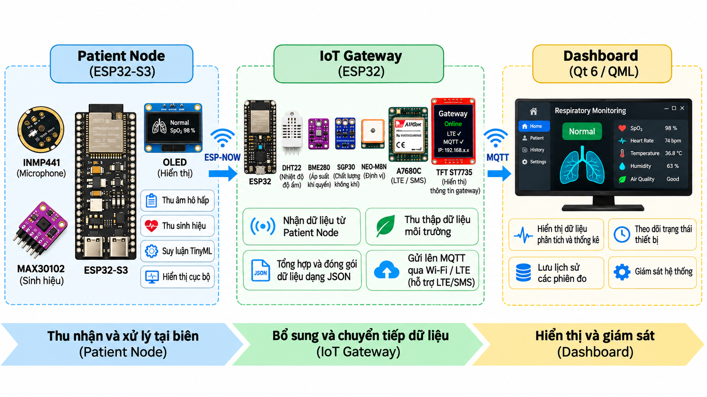

# 🫁 Edge AI & IoT hỗ trợ theo dõi hen suyễn


> **Mã đề tài:** 42-SV-2026-ĐT1  
> **Tên đề tài:** Nghiên cứu, thiết kế và chế tạo hệ thống IoT ứng dụng TinyML hỗ trợ theo dõi và cảnh báo sớm cho bệnh nhân hen suyễn.  
> **Đơn vị:** Học viện Công nghệ Bưu chính Viễn thông (PTIT) – ARM Lab.

## 1. 📖 Giới thiệu dự án

Dự án nghiên cứu và xây dựng một **nguyên mẫu AIoT xử lý tại biên (edge-first)**, có khả năng phân tích âm thanh hô hấp bằng mô hình TinyML chạy trực tiếp trên ESP32-S3, đồng thời kết hợp dữ liệu sinh hiệu và môi trường trong giao diện giám sát. Trọng tâm nghiên cứu gồm **xử lý tín hiệu âm thanh, huấn luyện và lượng tử hóa mô hình, firmware nhúng, truyền thông bảo mật và tích hợp hệ thống**.

Điểm cốt lõi là **suy luận diễn ra trên Patient Node**, không yêu cầu truyền liên tục âm thanh thô lên máy chủ. Gateway và Dashboard bổ sung khả năng kết nối, tổng hợp dữ liệu và giám sát, khi mất Gateway hoặc Internet, chức năng phân loại và hiển thị cục bộ của Node vẫn có thể hoạt động.

> Đây là **nguyên mẫu nghiên cứu**, không phải thiết bị chẩn đoán hay dự báo cơn hen đã được kiểm chứng lâm sàng. Kết quả phân loại chỉ hỗ trợ theo dõi, không thay thế đánh giá của nhân viên y tế.

## 2. 🧩 Kiến trúc tổng thể



Hệ thống có **ba phân hệ triển khai**: **Patient Node → IoT Gateway → Dashboard**. **AI Model** là thành phần phần mềm được nghiên cứu và đóng gói riêng, sau đó triển khai **bên trong Patient Node**, không phải một thiết bị vật lý thứ tư.

Liên kết Node–Gateway sử dụng **ESP-NOW** với bản tin được bảo vệ bằng **AES-128-GCM**, Gateway chuyển tiếp dữ liệu tổng hợp tới Dashboard qua **MQTT**, sử dụng Wi-Fi hoặc LTE theo trạng thái kết nối.

Các chi tiết về luồng trạng thái, cấu trúc bản tin, ACK/retry và các kịch bản vận hành nằm trong [đặc tả sản phẩm](./Docs/04_Xay_Dung_He_Thong/) và [tài liệu luồng hệ thống](./Docs/05_Luong_Hoat_Dong).

## 3. 📁 Cấu trúc repository

```text
NCKH_2026_AIOT/
├── Final_Project_NCKH/             # Source sản phẩm tích hợp cuối cùng
├── AI_Training_Model/              # Dataset, Train và artifact mô hình
├── Experiments_Benchmarking/       # Khảo sát, so sánh và kiểm chứng model
├── Deploy_Model/                   # Kiểm thử TinyML trên ESP32-S3
├── ESP32_Standalone_Modules_Test/  # Thử nghiệm các chức năng độc lập
├── ESP32_Sensor_Suite/             # Driver và prototype cảm biến
├── ESP32_Pinout/                   # Thông tin chân kết nối
├── Hardware_Design/                # Thiết kế phần cứng
├── Docs/                           # Tài liệu kỹ thuật trung tâm
├── Docs_NCKH/                      # Đặc tả và hồ sơ đề tài
├── Docs_Member/                    # Ghi chép theo thành viên
├── Assets/                         # Ảnh và video demo
├── Paperwork/                      # Báo cáo và slide
└── Committee_QnA/                  # Tài liệu chuẩn bị vấn đáp
```

**[Final_Project_NCKH](./Final_Project_NCKH/) là thư mục sản phẩm tích hợp hiện hành.** Các thư mục AI Training, Benchmark và standalone test được giữ lại để truy vết quá trình nghiên cứu, kiểm chứng và tái lập kết quả, không phải tất cả đều là thành phần cần chạy khi sử dụng sản phẩm.

## 4. 🔧 Các phân hệ của sản phẩm

### 🔵 Patient Node · ESP32-S3

- **Chức năng:** thu âm thanh hô hấp, kiểm tra chất lượng tín hiệu, tạo đặc trưng Log-Mel và thực hiện suy luận TinyML tại thiết bị.
- **Tương tác:** hỗ trợ CHECK, MONITOR, đo sinh hiệu theo phiên hợp lệ và hiển thị kết quả trên OLED.
- **Kết nối:** tạo sự kiện bảo vệ bằng AES-128-GCM để gửi qua ESP-NOW, vẫn xử lý cục bộ khi Gateway không khả dụng.
- **Mã nguồn:** [`Final_Project_NCKH/Patient_Node/`](./Final_Project_NCKH/Patient_Node/).

### 🟢 IoT Gateway · ESP32 / FreeRTOS

- **Chức năng:** tiếp nhận và xác thực sự kiện của Patient Node, kết hợp thông tin môi trường và trạng thái kết nối.
- **Truyền thông:** quản lý kết nối Wi-Fi/LTE, chuyển tiếp bản tin tổng hợp qua MQTT, hỗ trợ các chức năng định vị và cảnh báo theo cấu hình firmware.
- **Mã nguồn:** [`Final_Project_NCKH/Gateway/`](./Final_Project_NCKH/Gateway/).

### 🟡 Dashboard · Qt 6 / QML

- **Chức năng:** tiếp nhận dữ liệu MQTT, hiển thị kết quả phân loại, chỉ số hợp lệ, dữ liệu môi trường và tình trạng thiết bị.
- **Giao diện:** các màn hình giám sát, lịch sử phiên và thông tin định vị khi có dữ liệu.
- **Mã nguồn:** [`Final_Project_NCKH/Dashboard_Qt6/`](./Final_Project_NCKH/Dashboard_Qt6/).

## 5. ⚙️ Công nghệ và thông số chính

| Nhóm | Công nghệ / cấu hình hiện hành |
|---|---|
| **AI Training** | Python, TensorFlow/Keras, NumPy, SciPy, librosa |
| **Mô hình TinyML** | DS-CNN V1 + Flatten, cấu hình **C4 / seed 44 / QAT INT8** |
| **Đầu vào âm thanh** | Mono **16 kHz**, **5 giây**, Butterworth bậc 5, **100–2000 Hz** |
| **Đặc trưng** | **40 Mel**, FFT **2048**, Hop **625**, không sử dụng pre-emphasis, tensor **40 × 129 × 1** |
| **Thực thi trên Node** | C/C++, Arduino framework / PlatformIO, TensorFlow Lite Micro |
| **Firmware Gateway** | C/C++, FreeRTOS, ESP-NOW, AES-128-GCM, Wi-Fi / LTE, MQTT |
| **Dashboard** | Qt 6, QML |

**Mô hình đang sử dụng:** `combo_pre0_mel40_fft2048__V1__s44 / QAT_INT8`. Kết quả đánh giá trên tập Test gồm 159 mẫu: **Accuracy 95,60% (152/159)** và **Asthma Recall 92,11% (35/38)**. Đây là kết quả **đánh giá mô hình trên tập dữ liệu**, không đồng nghĩa với hiệu năng hoặc độ chính xác lâm sàng của toàn bộ thiết bị khi sử dụng thực tế (Xem thêm thực nghiệm thu mô hình TinyML [tại đây](./Experiments_Benchmarking/Patient_Node/Frontend_Benchmarking/)).

Các chỉ số RAM/Flash, Tensor Arena, DSP, Invoke và độ trễ truyền thông cần được đối chiếu với **firmware, phần cứng và log kiểm thử tương ứng**, không tự động coi số liệu của các bản thử nghiệm cũ là kết quả nghiệm thu cuối.

## 6. 🚀 Bắt đầu với dự án

Để tiếp cận đúng phiên bản sản phẩm, ưu tiên đọc và triển khai theo các hướng dẫn sau:

1. **Toàn bộ hệ thống:** [`Final_Project_NCKH/README.md`](./Final_Project_NCKH/README.md) – điểm bắt đầu để tìm cấu hình và source tích hợp.
2. **Model & triển khai TinyML:** [`Final_Project_NCKH/AI_Model/README.md`](./Final_Project_NCKH/AI_Model/README.md) và [`Deploy_Model/README.md`](./Deploy_Model/README.md).
3. **Tài liệu kỹ thuật và nghiệm thu:** [`Docs/README.md`](./Docs/README.md) và [checklist nghiệm thu V1](./Docs/06_Nghiem_Thu/01_Tai_Lap_Va_Chot_V1.md).

> **Lưu ý phiên bản:** Repository có thể còn các thử nghiệm lịch sử với frontend F0 hoặc mô hình/ngưỡng cũ. Khi build và kiểm thử, đối chiếu với source sản phẩm hiện hành và artifact model đã chọn trước khi sử dụng các kết quả đo.

## 7. 📚 Tài liệu, demo và nhóm thực hiện

**Tài liệu chính:**

- 📘 [Tổng mục lục tài liệu kỹ thuật](./Docs/README.md)
- 🧭 [Đặc tả sản phẩm](./Docs_NCKH/NCKH_PRODUCT_DEFINITION_FINAL_REVISED.md)
- 🔐 [Đặc tả AES-128-GCM](./Docs_NCKH/Encrypt_AES-128-GCM_REVISED.md)
- 📄 [Báo cáo NCKH](https://docs.google.com/document/d/1-8gFWI9OEdoooc5TgpuXBp2hJufUYXIVnaVUI4IQDnM/edit?tab=t.w6svx54cg3ib)

**🎬 Video demo:** *Đang cập nhật.* Video và tài nguyên trình bày được quản lý tại [`Assets/`](./Assets/README.md). Sau khi đăng video, bổ sung liên kết tại đây.

## 👥 8. Thành viên thực hiện

**Giảng viên hướng dẫn:** TS. Trần Thị Thúy Hà

**Sinh viên thực hiện:**    

| STT | Họ và tên | Mã sinh viên |
|:---:|---|:---:|
| 1 | Nguyễn Ngọc Chiến | B23DCVT061 |
| 2 | Vũ Hồng Kỳ | B23DCVT248 |
| 3 | Phan Nhật Linh | B23DCVT252 |
| 4 | Trần Nguyễn Nhật Tân | B23DCDT231 |
| 5 | Nguyễn Quang Thắng | B23DCDT246 |
